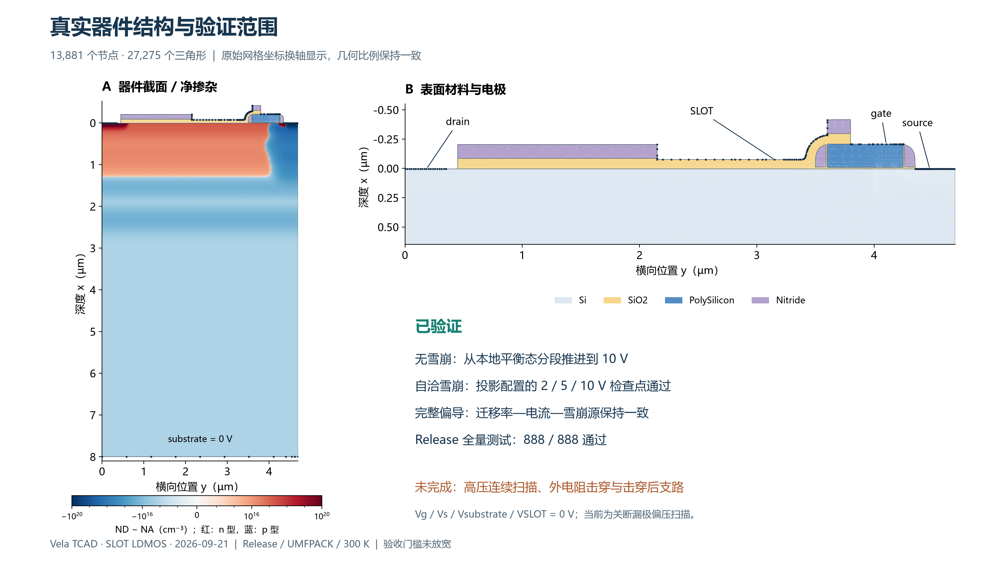
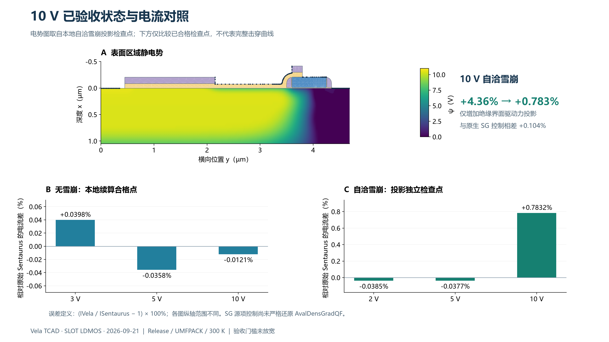
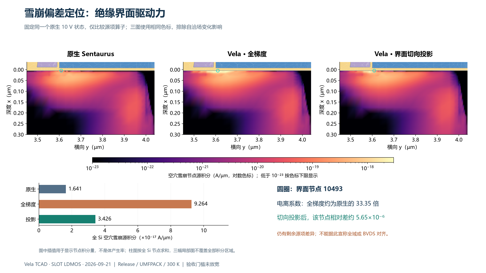

# SLOT LDMOS 验证日报素材 · 2026-09-21

状态截至当日暂停时；本次整理未恢复仿真。代码提交：`076ab59c`，本地分支
`codex/slot-ldmos-bvds-next`。验证对象为关断条件下的二维漂移扩散/Poisson
漏极偏压扫描，栅极、源极、衬底及 SLOT 电极均为 0 V。

## 可直接用于日报的摘要

今日完成 SLOT LDMOS 与 Sentaurus 的材料、边界和源项独立对照，恢复
掺杂多晶硅输运，统一约 7.93 mV 的材料能量参考，并修正界面节点的
SRH/Auger 积分体积。无雪崩计算已从本地平衡态分段推进至 10 V，3/5/10 V
电流与原生结果的差异均小于 0.04%。进一步定位自洽雪崩的绝缘界面
驱动力差异，加入默认关闭的切向投影控制后，10 V 电流差由 +4.36%
降至 +0.783%，与原生 SG 源项控制相差 +0.104%。迁移率、载流子和
雪崩源的完整 Jacobian 已作针对性验证，Release 全量测试 888/888 通过。
当前高压连续扫描、外电阻击穿及击穿后支路仍未完成，任务已暂停并保存恢复点。

## 今日完成内容与意义

| 工作项 | 完成内容 | 验证结论 |
| --- | --- | --- |
| 原始脚本对照 | 核对材料、IALMob、SRH/Auger、雪崩及接触配置 | 确认材料能量参考、多晶硅处理和源项构造存在差异 |
| Auger 独立控制 | 启用原生 H/N0 密度增强及现有完整导数；保持普通 Auger 作用范围 | 2/5/10 V 成对强制纠正后的电流输出精度内相同，不能解释本例低压百分数级差异 |
| 多晶硅与能量参考 | 恢复原生掺杂、载流子、常数迁移率及 Ohmic 接触；从能带关系推导参考电势 | Poly/Si 参考差为 7.92777 mV，原生状态的多晶硅密度重建最大相对差降至约 3.83×10⁻⁶ |
| 产生复合积分 | SRH/Auger 仅作用于 Si，并使用半导体局部 mixed-Voronoi 体积 | 2 V 无雪崩电流差由恢复多晶硅后的 +0.565% 降至 −0.0410%；主要改善来自源项体积 |
| 本地起始续算 | 由本地平衡态完成 0→2 V，再分段推进 3/5/10 V；校验暂停续算及割线预测 | 无雪崩链不依赖 Sentaurus 求解保存态；静态原生材料/几何参数仍用作对照输入 |
| 雪崩驱动力 | 在固定原生 10 V 状态定位界面法向梯度产生的超额源；增加默认关闭的切向投影 | 2/5/10 V 投影检查点均通过；10 V 相对原始原生电流差降至 +0.783% |
| 完整 Jacobian | 密度、迁移率、源项及边界投影使用一致链式导数 | 实际投影 10 V 雪崩块差分相对差约 7.47×10⁻⁹；极弱列另行记录，不用全块范数替代逐列判断 |
| 外电阻算法诊断 | 增加默认关闭的正密度试探更新并完成数值测试 | 解除了原先步长冻结，但上支路仍未收敛，不能称为 BVDS 修复完成 |

## 当前合格检查点

共同条件：13,881 节点、27,275 三角形；300 K、Boltzmann、OldSlotboom、
元素 IALMob、恢复后的多晶硅及 Auger 参数。UCRT64 Release，UMFPACK。
电流单位 A/µm；误差定义为 `(IVela / ISentaurus − 1) × 100%`。
验收沿用 Poisson `abstol=1e-9`、局部连续性 `eps_row=0.001`、全局闭合
容差 `0.01`，没有为通过检查而放宽。

| 模型/路径 | Vd | Vela 电流 A/µm | 原始 Sentaurus 电流 A/µm | 相对差 |
| --- | ---: | ---: | ---: | ---: |
| 无雪崩，本地续算 | 3 V | 1.2264611900e-15 | 1.2259727214e-15 | +0.039843% |
| 无雪崩，本地续算 | 5 V | 1.7745142466e-15 | 1.7751503815e-15 | −0.035835% |
| 无雪崩，本地续算 | 10 V | 2.9850261432e-15 | 2.9853867143e-15 | −0.012078% |
| 自洽雪崩，切向投影独立检查点 | 2 V | 9.2650257600e-16 | 9.2685914174e-16 | −0.038470% |
| 自洽雪崩，切向投影独立检查点 | 5 V | 1.7819343362e-15 | 1.7826069271e-15 | −0.037731% |
| 自洽雪崩，切向投影独立检查点 | 10 V | 3.0749676425e-15 | 3.0510731071e-15 | +0.783152% |

无雪崩为分段且有暂停恢复的本地起始续算，不宣称一次不间断自动扫描。
雪崩三点是独立检查点，不能画成已经验证的连续击穿曲线。

## 雪崩差异的证据与限制

固定同一原生 10 V 状态时，全 Si 空穴雪崩源积分为：原生
`1.641e-17`、本地全梯度 `9.264e-17`、本地切向投影 `3.426e-17 A/µm`。
界面节点 10493 的电离系数，全梯度重建约为原生的 33.35 倍，投影后
相对差约 5.65×10⁻⁶。仅改变接触电场回退基本不改变自洽 10 V 电流。

原始原生配置启用 `AvalDensGradQF`；本地仍用 SG/GSS-Laux 电流构造源项。
原生仅关闭 `AvalDensGradQF` 的 SG 控制，10 V 电流为
`3.0717596498e-15 A/µm`，本地投影结果相对它为 +0.104435%。
这能解释剩余差异的一部分，但元素密度平均公式尚未严格还原。
上述百分比使用不同参照，不应直接相加。

## 未完成事项及下一步素材

- 高压仍从已合格的投影 10 V 状态恢复。10.25 V 首次候选未合格；
  15/20 V 不能作为已完成结果。
- 15/20 V 原生对照 deck 已上传，但启动脚本 CRLF 导致 shell 解析失败，
  仿真未启动。恢复时先修正为 LF，再运行和下载结果。
- 继续核对 `AvalDensGradQF` 的密度构造及界面残余源项差异，保留完整导数。
- 外电阻仅旧源项配置的内部 10 V 下支路通过；上支路和击穿后支路未通过。
  正密度试探更新仍是实验开关，后续需逐点通过器件、局部连续性与负载线复验。
- 本次暂停保留全部证据；没有取得可报告的本地 BVDS 数值。

## 日报配图与图注

**图 1｜SLOT LDMOS 实际网格结构与验证范围。** 左图为真实截面净掺杂，
右上图为表面材料和电极，横轴采用原始 y、纵轴采用原始 x（深度），均以
µm 表示且保持几何比例。无雪崩本地续算已到 10 V，自洽雪崩投影配置已验证
2/5/10 V；高压及外电阻击穿支路仍待完成。适合作为日报主图。

**图 2｜10 V 已验收电势与检查点电流偏差。** 电势来自本地自洽雪崩投影
检查点；无雪崩 3/5/10 V 偏差均小于 0.04%，投影修正使 10 V 雪崩电流
差从 +4.36% 降至 +0.783%。两个误差柱图使用不同纵轴范围，仅表示检查点。

**图 3｜同一原生状态下的空穴雪崩源对照。** 三幅局部图采用同一色标，
显示节点源积分而非体产生率；圆圈标出界面节点 10493。切向投影显著降低
本地超额源，底部柱图按全 Si 积分。图中仍有剩余差异，未宣称全域原生对齐。

图片为 3520×1980 PNG，另附带高分辨率场图层的 SVG。绘图快照和原始输入
SHA-256 见 [summary.json](data/summary.json)；生成脚本支持从已归档数据重绘，
无需启动求解器。

依据：[材料/源项与完整验证记录](../../validation/slot_ldmos_energy_reference_and_source_volume_2026-09-21.md)、
[Auger/多晶硅独立对照](../../validation/slot_ldmos_auger_poly_independent_controls_2026-09-21.md)、
[暂停恢复记录](../../validation/slot_ldmos_pause_2026-09-21.md)。
