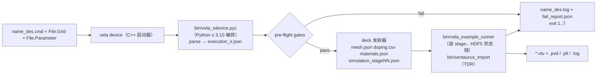

# Sentaurus SDevice 命令文件直读运行（`vela device`）开发方案

日期：2026-09-26

状态：方案 v2.5（v1 代码库盘点；v2 手册核对与平台/产物/命名决定；v2.1 待决项确认；v2.2 自审核
修正；v2.3 全部提案已采纳，第 10 节重写为低耦合工作包 WP0–WP12 + 接口契约 C1–C10；v2.4 于 2026-09-29
记录阶段 1–2（WP0 + 并行组 A）全部完成，新增第 10.5 节“完成情况汇总与交接说明”，把 WP4/WP5/WP10–WP12
细化为可由另一执行者直接落地的步骤，并新增 WP13“C++ 内置材料参数对齐与重新基线化”、WP14“Sentaurus
参考重跑（A-3）”；v2.5 于 2026-09-30 为每张未完成卡片补“背景”、新增 WP6.1 卡片、修正 WP4 的 v2 单位/键名
规则与 schema 校验说明，并配套交接文档
[sdevice_cmd_frontend_handoff_2026-09-30.md](../../validation/sdevice_cmd_frontend_handoff_2026-09-30.md)）；
开发工作树 `.worktrees/sdevice-cmd-frontend`（分支 `codex/sdevice-cmd-frontend`，领先 `main` 16+ 个提交，未推送）

目标 Sentaurus 语法版本：SDevice T-2022.03（命令文件语法）；Workbench 预处理指令不展开

手册依据：`D:\工作\学习资料\TCAD软件手册\Sentaurus帮助文档\data\sdevice_ug.pdf`
（Sentaurus Device User Guide, Version T-2022.03）；本文引用的章节/表号均出自该版本。
手册为 Synopsys 专有文档，只引用结论，不复制原文入库。

Vela 基线：本方案制定时本地 `main` 为 `04e07713`；正式执行时重新记录实际提交

## 1. 执行摘要

目标是让 Vela 以与 `sdevice` 一致的子进程 CLI 方式，直接读取 SDevice `.cmd`
文件，自动完成：解析 → 逐项映射为 Vela JSON deck → 核对并写用户可读 log →
运行仿真 → 输出 XML `.vtu`（每偏置点一个文件、字段名与 Sentaurus 一致）与
DF-ISE `.plt` 电流曲线；不满足要求时写 log 并以约定退出码返回。

盘点结论：这条流水线**已有可工作的 Python 原型**，不是从零开始。
`scripts/sentaurus_import.py` 的 `device`/`reference` 子命令已经覆盖
SDevice `.cmd` 解析、物理模型白名单分类、执行 IR、deck 生成、失败报告与运行
调用；C++ 侧 `sentaurus_import` 可读 TDR，`vela_example_runner` 有稳定退出码、
运行 log 与每偏置点 VTK 输出。

主要缺口集中在六处：

1. 解析覆盖：`*` 行注释（手册第 1 章：以 `*` 或 `#` 开头的字符串被忽略）、
   Electrode 属性（手册 Table 206：`Barrier`/`Resist`/`Schottky`/`Workfunction`/
   `eRecVelocity` 等）、`System{}`、扫描内 `Plot(...)`、`Set(... mode current)`、
   预处理指令检测。
2. 映射缺失：`Math{}`、`Plot{}`、`File{}` 三段“解析了但未映射”；
   `Band2Band(E2)`、`poisson_only`（ABA）、外接电阻、电流目标扫描、
   `BreakAtIonIntegral` 等 Vela 已有能力未接线。
3. 多段 `Solve`：当前只取最后一个 `Quasistationary`；
   `Quasistationary` 步长（归一化变量 t）被当作伏特使用。
4. `.par` → `materials_file` 发射器缺失（只有语法 IR 与映射矩阵）。
5. 网格输入：TDR 路径依赖手写的 `*_reference.json` 与 `--device` 模板；
   DF-ISE `.grd/.dat` 只有读取函数散落在比较脚本中，没有导入器。
6. 输出契约：无 XML `.vtu`、无字段选择与 Sentaurus 命名、无 `.plt` 写出、
   无统一 log 与退出码。

建议架构：`vela` 原生启动器（`vela device <cmd>`）+ Python（≥ 3.10，纯标准库）
编排器 + 现有 C++ 二进制（`vela_example_runner`、`sentaurus_import`），全部随
`bin/` 打包；以已有的 `vela.sentaurus_execution_ir.v1` 为稳定契约；C++ 侧只做
必要增量（`.vtu` 写出器、字段选择、电流终止判据）。

## 2. 已确认的需求与决策

| 编号 | 用户决定 | 方案中的处理 |
| --- | --- | --- |
| 1 | 子进程 CLI，调用方式与 `sdevice` 一致 | `vela device [选项] <cmd 文件或 basename>`；扩展名补全、选项镜像见第 5 节；工作目录 = cmd 所在目录 |
| 2 | 返回值参考 `sdevice` CLI（手册）；log 与结果文件与 cmd 同目录；log 供用户阅读 | 手册无数值退出码表，只定义 0/非 0 与 `ExitOnFailure` 语义；第 5.2 节给出 Vela 细分码；第 6 节输出契约 |
| 3 | 当前阶段网格由用户提供 `_msh.tdr` 或 DF-ISE 文件 | 本方案不含 SDE 造网；`File{Grid}` 只接受 `.tdr` 或 `.grd`(+`.dat`) |
| 4 | 材料参数文件必须检查，不存在则提示补齐 | `File{Parameter}` 缺失或文件不存在 → 致命错误 + 明确提示 |
| 5 | Sentaurus 2022 语法；预处理指令不展开，发现即要求用户先展开 | 解析前检测 `#if/#setdep/...`、`@…@`、`!( … )!`，fail-closed |
| 6 | 接受阶段 1 只支持 2-D DC Quasistationary，其余 fail-closed | 第 4.7 节显式拒绝清单 |
| 7 | XML `.vtu`、每偏置点一个文件、需要 `.plt` | 第 6 节；新增 C++ `.vtu` 写出器与 Python `.plt` 写出器 |
| 8 | 结果须与 Sentaurus 在阈值内一致 | 第 8 节：阈值来自已验证证据，按案例冻结，不因通过测试而放宽 |
| 9 | 手册位于本地目录（T-2022.03 全套 PDF） | 已核对命令行选项（附录 D）、文件命名（附录 C）、`Math`/`Electrode`/`File` 表（附录 G）、数据名（附录 F）、Quasistationary 与收敛准则（第 4/6 章）；结论写入第 4–6 节 |
| 10 | 验收产物部分在仓库、部分在 Sentaurus 虚拟机，体积大不宜入库；需要核对环节与存放方案 | 第 12 节：清单+哈希入库、原始产物放外部存储、`reference_staging/` 本地暂存、核对脚本作为验收前置门 |
| 11 | 平台：Windows 与 Ubuntu 24.04；Python ≥ 3.10；`vela` 可执行 + `bin/` 依赖与子程序；Linux 上多个 sdevice 脚本多进程并发（同目录或不同目录） | 第 13 节：部署布局、启动器、并发安全约束 |
| 12 | `.vtu` 字段名与 Sentaurus TDR 数据集名一致 | 第 6.4 节与附录 B：输出名 = 手册附录 F 数据名；`Plot{}` 中的常见别名只作输入识别 |
| 13 | `Trap(s)` 改为 fail-closed；`CurrentPlot{Field((x y))}` 忽略并在 log 以 warning 注明 | 第 4.3/4.4 节 |
| 14 | 退出码按 0/非 0，非 0 给出细分码 | 第 5.2 节表按此冻结（0、1–7） |
| 15 | 存储方案需要解释；能否用 GitHub Copilot 提供的存储空间 | 第 12.2 节：Copilot 不提供存储；仓库 `pasuka/vela-tcad` 是 **公开仓**，专有产物只能进私有仓或私有存储；当前阶段选 S3（决定 18），S2b（私有配套仓 + Releases）为后续迁移首选 |
| 16 | Python 随 `bin/` 携带 | 第 13.1 节：Windows 用官方 embeddable 包，Linux 用 python-build-standalone，固定 3.12 |
| 17 | “参数文件”是什么 | `sdevice -P/-L` 写出的 `.par` 材料模型参数文件（即 `File{Parameter}` 所指文件）；建议 `vela device -P` 写出 Vela 默认参数的 `.par`，供无 Sentaurus 的用户起步（第 5.1/WP3） |
| 18 | 当前阶段存储选 S3：验收产物存放在 Sentaurus 虚拟机的指定路径 | 第 12.2 节：VM 路径约定、SSH 拉取、本地镜像与单点风险缓解；manifest 仍以哈希为键，日后可无缝迁移到 S2b/S1 |
| 19 | `-P` 输出只含 Vela 实现的模型段 | 第 5.1 节与 WP3 按此冻结 |
| 20 | 电流符号约定以首个核对通过的参考 `.plt` 为准 | 第 6.3 节：约定确定程序与固化方式 |
| 21 | 同意退出码 8（被外部中止） | 第 5.2 节表冻结为 0、1–8 |
| 22 | log 文案英文 + 稳定编号，不附中文释义行 | 第 6.2 节 |
| 23 | 同意提案 A（sidecar `<stem>.vela.json`）与提案 B（deck 用 `format_version: 2`） | 第 9 节；契约 C10；WP4 实现 |
| 24 | 在独立 worktree 中开发；任务细化为低耦合工作包，每包有目标/内容/验收标准 | 第 10 节重写为 WP0–WP12 + 契约 C1–C10；工作树 `.worktrees/sdevice-cmd-frontend`（分支 `codex/sdevice-cmd-frontend`） |

## 3. 现状盘点（可复用资产）

### 3.1 运行时入口与输出

| 能力 | 现状 | 证据 |
| --- | --- | --- |
| CLI | `vela_example_runner --config <json> [--mesh-report] [--log auto\|off\|path] [--log-profile minimal\|default\|debug]` | `src/tools/vela_example_runner.cpp:42-43` |
| 退出码 | `0` 收敛；`1` 失败/未收敛/异常；`2` 用法错误或未知 `simulation_type`；stdout 一行 JSON status | `src/tools/vela_example_runner.cpp:3489-3500` |
| `simulation_type` | `dc_sweep`、`poisson`、`newton`、`newton_solve_from_state`、`electrothermal_dc_sweep`、`write_dd_state_vtk`、多种 probe | `src/tools/vela_example_runner.cpp:3397-3490` |
| 运行 log | `runtime_log{enabled,file,level,flush_level,append,profile}`，默认 `<config stem>.log` | `docs/config_schema.md` `runtime_log`；`include/vela/core/RuntimeLog.h` |
| VTK | legacy ASCII `UNSTRUCTURED_GRID`；DC sweep 每收敛点一个文件 `<prefix>_NNNN_<V>V.vtk` | `src/io/VTKWriter.cpp:24-27`；`src/simulation/DCSweep.cpp:2839-2845, 7237-7242` |
| VTK 字段 | Potential/QF/n/p/NetDoping/ElectricField(+Vector)/SRH/Auger/SpaceCharge/BandGap/BGN/Affinity/Ec/Ev/Band2Band/AvalancheGeneration/J 分量/Mobility/Velocity/Alpha/IonIntegral 等 | `src/solver/GummelSolver.cpp:944-1126, 1511-1531, 1716-1752` |
| 曲线 CSV | 单一 `current_contact` 的 e/h/total 电流；`unit_scaling` 下附 `*_A_per_um` 列 | `src/simulation/DCSweep.cpp:3554-3590` |
| 全接触电流 | `diagnostics.terminal_balance` 单独 CSV | `docs/config_schema.md` `sweep` 诊断字段 |
| 状态链 | `write_state_file`/`initial_state_file`（HDF5 `.h5`，`vela.state/2`） | `docs/config_schema.md` `sweep` |
| 外接电阻 / 电流目标 | `sweep.external_circuit.series_resistor`、`sweep.voltage_to_current` | `docs/config_schema.md` “External circuit and voltage-to-current boundary control” |
| 击穿终止判据 | `sweep.breakdown.{max_electric_field_V_per_m,current_jump_ratio,non_convergence}` | `docs/config_schema.md:2505-2515` |
| 电离积分 | `diagnostics.path_ionization_integrals{break_rank,break_value,...}` | `docs/config_schema.md` `sweep` 诊断字段 |

### 3.2 Sentaurus 前端（Python）

| 模块 | 作用 | 证据 |
| --- | --- | --- |
| `parse_cmd()` | `File`/`Electrode`(仅 Name/Voltage)/`Thermode`/`Physics`(含 Material/MaterialInterface 作用域)/`Plot`/`Math`/`Solve`(Coupled、Quasistationary、NewCurrentPrefix、CurrentPlot、Save/Load)；`@var@` 占位符展开与未解析报告 | `scripts/sentaurus_import.py:223-545` |
| 注释处理 | 仅 `#` 与 `//`；**不处理 `*`**（手册第 1 章规定注释字符为 `*` 与 `#`；`//` 非手册语法） | `scripts/sentaurus_import.py:138-144` |
| 执行 IR | 模型白名单（supported / metadata_only / unsupported，fail-closed）、analysis kind 推导、有序 stages | `scripts/sentaurus_execution_ir.py:28-75, 118-260` |
| Physics 映射 | DopingDep→masetti；HighFieldSaturation/Enormal→masetti_field(_lombardi)；SRH/Auger；SRH(DopingDep TempDependence)；eQuantumPotential；OldSlotboom；Avalanche(VanOverstraeten)（其它系数模型 fail-closed，`--allow-lossy` 才替换）；Fermi | `scripts/sentaurus_import.py:571-679` |
| `device` 子命令 | SDE+SDevice → `device_ir.json`/`execution_ir.json`/`mesh.json`/`doping.csv`/`simulation.json`/`run_manifest.json`；失败写 `fail_report.json{stage,message}`；`--run` 调 runner | `scripts/sentaurus_import.py:1463-1710` |
| `reference` 子命令 | TDR 网格路径：`sentaurus_import.exe` → `convert_tcad_export.py` → patch deck → 运行 → 与 `.plt` 比对 | `scripts/sentaurus_import.py:1107-1337` |
| 步长映射 | `MaxStep/MinStep/Increment/Decrement` → `max_step/min_step/growth_factor/shrink_factor/max_retries`；**未做归一化时间→伏特换算** | `scripts/sentaurus_import.py:895-917` |
| TDR 读取 | C++ `sentaurus_import --tdr --inventory-json --export-dir`（nodes/elements/contacts/doping/fields CSV） | `src/tools/sentaurus_import.cpp:92-98`；`docs/sentaurus_import.md` |
| TDR 导出 → deck | `convert_tcad_export.py --device {pn_diode,nmos2d,...}`（依赖器件模板选扫描接触） | `scripts/convert_tcad_export.py:189-243` |
| DF-ISE 读取 | `parse_grd`/`parse_dat`（比较脚本内） | `scripts/compare_sentaurus_tdr_tdx.py:40-130` |
| DF-ISE 写出 | `render_dfise_grid`/`render_dfise_doping` | `scripts/run_pn2d_same_mesh_sdevice_vector_export.py:116-290` |
| `.plt` 读取 | `export_plt_reference`（`datasets`+`Data`） | `scripts/sentaurus_import.py:113-135`；夹具 `tests/regression/test_sentaurus_import_tools.py:2849-2872` |
| `.par` | 语法 IR `sentaurus_parameter_ir.py`；映射矩阵/分类 `sentaurus_parameter_map.py`（exact/frozen/approximated/unsupported）；**无发射器** | `docs/sentaurus_parameter_import.md` |
| 验收契约 | `configs/sentaurus_e2e_contract.json` + `schemas/vela.sentaurus_e2e_contract.v1.schema.json` | — |
| 曲线比对 | `scripts/compare_reference_curves.py`（orders-of-magnitude、相对误差、趋势） | `scripts/sentaurus_import.py:1260-1320` 调用方式 |
| 测试 | 13 个 `tests/regression/test_sentaurus_*.py`，含 `device --allow-lossy` 端到端 | `tests/regression/test_sentaurus_import_tools.py:134-214` |

### 3.3 未合并分支

`codex/sentaurus2022-sde-workflow`（worktree `D:/code-repo/copilot-worktrees/vela-tcad-dev`，
领先 `main` 22 提交、落后 95）包含 gmsh SDE 后端、ABA/BAB 布尔、解析型掺杂、
细化窗与 `test_sentaurus_device_e2e_contract.py`。按用户决定 3，本方案
**不依赖该分支**；SDE 造网列为后续阶段的前置条件。

## 4. SDevice 命令 → Vela 映射契约

“状态”列：`✅` 已有；`⚠️` 部分/有缺陷；`❌` 缺失；`⛔` 阶段 1 显式拒绝。

### 4.1 `File{}`

文件名规则（手册附录 C“File-Naming Conventions”，Table 194）：基名中含 `.` 的字符串
按字面使用；否则追加工具扩展名 `_des.<ext>`：命令文件 `_des.cmd`/`.cmd`、日志
`_des.log`、参数 `.par`、网格 `.tdr`、Save/Load `_des.sav`、器件 Plot `_des.tdr`、
电流 `_des.plt`。Quasistationary 期间的 plot/save 文件按全局序号编号
（`<prefix>_NNNN_des.tdr`，手册第 5 章“When to Plot”示例）。`Output` 默认值为
`"output"`（Table 207）。`NewCurrentPrefix` 把前缀加到默认电流文件名之前
（第 5 章“Current File”；仓库证据：`Current="schottky_n_iv"` +
`NewCurrentPrefix="forward_"` → `forward_schottky_n_iv_des.plt`，
`reference_tcad/schottky_charon_sentaurus2018/schottky_charon_sentaurus2018_reference.json:80`）。

| 命令 | Vela | 状态 | 说明 |
| --- | --- | --- | --- |
| `Grid="x_msh.tdr"` | `mesh_file`+`node_doping_file`（经 TDR 导入） | ⚠️ | 现仅 `reference` 路径；需并入统一入口 |
| `Grid="x_msh.grd"` (+ 同名 `.dat`) | 同上（经 DF-ISE 导入器） | ❌ | 复用 `parse_grd/parse_dat`；边索引单元 → 节点三角形；`material=Contact` 区 → contacts。DF-ISE 不在 Table 194 中，是 Vela 扩展输入 |
| `Parameter=`/`Parameters="models.par"` | `materials_file` | ❌ | 两种拼写都接受（Table 207 列 `Parameters`，决赛 deck 用 `Parameter`）；缺 key 或文件不存在 → 致命错误，提示补齐 |
| `Current="x"` | `output_csv` → `<NewCurrentPrefix>x_des.plt` | ❌ | 按 Table 194 规则补全 |
| `Plot="x_des.tdr"` | `sweep.vtk_prefix` → `x_des_NNNN.vtu` 序列 | ❌ | `.tdr` 被 `.vtu` 替代；`build_device_deck` 目前硬编码 `write_vtk:false`（`scripts/sentaurus_import.py:1537`） |
| `Output="x.log"` | 统一 log 文件 | ❌ | 无扩展名时补 `_des.log`；缺省 `output_des.log`（Table 207） |
| `Load=`, `Save=`, `ACExtract=`, `NewtonPlot=`, `Extraction=`, `MobilityDoping=`, `LifeTime=` 等 | — | ⛔/忽略 | `Save/Load` 在 `Solve` 内处理；其余 File 键 fail-closed（影响物理者）或 log 警告忽略（纯附加输出者） |

### 4.2 `Electrode{}`

属性集合以手册附录 G Table 206 为准。

| 属性（Table 206） | Vela | 状态 | 说明 |
| --- | --- | --- | --- |
| `Name=<string>`, `Voltage=<float>` (V) | `contacts[].{name,bias}` | ✅ | 电极名必须与网格 contact 名一致（已有检查）；`Name=Regexp(...)` ⛔ |
| `Barrier=<float>` (**V**) | `contacts[].type="metal_gate"` + 势垒字段 | ❌ | 手册 Eq. 104：绝缘体上接触 `φ = φ_F − Φ_MS`，`Barrier` 即 Φ_MS（相对本征参考半导体）；缺省 Φ_MS = 0。WP4a 需用一个 MOS 电容夹具验证 Vela `metal_gate` 的参考能级与 Eq. 104 一致（带平电压对照），而不是只拷数值 |
| `Workfunction=<float>` (eV) | `contacts[].work_function_eV` | ❌ | 同上，Φ_MS 由金属功函数与本征半导体参考能级之差给出 |
| `Resist=<float>` (Ω·µm^(3−d)，2-D 即 Ω·µm)；训练 deck 中的 `Resistor=` 作别名接受 | `sweep.external_circuit{mode:"series_resistor", resistance_ohm_um}` | ❌ | Vela 侧已支持；`Voltage` 变为外电压；仓库证据 `bvmethods_sentaurus2018/source/external_resistor_sdevice.cmd:12` 用 `Resistor=1e7` 且已在 Sentaurus 上运行成功 |
| `Schottky` + `eRecVelocity`/`hRecVelocity` (cm/s，默认 2.573e6 / 1.93e6) | `contacts[].type="schottky"`, `emission_model:"thermionic_robin"`, 速度字段 | ❌ | 仅 Newton 路径支持（`docs/config_schema.md` contacts）；缺省速度按手册默认写入 |
| `Material=<string>`（金属，如 `"Gold"`） | `work_function_eV` ← `.par` 中 `Material="Gold"{Bandgap{WorkFunction}}` | ❌ | 手册“Contacts on Insulators”：功函数取自参数文件；`.par` 无该材料时致命 |
| `Material=<string>(N=|P=)`（多晶硅栅仿真） | — | ⛔ | 阶段 1 不支持接触侧半导体模型 |
| `Poisson=Dirichlet`（默认）/`Neumann` | — | `Dirichlet` 接受；`Neumann` ⛔ |
| `AreaFactor=<float>` | 电流乘子 | ⛔（≠1 时） | 可后续映射到输出缩放 |
| `Charge=`, `Current=`, `DistResist=`, `EqOhmic`, `SRDoping`, `FGcap`, `Extraction{}`, `CyclicNorm`, 瞬态 `(<v> At <t>)` 列表 | — | ⛔ | `Current=` 的电流边界仅通过 `Quasistationary Goal{Current}` + `Set(mode current)` 支持（4.6） |
| 未在 Table 206 中的属性 | — | ⛔ | 语法错误级别拒绝 |

### 4.3 `Physics{}`

手册第 2 章“Physical Models and the Hierarchy of Their Specification”：全局 `Physics{}` 应用于所有
区域；`Physics(Material=)`/`Physics(Region=)` 中的模型**叠加**到全局模型上；同一区域同时有
区域块与材料块时，区域块覆盖材料块（不继承）；界面块（`MaterialInterface`/`RegionInterface`）
独立于全局，且不允许迁移率/BGN 等体模型。据此，Vela 的接受规则是：为每个半导体区域计算
“有效模型集 = 全局 ∪（区域块，否则材料块）”，**所有半导体区域的有效模型集必须相同**（Vela
只有一套全局物理），否则 fail-closed；绝缘体区域的块只允许含 `Traps(FixedCharge)`。

| 模型 | Vela | 状态 |
| --- | --- | --- |
| `Mobility(DopingDep/DopingDependence)` | `solver.mobility.model=masetti` | ✅ |
| `HighFieldSaturation(GradQuasiFermi/Eparallel)`、`Enormal` | `masetti_field`/`masetti_lombardi`/`masetti_field_lombardi` + `high_field_driving_force` | ✅（驱动力目前固定为 `quasi_fermi_gradient`，需按参数选择） |
| `Recombination(SRH[(DopingDep TempDependence)]/Auger)` | `solver.recombination`, `srh_doping_dependence` | ✅（但现有映射把 τ 等参数硬编码在 `apply_solver_physics`，新发射器（WP3/WP4）必须取自 `.par`） |
| `Avalanche(VanOverstraeten/…)` + 驱动力 | `solver.impact_ionization`（系数取自 `.par`） | ✅（Okuto/Lackner/UniBo fail-closed） |
| `Band2Band(E2)` | `solver.band_to_band.model="e2"`（A/B 取自 `.par`） | ❌（Vela 已实现，未映射） |
| `EffectiveIntrinsicDensity(OldSlotboom)` | `bandgap_narrowing="old_slotboom"` | ✅ |
| `Fermi` | `carrier_statistics.model="fermi_dirac"` | ✅ |
| `eQuantumPotential` | `electron_quantum_potential` | ✅ |
| `Temperature=`（默认 300 K） | `solver.temperature_K`；同时作为 `.par` 发射器的冻结温度 | ❌ |
| `AreaFactor=` | — | ⛔（≠1 时） |
| `Traps(Conc=<float> FixedCharge)` 于 `MaterialInterface`/`RegionInterface` 块 | `interfaces[].fixed_charge_m2`（cm⁻²） | ❌（手册第 2/17 章：界面固定电荷用 `Traps(... FixedCharge)` 表达；仅均匀分布可映射） |
| `Traps((FixedCharge SpatialShape=Uniform Conc=<float>))` 于绝缘体区域/材料块 | `regions[].fixed_charge_m3`（cm⁻³） | ❌（`SpatialShape=Gaussian` ⛔） |
| 其它 `Trap(s)`（能级、施主/受主、分布、动力学） | — | ⛔（决定 13：从 `METADATA_ONLY_MODELS` 移入 `KNOWN_UNSUPPORTED_MODELS`，`--allow-lossy` 也不放行） |
| `Physics(Material=…)`/`(Region=…)` 作用域 | 按上述有效模型集规则展开 | ⚠️（有效集不一致即拒绝） |
| `Thermodynamic`/`Hydrodynamic`/`eTemperature`/`IALMob`/`hQuantumPotential` | — | ⛔（已 fail-closed） |

网格材料约束（与 Physics 共同决定可运行性）：Vela 内置材料只有 `Si` 与 `SiO2`
（`src/material/MaterialDatabase.cpp:258-277`），TDR 导入器将 `Silicon→Si`、`Oxide→SiO2`，其余名字
原样透传（`src/io/SentaurusTdrReader.cpp:415-424`），未定义的材料在运行时抛出 `unknown material`。
因此阶段 1：网格中每种材料必须是 `Si`/`SiO2`，或在 `.par` 中有 `Material="..."` 段可由 WP3 发射器
写出（绝缘体至少 `Epsilon`，如 Nitride）；`PolySilicon` 作为半导体区域在阶段 1 fail-closed（仅有 LDMOS
工作树的部分资格证据，未进入 main 默认路径）。材料文件采用仓库现有的基于 `role`
（`transport_semiconductor`/`dielectric`）与 `provenance` 的 schema
（`schemas/vela.templates_ldmos.materials.v1.schema.json`，建议在 WP0 以通用名别名发布），而不是旧的
“缺字段就继承”格式，避免绝缘体条目意外继承半导体参数。

### 4.4 `Plot{}` 与 `CurrentPlot{}`

手册附录 F：`Plot`/`CurrentPlot` 中的名字与 TDR/PLT 数据名相同（除另有标注）；
`/Vector`、`/Element` 后缀选择向量/单元数据。仓库中已在 Sentaurus 上运行成功的
各 deck 还使用 `Potential`、`Doping`、`SRH`、`eQuasiFermi`、`eCurrent/Vector`、
`Affinity`、`ConductionBand`、`Band2Band`、`Auger`、`Temperature` 等历史别名，
因此输入端同时接受数据名与附录 B 列出的别名；输出端统一用数据名。

| 命令 | Vela | 状态 | 说明 |
| --- | --- | --- | --- |
| 字段列表 | `.vtu` 写出字段选择 + TDR 数据名/单位 | ❌ | 需 C++ 字段过滤与名称/单位映射（附录 B） |
| `/Vector` 后缀 | 向量字段 | ⚠️ | Vela 已有向量数组，需按名映射 |
| `/Element` 后缀 | 单元字段 | ⚠️ | 仅对已有单元数组（如单元电场）提供；其余警告跳过 |
| Vela 无法提供的字段（如 `eTemperature`） | — | 输出项：写 log warning 并跳过，不致命 |
| `DatasetsFromGrid`, `PlotExplicit`/`-PlotLoadable` 等 | — | 警告忽略 |
| `CurrentPlot{ <Field>((x y)) }`（按坐标采样） | 无 | 按决定 13：忽略，log 以 warning 注明 |
| `CurrentPlot{ AvalancheGeneration(Integrate(...)) }` 等 域积分/极值 | `diagnostics.release_bv_config_audit` 有 qG 积分 | ⚠️ 后续阶段；阶段 1 警告忽略 |

### 4.5 `Math{}`

默认值与语义出自手册附录 G Table 211 与第 6 章“Convergence and Error Control”。
Sentaurus 的收敛判据（Eq. 31）是更新量准则：`|Δx| / (|x| + x_ref) < 10^-Digits`
（`RelErrControl` 默认），或 RHS 范数 `< RhsMin`；Vela 的判据是残差范数
（`abstol/reltol`）。二者无一一对应，映射只能是“不更松”的启发式并在 log
记录；一致性以第 8 节的阈值评价。

| 关键字（默认） | Vela | 状态 | 说明 |
| --- | --- | --- | --- |
| `Iterations=`（50） | `solver.max_iter` / `handoff.newton_max_iter` | ❌ | `Coupled(Iterations=)` 覆盖全局值 |
| `Digits=`（5）, `RelErrControl`（+）, `ErrRef(Electron/Hole)=`（cm⁻³） | `solver.reltol/abstol` 启发式 | ❌ | 见上文；原值原样写入 log 与 IR |
| `Extrapolate`（−） | `sweep.predictor="linear"`（否则 `none`） | ❌ | `Extrapolate(Order=2 ...)` 参数警告忽略 |
| `Derivatives`（+）, `AvalDerivatives`（+） | `impact_ionization.source_jacobian` 非 `frozen`；`-AvalDerivatives` → `frozen` | ❌ | Vela 默认 `finite_difference` 已含导数 |
| `ComputeIonizationIntegrals`（off）, `BreakAtIonIntegral(<int> <float>)`（默认 1 1） | `diagnostics.path_ionization_integrals{enabled,break_rank,break_value}` | ❌ | Vela 已实现 |
| `BreakCriteria{ Current(Contact= AbsVal=/MinVal=/MaxVal=) Voltage(...) }` | `sweep.breakdown` 新增电流绝对值/区间判据；电压判据用扫描终点 | ❌（C++） | 单位 2-D 为 A/µm（手册第 4 章） |
| `ExitOnFailure`（off） | 退出码语义（第 5 节） | ❌ | Table 211：“Terminate the simulation as soon as a Solve command fails”；证据 deck `schottky_n_des.cmd:44` |
| `NumberOfThreads=`（1） | 进程线程数（`OMP_NUM_THREADS` 等，第 13 节） | ❌ | CLI `--threads` 优先 |
| `NotDamped`（1000）, `Method=`, `Transient=BE`, `CNormPrint`, `WallClock`, `CheckUndefinedModels`, `ParameterInheritance`, `PlotExplicit` 等 | — | 记录并忽略（log 明示） |
| 未知关键字 | — | 记录 warning；不致命（Math 不改变方程） |

### 4.6 `Solve{}`

手册第 4 章“Quasistationary Ramps”：内部变量 `t` 从 0 到 1，`V = V0 + t (V1 − V0)`，
`InitialStep/MaxStep/MinStep/Increment/Decrement` 均定义在 `t` 上；`t = 0` 点在前一
语句已求解同一方程组时省略（`DoZero` 可强制）；步长小于 `MinStep` 时退出该
`Quasistationary`（不是退出程序）。第 5 章“When to Plot”：`Plot(... Time=(Range=(0 1)
Intervals=n))` 强制在这些 `t` 点求解并写文件，文件名 `<FilePrefix>_NNNN_des.tdr`。
“Current File”：默认每个接受步写一行电流；存在 `CurrentPlot(Time=...)` 时仅写指定
`t` 点（内部仍可计算中间点）。

| 命令 | Vela | 状态 | 说明 |
| --- | --- | --- | --- |
| `Coupled{Poisson}` 初始化 | `sweep.initialization.mode="poisson_block"` | ✅ | |
| `Coupled{Poisson Electron Hole}` | `solver.method="gummel_newton"`/`newton` | ✅ | `Coupled(Iterations= LineSearchDamping= Method=)` → `max_iter`；其余记录 |
| `Coupled{Poisson}` 扫描（ABA） | `solver.method="poisson_only"` | ❌ | Vela 已实现 |
| `Coupled{Poisson Electron}` 单载流子、`Coupled{... Circuit/Contact/Temperature}` | — | ⛔ | |
| `Quasistationary(... Goal{Name Voltage})`，单一 Goal | `sweep{contact,start,stop,step,initial_step,min_step,max_step,growth_factor,shrink_factor,max_retries}` | ⚠️ | 步长乘 `|V1−V0|` 从 `t` 换算为伏特；`start` 取当前电极电压 |
| 同一 `Quasistationary` 内多个 `Goal`（同步扫描） | — | ⛔ | Vela 单接触扫描；手册允许多 Goal |
| `Goal{Name=Regexp(...)}`、`Goal{Model= Parameter= Value=}`（参数扫描）、`Goal{DopingWell/WellContactName}` | — | ⛔ | |
| 多个 `Quasistationary` 顺序执行 | 每段一个 `dc_sweep` deck，HDF5 `write_state_file`→`initial_state_file` 链接；后段 `contacts[].bias` 取前段**实际到达**的终值 | ❌ | 目前只取最后一段。语义细则：（a）前段未达 Goal 时，与 `sdevice` 一致从最后接受的偏置继续，log 明示；（b）`Load` 后电极电压回到该状态保存时的值，编排器为每个状态文件记录电极电压表；（c）`initialization.mode=poisson_block` 与 `initial_state_file` 互斥（schema），只用于第一段；（d）第一段前无 `Coupled{Poisson}` 时 `initialization.mode=none` |
| `Goal{Name Current=}` + `Set("c" mode current)` | `sweep.voltage_to_current` | ❌ | Vela 已实现；单位 A/µm |
| 扫描内 `Plot(FilePrefix Time=(Range Intervals | 列表) NoOverWrite)` | 新增 `sweep.vtk_bias_points`（必经点 + 写 `.vtu`） | ❌ | 未解析；`Intervals` 含义按手册 Eq. 28 |
| 扫描内 `CurrentPlot(Time=(Range Intervals))` | `.plt` 写出点过滤 + 必经点 | ⚠️ | 现仅用于推导 `step` |
| 顶层 `Plot(FilePrefix=)` / `CurrentPlot` | `write_dd_state_vtk` 当前状态 / 写一行电流 | ❌ | |
| `Save/Load(FilePrefix=)` | 命名 HDF5 状态文件（`_des.sav` 由 `.h5` 替代） | ❌（已解析为事件） | |
| `NewCurrentPrefix=` | `.plt` 文件名前缀 | ⚠️ | 已解析，未用于输出 |
| `Transient(...)`, `ACCoupled`, `Plugin`, `Continuation`, `Unset`, `Set` 其它用法 | — | ⛔ | |
| `System{}`（混合模式） | — | ⛔ | 未解析，需先识别再拒绝 |
| `Thermode{}` | 电热服务是独立 schema | ⛔ | 已解析，阶段 1 拒绝 |

### 4.7 显式 fail-closed 清单（阶段 1）

Workbench 预处理指令（`#if/#elif/#else/#endif/#setdep/#define/#include/#noprint/#header/#endheader/#split/#endsplit/#exit`）、
`@…@` 占位符、Tcl `!( … )!` 块、`System{}`、`Transient`、`ACCoupled`、`Plugin`、
`Continuation`、`Thermode`、`Thermodynamic`/`Hydrodynamic`/载流子温度、`IALMob`、
`hQuantumPotential`、除均匀 `FixedCharge` 外的 `Trap(s)`、Okuto/Lackner/UniBo 系数模型
（无 `--allow-lossy`）、半导体区域间有效 `Physics` 模型集不一致、多 `Goal` 同步扫描、`Regexp`
电极名、参数/掺杂阱 Goal、多晶硅半导体区域、未定义材料、3-D 或 1-D 网格、非三角形单元
（TDR 元素类型 3 等；WP2 可选实现矩形确定性对角剖分，否则拒绝）、`Electrode` 未列属性、
`Grid` 非 `.tdr/.grd`、从标准输入读取命令文件（`sdevice` 支持，Vela 不支持）。每一项都
必须给出源文件行号与原文命令的诊断信息，并带稳定的消息编号（第 6.2 节）。

## 5. CLI 与返回值契约（对齐 `sdevice`）

### 5.1 调用形式

```text
vela device [选项] <name_des.cmd | name_des | name>
```

- 手册附录 D：`sdevice [<options>] [<commandfile>]`，“自动追加相应扩展名”；命令文件
  扩展名为 `_des.cmd` 或 `.cmd`（Table 194）。Vela 按“字面文件存在 → `<name>.cmd`
  → `<name>_des.cmd`”顺序解析；未给命令文件时 `sdevice` 读标准输入，Vela 不支持，
  按用法错误退出。
- 工作目录取 cmd 文件所在目录；`File{}` 内相对路径相对该目录解析；所有用户可见
  产物写入该目录。
- `sdevice` 选项（附录 D）的镜像策略：

| `sdevice` 选项 | Vela 处理 |
| --- | --- |
| `-h` | 同义：列出选项并退出 |
| `-v` | 同义：打印版本头（Vela 版本、提交、支持的 SDevice 语法版本） |
| `-q` | 同义：安静模式（不向 stdout 回显进度，log 文件不变） |
| `-n` | 同义：log 中不写 Newton 迭代信息（对应 `runtime_log.profile=minimal`） |
| `--exit-on-failure` | 同义：等于 `Math{ExitOnFailure}` |
| `--threads <int>` / `--max_threads <int>` | 同义：线程数上限，优先于 `Math{NumberOfThreads}`（第 13 节） |
| `--verbose` | 同义：`runtime_log.profile=debug` |
| `-i` | 部分同义：写初始解（平衡态）的 plot 后退出；阶段 1 实现为“完成校验 + 首个平衡态求解 + 写 `.vtu`” |
| `-P`/`-L` 系列（写参数文件并退出） | `-P`：把 `share/vela/materials/models.par`（Vela 默认硬参数的 `.par` 形式，只含 Vela 实现的模型段）复制到当前目录并退出；`-P <cmd>`/`-P:<Material>` 在 Vela 只有硬一种材料时与 `-P` 同义，其他材料拒绝；`-L` 系列拒绝（WP3 交付） |
| `-d`, `-M`, `-S`, `-r`, `-ver`, `-rel`, `-versions`, `--tcl`, `--xml`, `--field-names`, `--parameter-names`, `--compiler-version` | 拒绝：“option not supported by vela device”，用法错误退出 |

　Vela 自有选项（与 `sdevice` 不冲突）：`--check`（仅解析+校验+生成 deck，不求解）、
`--allow-lossy`（显式接受已登记的有损替代）、`--keep-intermediate/--no-keep-intermediate`、
`--vtu-binary`（appended raw 二进制，默认 ASCII）。

### 5.2 退出码（已确认：0/非 0 + 细分码）

手册事实（T-2022.03）：附录 D 与第 4/6 章**未定义数值退出码表**；可确定的语义只有
（a）`Math{ExitOnFailure}` / `--exit-on-failure`：“某个 Solve 命令失败后立即终止仿真”，
默认 off，即默认情况下失败的 `Solve` 语句被记录后继续执行后续语句；
（b）`Quasistationary` 步长小于 `MinStep` 时退出该语句，不是退出程序；
（c）Workbench 仅按 0/非 0 判定节点 done/failed（SWB 手册“Rerunning Failed Nodes”）。
因此 Vela 契约（决定 14 已确认）：**0 = 流程完成；非 0 = 失败**，非 0 按下表细分；平台侧只需
判 0/非 0 即可与 Workbench 行为一致，细分码供分类统计与自动重跑策略使用。

| 退出码 | 含义 | 触发示例 |
| --- | --- | --- |
| 0 | 仿真流程完成（无 `ExitOnFailure` 时包含“某 stage 未达 Goal”，log 与 `.plt` 中明示） | 正常完成 |
| 1 | 输入致命错误：解析失败、不支持的命令/模型、预处理指令未展开 | `IALMob`、`#if`、`@Vg@`、`Trap` |
| 2 | 用法错误 | 无命令文件、不支持的选项（沿用 runner 约定） |
| 3 | 输入文件缺失 | `Grid`/`Parameter` 文件不存在、`Parameter` 未声明 |
| 4 | 校验失败 | 电极名与 contact 不符、钝角网格不满足节点体积策略、`.par` 含不可导入的激活参数 |
| 5 | 求解失败 | `ExitOnFailure` 且某 stage 失败；或首个 stage（平衡态）失败 |
| 6 | 输出写入失败 | `.vtu/.plt/.log` 不可写 |
| 7 | 并发冲突 | 同一 cmd 已有运行中的实例（第 13 节锁文件） |
| 8 | 被外部中止（SIGINT/SIGTERM/Ctrl+C）；已写的 `.plt`/`.vtu` 保留，log 记录中止点 | 平台终止任务 |

`sdevice` 对 INT 信号的默认行为是退出（手册“Snapshots”）；Vela 在收到中止信号时结束当前
偏置点、刷新 log、释放锁文件、以码 8 退出；`Interrupt=PlotRequest/BreakRequest` 阶段 1 不支持。

每个非 0 退出都同时写：log 尾部的 `[FATAL]` 摘要、中间目录内
`fail_report.json{stage,message,details,exit_code}`（复用现有 `_write_fail_report`）。

## 6. 输出契约

### 6.1 目录布局

文件名按手册附录 C 规则补全（含 `.` 者字面使用，否则追加 `_des.<ext>`）；器件 plot
的 `.tdr` 由 `.vtu` 替代，`.sav` 由 `.h5` 替代。

```text
<cmd 目录>/
  name_des.cmd
  name_des.log                       # File{Output}；缺省 output_des.log
  <NewCurrentPrefix>name_des.plt     # File{Current}
  name_des.vtu                       # File{Plot}：末态（与 sdevice 默认“仿真结束时写一次”一致）
  <FilePrefix>_0000_des.vtu ...      # Solve 内 Plot(FilePrefix Time=... NoOverWrite)：全局序号，规则同 _NNNN_des.tdr
  name_des.pvd                       # ParaView 序列索引，timestep = 全局偏置点序号（多段扫描下“偏置”不唯一）；Vela 扩展
  name_des_vela/                     # 中间产物，默认保留，`--no-keep-intermediate` 删除
    execution_ir.json  mesh.json  doping.csv  materials.json
    simulation_stage00.json ...      stage00_state.h5 ...
    stage00.csv ...  run_manifest.json  fail_report.json  .lock
```

“每偏置点一个文件”的默认行为：当 deck 没有任何 `Plot(...)` 语句时，`sdevice` 只在
结束时写一个 plot；为满足决定 7，Vela 默认额外按接受的偏置点写 `name_des_NNNN.vtu`
并生成 `.pvd`；可用 `--plot-final-only` 关闭以严格对齐 `sdevice` 文件集。求解失败或被中止时，
末态 `name_des.vtu` 写**最后接受**的状态（与 `sdevice` 在 Solve 结束时写 plot 的行为一致），
`FieldData` 中标记 `goal_reached=false`。

输出产物的溩源：每个 `.vtu` 的 `FieldData` 包含 `VelaVersion`、`CmdSHA256`、`Stage`、`t`、
全部电极的 `OuterVoltage/InnerVoltage/TotalCurrent`；`.plt` 头部注释行写 Vela 版本与 cmd 哈希
（DF-ISE `Info{}` 内允许的字段以仓库夹具为准，不确定则不写，避免破坏 Sentaurus Visual 读取）。

### 6.2 log（供用户阅读）

单一文件，顺序追加：

1. 头部：`vela device` 版本、Vela 提交、cmd 路径与 SHA-256、时间、主机/进程号。
2. 命令文件回显（`sdevice` 日志也回显命令文件）。
3. 解析报告：识别到的各段摘要；每条映射决策（“`Iterations=20` →
   `solver.max_iter=20`”）；忽略项与 warning（含 `CurrentPlot` 坐标采样）；不支持项
   （若致命则到此结束）。
4. 输入检查：网格统计（节点/单元/接触/最大角）、材料文件分类结果
   （exact/frozen/approximated 计数与温度）、电极一致性。
5. 各 stage：目标、步长、偏置点数、收敛/重试摘要——由 runner 的
   `runtime_log{file: 同一文件, append: true, profile: minimal|default|debug}` 直接写入。
6. 结束摘要：写出的文件清单、是否到达 Goal、退出码。

消息约定：所有 warning/error 行带稳定编号（`W1xx` 解析、`W2xx` 映射忽略、`E1xx` 语法/不支持、
`E3xx` 文件、`E4xx` 校验、`E5xx` 求解、`E6xx` 输出、`E7xx` 并发），与退出码百位对应，并在
`docs/sentaurus_sdevice_workflow.md` 附消息目录，供平台按编号匹配而不是按文案匹配。消息文案
英文（与 `sdevice` 日志一致，避免编码问题），不附中文释义行（决定 22）。除 `-q` 外，
编排器在 stdout 回显 stage/偏置点进度一行，供平台展示进度。

### 6.3 `.plt`（DF-ISE xyplot）

按仓库夹具格式（`tests/regression/test_sentaurus_import_tools.py:2849`）写出：
`datasets` 含 `time` 与每个电极的 `OuterVoltage`、`InnerVoltage`、`eCurrent`、
`hCurrent`、`TotalCurrent`（手册 Table 179 列为标准接触数据组；`Charge`、
`QuasiFermiPotential`、`DisplacementCurrent` 在 Vela 有值时才写）；`time` 为当前
`Quasistationary` 的 `t`（手册定义：`V = V0 + t(V1−V0)`）；2-D 电流单位 A/µm，与
Vela `unit_scaling` 的 `*_A_per_um` 列一致。数据来源：主 CSV（扫描接触）+
`diagnostics.terminal_balance`（其余电极）。写出点集合遵守 `CurrentPlot(Time=...)`
过滤规则。多段扫描时 `time` 列是每段重新从 0 起还是累加，手册未明说，在 12.4 核对时用含
两个 `Quasistationary` 的参考 `.plt`（如 `full_physics_ablation`）确定并写入契约。

`.plt` **增量写出**：`sdevice` 在每个接受步后追加电流文件，因此被中止的运行也留下可用的部分
曲线。Vela 编排器跟踪 runner 的 CSV，每新增一个接受点就重写一次 `.plt`（写 `.tmp` 再 rename），
而不是等全部 stage 结束后才生成。

电流符号约定（决定 20）：以首个通过第 12.4 节核对的参考 `.plt`（预期为
`pn2d_iv`）为准——在正向偏置下比较 `Anode TotalCurrent` 的符号与 Vela
`current_total_A_per_um` 的符号（Vela 以流入器件为正），得到一个全局符号因子
（+1 或 −1）。该因子对所有电极、所有案例统一（Sentaurus 的接触电流符号约定是全局的，
不按案例变化），作为常量固化在 `.plt` 写出器中，并用该参考 `.plt` 的前三个偏置点
建一个回归测试；契约文档记录确定符号时使用的文件哈希。其他案例的比对不得再用
`candidate_scale=-1` 等讲法掉符号差异；若出现矛盾，说明接触电流的定义本身不一致，
必须回到第 8 节作为差异登记，而不是改符号。

### 6.4 `.vtu`

- 新增 C++ XML `UnstructuredGrid` 写出器（Float64；ASCII 默认，`--vtu-binary` 选
  appended raw），`region_id` 作 CellData，区域/材料名与偏置写入 `FieldData`。
- 字段名与单位采用手册附录 F（Table 195/196）的 TDR 数据名（决定 12），见附录 B；
  向量数据用同名 3 分量数组（z 分量为 0）。
- 只写 `Plot{}` 请求的字段；手册“What to Plot”指出 `sdevice` 默认额外写出载流子密度等
  隐式字段（`PlotExplicit` 可关），Vela 同样隐式追加 `ElectrostaticPotential`、
  `eDensity`、`hDensity`、`DopingConcentration`；`PlotExplicit` 时不追加。
- 请求了 Vela 无法提供的字段时 log warning 并跳过。

## 7. 校验流程（pre-flight gates）

按顺序执行，任一失败即按第 5.2 节退出：

0. 运行环境：定位 `bin/` 子程序、Python ≥ 3.10；取 `<stem>_vela/.lock`（第 13.2 节）；
   打开/创建 `File{Output}` log 并写头部。
1. 预处理指令/占位符扫描（在剥离注释之前）。
2. 语法解析：段落完整、括号匹配、未知段名。
3. 命令白名单：`Physics`/`Solve`/`Electrode` 属性/`Math` 的分类（第 4 节）。
4. 文件存在性：`Grid`（`.tdr` 或 `.grd`+`.dat`）、`Parameter`/`Parameters`。
5. 网格导入与资格：仅 2-D 三角形；接触名集合 ⊇ 电极名集合；坐标单位与包围盒合理性
   （TDR 带单位属性，`sentaurus_import --coordinate-unit`；DF-ISE 约定 µm，包围盒落在 1e-3–1e4 µm
   之外则拒绝）；网格材料全部可解析（内置 Si/SiO2 或 `.par` 发射条目）。**导入网格的默认离散策略
   是 `node_volume_policy=barycentric` 且允许钝角（保留负余切回退）**：Sentaurus Mesh 的 Delaunay
   网格普遍含钝角三角形，现有 `device` 路径的 `mixed_voronoi + require_non_obtuse` 只对它自己生成的
   直角三角形网格成立，不能沿用；`mixed_voronoi` 只在网格通过非钝角检查且案例契约要求时由
   sidecar（第 9 节提案）启用。报告最大角、钝角单元数与占比。
6. 材料：`.par` 语法 IR → 以执行 IR 激活模型为上下文分类
   （`assert_importable`）；`approximated` 需 `--allow-lossy`；
   `unsupported_*` 致命。
7. Deck 校验：生成的每个 stage deck 通过
   `configs/schema/vela-simulation.schema.json`；扫描方向/步长范围检查
   （复用 `generate_pn2d_config.py` 的检查逻辑）。
8. 一致性：电极初始电压与第一段 `start` 一致；stage 链的状态文件依赖闭合；
   `Plot`/`CurrentPlot` 的 `t` 点落在 `[0,1]`。

`--check` 在第 8 步后停止并返回 0（或对应失败码），产物只有 log 与中间目录。

## 8. 结果一致性验收

- 曲线：沿用 `compare_reference_curves.py` 与
  `configs/sentaurus_e2e_contract.json` 的按案例契约；指标为
  orders-of-magnitude、相对误差、趋势一致性、终端电流守恒。
- 场量：`.vtu` 字段与 Sentaurus `_des.tdr` 导出（`sentaurus_import.exe`
  fields CSV）逐节点比较：电势 RMS、载流子密度 log10 分位数、电场结区误差。
- 阈值来源：只能来自已验证证据（如 PN2D IV OOM ≤ 0.4 的现行门限；PN2D BV
  在 −13.2 V 的 0.70x 已知偏差；LDMOS 峰值 gm 24% 已知偏差），按案例冻结
  于契约文件；任何放宽都需在契约中记录理由。已知差异进入
  `known_difference_ledger`，不自动成为其它案例的容差地板。
- 验收 deck（需用户提供对应 `_msh.tdr`/`.grd+.dat`、参考 `.plt` 与
  `_des.tdr`；产物的存放与核对见第 12 节，核对未通过的案例不计入验收）：

| 案例 | 覆盖点 |
| --- | --- |
| `reference_tcad/pn2d_sentaurus2018/source/pn2d_{0v,iv,bv}_sdevice.cmd` | 平衡态/IV/BV、`Plot(Time=Intervals)`、OldSlotboom、VanOverstraeten |
| `reference_tcad/bvmethods_sentaurus2018/source/aba_poisson_sdevice.cmd` | `Barrier=`、`Fermi`、ABA `poisson_only`、`BreakAtIonIntegral` |
| `reference_tcad/bvmethods_sentaurus2018/source/external_resistor_sdevice.cmd` | `Resistor=`、`BreakCriteria{Current}`、`AvalDerivatives`、Band2Band(E2) |
| `reference_tcad/bvmethods_sentaurus2018/source/full_physics_ablation_sdevice.cmd` | `Set(... mode current)` + `Goal{Current=}`、`CurrentPlot{Integrate}` |
| `reference_tcad/schottky_charon_sentaurus2018/source/schottky_n_des.cmd` | Schottky 电极属性、`ExitOnFailure`、`NewCurrentPrefix`、`*` 注释 |
| `reference_tcad/singledevice_sentaurus2018/source/singledevice_sdevice.cmd` | 多段扫描 + `Save/Load` + 预处理指令（应被拒绝） |
| `reference_tcad/genius_bjt_sentaurus2022/source/bjt_m0_des.cmd`（`bjt_m1` 同构） | 2022 语法正例：裸 `Poisson`、顶层 `Plot(FilePrefix)`、两段 `Quasistationary`、`Time=(a; b; c)` 列表、`Current/Output` 无扩展名 |
| `reference_tcad/templates_ldmos_sentaurus2022`（cmd 仅在 VM）、`transportmodels_sentaurus2022/source/pp6_des.cmd` | 2022 语法；IALMob/Thermodynamic、`Thermode{}`、`System(...)` 等 fail-closed 用例 |

## 9. 架构与落点



- **入口**：`vela`（`vela.exe`）是一个小 C++ 启动器，子命令 `device` 镜像 `sdevice`。
  它定位自身目录下的 `bin/`，使用随包的 `bin/python/`（开发者可用 `VELA_PYTHON` 覆盖）
  以子进程运行 `bin/vela_sdevice.pyz`，透传参数与退出码。统一的原生入口满足“可执行
  二进制 + `bin/`”的部署要求，同时保留了现有 Python 前端的全部解析/测试资产。
- **编排器**：`scripts/vela_sdevice/`（包）打包为 zipapp，纯标准库（现有 `sentaurus_*.py`
  已是纯标准库），不依赖 numpy/h5py；TDR 读取由 `bin/sentaurus_import` 完成。
- **契约**：`execution_ir.json`（`schemas/vela.sentaurus_execution_ir.v1.schema.json`，
  需升 v2）是前端与发射器之间的稳定契约；若日后要去掉 Python 依赖，只需把“IR →
  deck 发射器 + 编排”移植进 `vela` 二进制（后续工作，不在 WP0–WP12 内）。
- **C++ 增量**限定为：`vela` 启动器；`.vtu` 写出器与字段选择/命名；
  `sweep.vtk_bias_points`；`sweep.breakdown` 电流判据；主 CSV 可选全接触电流列（或沿用
  `terminal_balance`）；线程数环境变量注入。每项都需 Catch2 测试且现有回归不回退。
- **提案 A（已采纳，决定 23）：sidecar 覆盖文件**。sdevice cmd 无法表达 Vela 特有的数值选项
  （`node_volume_policy`、`solver.method`、`handoff`、诊断开关），而验收与排错都需要不改 cmd
  就能调这些选项。建议：若存在 `<stem>.vela.json`，则在生成每个 stage deck 后按 JSON merge
  叠加（只允许白名单内的 `solver/mesh_geometry/discretization/sweep.diagnostics` 键，不允许改
  电极、物理模型与扫描目标），并在 log 与 `run_manifest.json` 中逐键记录。默认无 sidecar。
- **提案 B（已采纳，决定 23）：生成的 deck 使用 `format_version: 2`**。`docs/config_schema.md` 标明
  `scaling.mode: unit_scaling` 这种过渡形式“计划移除”，而现有 `device` 路径仍在生成它。新发射器
  直接使用 v2 键名（`donors_cm3` 等）与基于 `role` 的材料文件，避免上线后再迁移。

## 10. 工作分解（WP）、接口契约与验收标准

原则：每个工作包（WP）只依赖**已冻结的契约**（schema/文件格式/CLI 协议），不依赖其它 WP 的
实现；每个 WP 独占一组文件路径，避免并行开发时改同一文件；每个 WP 的验收是可执行的测试或
可检查的产物，不是“已实现”三个字。

### 10.0 接口契约（WP0 先冻结，其余 WP 只依赖这些）

| 契约 | 内容 | 生产者 | 消费者 | 冻结形式 |
| --- | --- | --- | --- | --- |
| C1 执行 IR v2 | cmd 的结构化表示：`files`（按附录 C 补全后的输出名）、`electrodes[].attributes`、`physics.effective_models`（按 4.3 规则展开后的有效集）、`fixed_charges[]`、`math`（结构化）、`plot`、`stages[]`（含 `outputs`）、`preprocessor_findings`、`warnings[]`（带编号） | WP1 | WP3、WP4、WP5 | `schemas/vela.sentaurus_execution_ir.v2.schema.json` + `tests/fixtures/sdevice/*.ir.json` golden |
| C2 网格包 | `mesh.json`（现有 `JsonMeshReader` 契约）+ `doping.csv`（`node_id,donors_cm3,acceptors_cm3`）+ `mesh_qualification.json`（节点/单元/接触名与节点数、最大角、钝角占比、材料集合、包围盒、单位） | WP2 | WP4、WP5 | `schemas/vela.mesh_qualification.v1.schema.json` |
| C3 材料文件 | 基于 `role`/`provenance` 的材料 JSON（现有 `vela.templates_ldmos.materials.v1`，加通用别名 `vela.materials.v1`），每种网格材料一条 | WP3 | WP4 | 现有 schema + 别名 |
| C4 stage 计划 | `stage_plan.json`：有序 stage 列表（deck 路径、输入/输出状态文件、电极电压表、`t`→偏置映射、必经点、`.plt` 写出点、`.vtu` 写出点、`exit_on_failure`） | WP4 | WP5、WP8 | `schemas/vela.stage_plan.v1.schema.json` |
| C5 求解器协议 | deck（`format_version: 2`）键集；runner 退出码 0/1/2；主 CSV 与 `terminal_balance` CSV 列名；HDF5 状态文件；新增键 `sweep.vtk_format/vtk_fields/vtk_bias_points`、`sweep.breakdown.current_*_A_per_um`、`sweep.csv_all_contacts` | WP6（新增键） | WP4、WP5、WP8 | `docs/config_schema.md` + `configs/schema/vela-simulation.schema.json` |
| C6 输出文件契约 | `.plt` 数据组与顺序、`time` 语义、符号因子；`.vtu` 字段名/单位/`FieldData` 键；`.pvd` 结构；文件命名规则 | WP8、WP6 | WP10 | `docs/sentaurus_sdevice_workflow.md` 第“输出”节 + 夹具 |
| C7 产物清单 | `artifact_manifest.json` | WP9 | WP10 | `schemas/vela.reference_artifact_manifest.v1.schema.json` |
| C8 CLI/退出码/消息目录 | 第 5 节选项表、退出码 0–8、`W1xx/E1xx–E8xx` 编号 | WP0 | WP5、WP7、WP12 | `docs/sentaurus_sdevice_workflow.md` |
| C9 启动器协议 | `vela device <args>` → `bin/python/... bin/vela_sdevice.pyz device <args>`，cwd 不变，退出码透传，`VELA_PYTHON` 覆盖 | WP7 | WP5 | 同上 |
| C10 sidecar | `<stem>.vela.json` 白名单键（`solver`、`mesh_geometry`、`discretization`、`sweep.diagnostics`）与合并规则（深合并、数组替换） | WP0 | WP4 | `schemas/vela.sdevice_sidecar.v1.schema.json` |

### 10.1 依赖关系与并行组

```mermaid
flowchart LR
  WP0[WP0 契约与夹具]:::done --> WP1[WP1 cmd 解析器]:::done
  WP0 --> WP2[WP2 网格导入]:::done
  WP0 --> WP3[WP3 材料参数]:::done
  WP0 --> WP6[WP6 C++ 求解器增量]:::done
  WP0 --> WP7[WP7 C++ 启动器]:::done
  WP0 --> WP8[WP8 .plt/.pvd 库]:::done
  WP0 --> WP9[WP9 产物工具]:::done
  WP0 --> WP4a[WP4a 栅接触能级核对]:::done
  WP1 -. C1 .-> WP4[WP4 deck 发射器]
  WP4a -. 公式 .-> WP4
  WP3 -. C3 报告 .-> WP4
  WP4 -. C4 .-> WP5[WP5 编排器 CLI]
  WP2 -. C2 .-> WP5
  WP3 -. C3 .-> WP5
  WP8 -. 库 .-> WP5
  WP6 -. C5 .-> WP5
  WP7 -. C9 .-> WP11[WP11 打包与并发]
  WP5 --> WP10[WP10 一致性验收]
  WP9 -. C7 .-> WP10
  WP14[WP14 Sentaurus 参考重跑 A-3] -. 参考 .plt/.tdr .-> WP10
  WP5 --> WP11
  WP10 --> WP12[WP12 文档]
  WP13[WP13 内置材料对齐与重新基线化] -. 文档同步 .-> WP12
  classDef done fill:#d8f0d8,stroke:#2e7d32;
```

并行组：**组 A**（WP0 后可同时开工，互不改同一文件）= WP1、WP2、WP3、WP4a、WP6、WP7、WP8、WP9 ——
**已全部完成（2026-09-29，见 10.5）**；**组 B** = WP4（C1 已冻结，10 个 golden IR 可用，可立即开工）；
**组 C** = WP5（C2–C5、C9 均已交付；先用假 runner 与 golden `stage_plan` 开发 CLI/gates/锁/信号，不等 WP4
完工）；**组 D** = WP10、WP11、WP12；**组 E**（与 B/C/D 文件不相交，可随时并行）= WP13（只改 C++ 内置材料与
受影响基线）、WP14（需用户授权 VM 重跑，产物供 WP10 与 WP4a 遗留核对使用）。

### 10.2 工作包卡片

每张卡片：状态 / 背景（为什么有这项任务、受哪些已确认决定约束）/ 目标 / 主要内容（范围或逐步）/ 输入 / 输出 /
独占文件 / 验收标准（可执行的测试或可检查的产物）/ 明确不做。未完成卡片的逐步内容与验收命令另见
[交接文档](../../validation/sdevice_cmd_frontend_handoff_2026-09-30.md)。

#### WP0 契约与夹具冻结

- 状态：**完成**（`a5bd061a`、`2b3238a7`、`851bb481`；CTest `sdevice_contracts`）。
- 目标：让其余 WP 只依赖文件格式与 schema，不依赖彼此的代码。
- 范围：写出 C1、C2、C4、C7、C10 的 JSON schema；把第 8 节验收 deck 复制为
  `tests/fixtures/sdevice/<case>/` 夹具（cmd + `.par`），并手写每个 deck 的期望 IR v2 golden
  （含被拒绝 deck 的期望错误编号）；写 `docs/sentaurus_sdevice_workflow.md` 初稿（第 4–6 节
  契约 + 消息目录 C8）；在 VM 建 `/home/tcad/vela_reference_artifacts/` 并归档首批产物。
- 输入：本方案。输出：schema 文件、夹具、workflow 文档初稿、VM 目录。
- 独占文件：`schemas/vela.sentaurus_execution_ir.v2.schema.json`、
  `schemas/vela.mesh_qualification.v1.schema.json`、`schemas/vela.stage_plan.v1.schema.json`、
  `schemas/vela.reference_artifact_manifest.v1.schema.json`、`schemas/vela.sdevice_sidecar.v1.schema.json`、
  `tests/fixtures/sdevice/**`、`docs/sentaurus_sdevice_workflow.md`。
- 验收：`python -m jsonschema`（或仓库现有校验器）能校验每个 golden；每个 schema 有一个
  最小合法样例与一个非法样例的单测（`tests/regression/test_sdevice_contracts.py`）；消息目录
  编号无重复；VM 目录与首份 `artifact_manifest.json` 存在（可用 `ssh sentaurus ls` 验证）。
- 不做：任何解析/求解代码。

#### WP1 cmd 解析器 → IR v2

- 状态：**完成**（`b93e477e`；CTest `sdevice_cmd_parser` 29 例；入口 `vela_sdevice.cmd_parser.parse_cmd_file/parse_cmd_text`）。
- 目标：把 T-2022.03 语法的 sdevice cmd 无损解析为 C1，未支持项 fail-closed 且带行号与编号。
- 范围：新包 `scripts/vela_sdevice/cmd_parser/`（词法：字符串/注释/预处理指令；语法：段落、
  括号、赋值；语义：4.1–4.6 全部关键字，大小写不敏感，别名表，4.3 有效模型集展开，
  附录 C 文件名补全，`t` 步长保留原值）。现有 `sentaurus_import.py` 不改，只在最后加薄的
  委托导出以保持旧测试。
- 输入：cmd 文本。输出：IR v2 JSON 或带编号的错误。
- 独占文件：`scripts/vela_sdevice/cmd_parser/**`、`tests/regression/test_sdevice_cmd_parser.py`。
- 验收：（1）第 8 节全部夹具 deck 的 IR 与 golden 逐字节一致；（2）4.7 节每一类 fail-closed 至少
  一个夹具，错误编号与行号正确；（3）性质测试：对任意夹具，剥注释不改变引号内文本；
  关键字大小写变体产生相同 IR；BOM/CRLF 变体产生相同 IR；（4）现有 `test_sentaurus_*` 全部仍通过。
- 不做：读网格、读 `.par`、生成 deck。

#### WP2 网格导入（TDR / DF-ISE → C2）

- 状态：**完成**（`021593de`；CTest `sdevice_mesh_import` 8 例；入口 `vela_sdevice.mesh_import.import_grid/check_electrodes/find_importer`；
  四边形单元选择“拒绝（E402）”）。
- 目标：把 `File{Grid}` 指向的 `.tdr` 或 `.grd+.dat` 转成 C2 网格包并给出资格报告。
- 范围：`scripts/vela_sdevice/mesh_import/`：TDR 路径调用 `bin/sentaurus_import`（`--export-dir`，
  `--coordinate-unit`）后转换；DF-ISE 路径新写解析（复用 `compare_sentaurus_tdr_tdx.py` 的
  `parse_grd/parse_dat` 逻辑，边索引单元→节点三角形，`Contact` 区→contacts 与 `edge_node_ids`，
  掺杂字段→`doping.csv`）；资格报告（2-D、三角形、接触名/节点数、最大角、钝角占比、材料集合、
  包围盒与单位合理性）；四边形单元：拒绝，或实现确定性对角剖分（二选一，写入报告）。
- 输入：网格文件路径。输出：C2 三件。
- 独占文件：`scripts/vela_sdevice/mesh_import/**`、`tests/regression/test_sdevice_mesh_import.py`、
  `tests/fixtures/sdevice_mesh/**`（用 `render_dfise_grid` 合成的小网格 + 同源 TDR 由
  `sentaurus_import` 导出的 CSV 快照）。
- 验收：（1）合成 DF-ISE 夹具导入后节点/单元/接触/掺杂与生成器输入一致；（2）同一网格的
  TDR 导出与 DF-ISE 导入结果一致（复用 `compare_sentaurus_tdr_tdx.py` 的比较逻辑，坐标 1e-9 µm、
  拓扑完全一致）；（3）`mesh.json` 能被 `JsonMeshReader` 读取（用 `vela_example_runner --config`
  跑一个 `poisson` 最小 deck 作为冒烟）；（4）资格报告通过 C2 schema；（5）含钝角三角形的夹具
  不被拒绝，报告钝角占比。
- 不做：任何 SDE 造网；不决定离散策略（只报告）。

#### WP3 材料参数（`.par` → C3；`models.par`；`-P`）

- 状态：**完成**（`fcea7cad`、`be073edb`、`0e87e661`；CTest `sdevice_materials` 30 例；入口
  `vela_sdevice.materials.emit_materials/active_models_from_ir/write_materials/default_models_par_path`）。验收项（1）按用户
  2026-09-29 意见以 5e-4 相对容差核对历史 `ni`；验收项（2）改为“默认库 = Sentaurus 默认 Silicon 参数集，与 PN2D `sdevice -P`
  转储的发射结果逐字段相等”，C++ 内置对齐移至 WP13（见附录 A）。
- 目标：把 `.par` 中被激活模型的参数无损、可追溯地写成 C3；提供 Vela 默认参数的 `.par`。
- 范围：`scripts/vela_sdevice/materials/`：以 C1 的 `effective_models` 与 `temperature_K`、C2 的
  材料集合为输入，调用现有 `sentaurus_parameter_ir.py`/`sentaurus_parameter_map.py`，发射
  每种材料的条目（半导体全参数；绝缘体 `Epsilon`；金属电极 `WorkFunction`）；实现
  `share/vela/materials/models.par` 生成脚本与往返测试；`approximated` 仅 `--allow-lossy`。
- 输入：`.par` 路径、激活模型列表、温度、材料名列表、电极材料名列表。输出：`materials.json`
  + `materials_report.json`（每参数的状态与来源）。
- 独占文件：`scripts/vela_sdevice/materials/**`、`share/vela/materials/models.par`（生成产物）、
  `scripts/generate_default_models_par.py`、`tests/regression/test_sdevice_materials.py`。
- 验收：（1）PN2D `models.par` + IV 激活集 → 与 `pn2d_sentaurus2018_iv_materials.json` 的数值
  逐项一致（容差 1e-12 相对）；（2）`models.par`（Vela 默认）往返闭合：解析+发射后与
  `MaterialDatabase` 内置 Si/SiO2 数值一致；（3）缺 `Material="Nitride"` 但网格含 Nitride →
  错误编号 E4xx；（4）`unsupported_*` 激活参数 → 致命，`approximated` 无 `--allow-lossy` → 致命，
  有则写入并记录；（5）输出通过 C3 schema。
- 不做：改 `apply_solver_physics`（旧入口不动）；不生成 deck。

#### WP4a 栅接触参考能级核对（独立小课题）

- 状态：**完成**（`e5cae3e9`；CTest `sdevice_gate_contact_mapping` 6 例；平带偏差 2e-16 V；公式已写入
  `docs/sentaurus_sdevice_workflow.md` §2.5，`scripts/check_sdevice_gate_contact_mapping.py::intrinsic_work_function_eV` 可被 WP4 复用）。
  遗留：Sentaurus 对 Φ_S,i 是否含 `(kT/2)ln(N_c/N_v)` 项需 WP14 的 `WorkFunction` 栅重跑核对。
- 目标：确定 `Barrier`/`Workfunction` → Vela `metal_gate` 字段的精确公式。
- 范围：1-D 等效 MOS 电容 Vela 夹具，扫描 `Barrier` 与 `Workfunction`，提取带平电压，
  与手册 Eq. 104（Φ_MS 相对本征参考半导体）比较；产出映射式与说明。
- 输出：`docs/validation/sdevice_gate_contact_reference_2026-xx-xx.md` + 一个 Catch2 或 Python
  回归测试固定该公式。
- 独占文件：上述文档、`tests/regression/test_sdevice_gate_contact_mapping.py`。
- 验收：夹具带平电压与 Eq. 104 预测之差 ≤ 1 mV（三个 Barrier 值）；公式写入 C4 发射规则。
- 不做：改 Vela 接触物理。

#### WP4 IR → stage 计划与 deck 发射器

- 状态：**完成**（2026-10-02；WP4 22/22 项通过，基准确认后相关 CTest 11/11，其他 Debug CTest 1017/1017；见 [验证记录](../../validation/sdevice_deck_emit_validation_2026-10-02.md)）。C1 golden IR（`tests/fixtures/sdevice/<case>/*.ir.json`，索引
  `fixtures.json`）、C2 `mesh_qualification.json`（WP2）、C3 `materials.json` + `materials_report.json`（WP3）、C4 schema
  （`schemas/vela.stage_plan.v1.schema.json`）、C5 新增键（WP6，`docs/config_schema.md`）、C10 sidecar schema、栅接触发射规则
  （`docs/sentaurus_sdevice_workflow.md` §2.5）。
- 背景：现有 `scripts/sentaurus_import.py::build_device_deck` 只取最后一个 `Quasistationary`、把 `t` 步长当伏特使用、硬编码
  `write_vtk:false`，并把 τ 等物理参数写死在 `apply_solver_physics`（第 1、3、4.3 节盘点）。方案决定新写发射器直接产出
  `format_version: 2` deck（提案 B，决定 23），只吃 C1 IR，物理参数一律来自 WP3 报告；栅接触公式由 WP4a 定案，C5 新增键由 WP6
  交付。本 WP 是组 B 的唯一成员，也是 WP5 的前置。
- 目标：纯函数：C1 + C2 报告 + C3 报告 + 可选 sidecar → C4 `stage_plan.json` 与各 stage 的 `format_version: 2` deck；
  不读 cmd 文本、不运行 runner。
- 独占文件：`scripts/vela_sdevice/deck_emit/__init__.py`（库）、`scripts/vela_sdevice/deck_emit/__main__.py`（CLI）、
  `tests/regression/test_sdevice_deck_emit.py`、`tests/fixtures/sdevice/<case>/expected_stage_plan.json`、
  `tests/fixtures/sdevice/<case>/expected_stage00.json ...`；`CMakeLists.txt` 只追加一个 `add_test(NAME sdevice_deck_emit ...)`
  注册块（照抄 `sdevice_materials` 的三行写法）。
- 库接口（与 WP3 风格一致；名字可调整但须在 workflow 文档登记）：
  `emit_stage_plan(ir, *, mesh_qualification, materials_report, work_dir, cmd_basename, cmd_sha256, options, sidecar=None)
  -> StagePlanResult(stage_plan: dict, decks: list[dict], decisions: list[dict])`；
  `EmitOptions(exit_on_failure, threads, plot_final_only, vtu_binary, keep_intermediate, allow_lossy)`；
  `rebase_stage(result, stage_index, reached_voltages_V: dict) -> StagePlanResult`（供 WP5 在“前段未达 Goal”时重写后续 stage）；
  `write_stage_plan(out_dir, result)` 写 `stage_plan.json` 与 `simulation_stageNN.json`；错误类 `DeckEmitError(message_id, **fields)`，
  编号用 C8 目录的 E4xx（校验）段，新编号先登记到 workflow 第 4 节（E410 已被 WP3 占用）。
- 输入 IR 的取得：golden 中主验收 deck 因原文缺 `Parameter=` 带 `E301`（A-2），测试应对夹具 cmd 追加 `Parameter="models.par"` 后用
  `vela_sdevice.cmd_parser.parse_cmd_text(text, path_name=...)` 现场生成 accepted IR；不要修改 golden 文件。
- 逐步实现（建议顺序，每步至少一个测试）：
  1. **stage 链**：遍历 IR `stages[]`（`kind ∈ initial|sweep|save|load`，字段 `equations`、`iterations`、`goal{contact,voltage_V}`、
     `t_control{initial_step,min_step,max_step,increment,decrement,do_zero}`、`current_mode_contacts[]`、`current_prefix`、
     `outputs{current_file,plot_files[],current_plot_times}`、`depends_on[]`）。连续的 `initial` 合并为一个 C4 `equilibrium` stage：
     `Coupled{Poisson}` → `sweep.initialization.mode="poisson_block"`，其后 `Coupled{Poisson Electron Hole}` → `solver.method`
     （默认 `gummel_newton`；deck 只含 Poisson 时 `poisson_only`）；平衡 deck 的形式以 `scripts/sentaurus_import.py::build_device_deck`
     为起点，键名以 `docs/config_schema.md` 为准。每个 `sweep` 一个 C4 `sweep` stage；`save` 只改后续 stage 的 `output_state` 名；
     `load` 产生 `kind="load"` 并把电极电压表回到该状态保存时的值。第一段 `input_state=null`，其后 `input_state` = 前段 `output_state`
     （`stageNN_state.h5`），deck 写 `initial_state_file`/`write_state_file`；`initialization.mode` 只出现在第一段（与
     `initial_state_file` 互斥）。
  2. **电极电压表**：C4 `electrodes[]{name, contact, initial_voltage_V, series_resistance_ohm_um?}` 初值 = IR `electrodes[].voltage_V`；
     每个 stage 的 `electrode_voltages_start_V` = 前段 `electrode_voltages_goal_V`，goal 段只改 `goal.contact` 的值；`sweep.start_V` 取
     当前表值，`stop_V = goal.voltage_V`。`current_mode_contacts` 非空且 goal 为 `Current=` → `sweep.mode="current"` +
     `stop_current_A_per_um` → deck `sweep.voltage_to_current`。
  3. **`t` → 伏特**：`ΔV = |stop_V − start_V|`；`initial_step_V = initial_step·ΔV`，`max_step_V = max_step·ΔV`，`min_step_V = min_step·ΔV`，
     `growth_factor = increment`；C4 `shrink_factor = decrement` 保留除数，runner deck `shrink_factor = 1/decrement`；
     `step_V`（名义输出间距）= `ΔV/intervals`（有 `CurrentPlot(Time=Intervals)`）
     否则 `= max_step_V`；`ΔV = 0` → 退化为单点平衡 stage 并写 W2xx 决策。
  4. **必经点与写出点**：`outputs.plot_files[].time`（`{range:[a,b], intervals:n}` 或列表）展开为 `t` 列表 → C4 `required_t`
     （排序去重；超出 `[0,1]` → E4xx）→ deck `sweep.vtk_bias_points = [start_V + t·(stop_V − start_V)]`；C4 `vtu_write` 记录每个 `t`
     对应的用户可见文件名（`vela_pattern` 的 `NNNN` 用**全局** plot 序号，跨 stage 连续）；`current_plot_times` 展开写入 `plt_write`
     （`null` = 每接受步都写）。无任何 Plot 时 `vtk_format="vtu"` 且默认每接受点写文件（`plot_final_only=false`）。
  5. **`Plot{}` 字段**：IR `plot.fields[].data_name` + `component`（`scalar|vector`）→ deck `sweep.vtk_fields`（`Name` / `Name/Vector`）；
     `plot.explicit=false` 时追加 `ElectrostaticPotential`、`eDensity`、`hDensity`、`DopingConcentration`。把
     `tdrFieldCatalogue()` 的实现（`src/io/VtuWriter.cpp`）名单抄成 Python 常量并加一个一致性测试；不在目录中的名字
     仍写入 deck，由 runner 记 `vtk_fields_skipped`（WP5 转 W202）。
  6. **物理映射**：IR `physics.effective[]{key,parameters,status,vela}` 中 `status=supported` 的 `vela`（形如
     `solver.bandgap_narrowing=old_slotboom`）逐条写入 deck；`status=unsupported` → 不生成 deck，透传 `finding_id`；数值参数一律取
     WP3 `materials_report.json.solver_parameters[]`，不得写死任何 τ/Masetti/vsat 数值。**单位与键名**：deck 是 `format_version: 2`，
     所有数值按 TCAD 内部单位（cm⁻³、cm²/(V·s)、cm/s、V/cm、cm⁻¹、cm⁶/s、eV、s）书写，键名按 `docs/config_schema.md`“v2 key names”
     的后缀规则重命名；而报告中的 `target` 是 v1（SI）键路径（如 `solver.mobility.electron_mumin1_m2_V_s`、
     `solver.srh_doping_dependence.electron.reference_doping_m3`、`solver.impact_ionization.electron_a_low_m_inv`）、`value_si` 是 SI 值。
     因此写 deck 时取 `value_par`（`.par` 单位即 TCAD 单位）并把 `target` 后缀改写：`_m3→_cm3`、`_m2_V_s→_cm2_V_s`、`_m_s→_cm_s`、
     `_m_inv→_cm_inv`、`_V_m→_V_per_cm`、`_m6_per_s→_cm6_per_s`（写 `v2_key(target)` 帮助函数并加测试）；Auger 合成值
     `solver.auger_cn/cp_m6_per_s` 是 SI，×1e12 后写 `auger_cn/cp_cm6_per_s`；`solver.band_to_band` 保留原键名与其文档单位。
     `physics.temperature_K` → `solver.temperature_K`；`physics.fixed_charges[]` → `regions[].fixed_charge_cm3` /
     `interfaces[].fixed_charge_cm2`（v2 名，cm 单位，写换算测试）。
  7. **电极映射**（workflow §2.5）：`attributes.barrier_V` → `contacts[]{type:"metal_gate", work_function_eV: barrier_V}`；
     `attributes.workfunction_eV` → `work_function_eV = Φ_M − Φ_S,i`，`Φ_S,i = χ + E_g/2 + (kT/2)ln(N_c/N_v)` 取 C3 中 `Si` 条目
     （与 `scripts/check_sdevice_gate_contact_mapping.py::intrinsic_work_function_eV` 同式计算；当前 WP3 默认库 300 K 下 = 4.611003610676079 eV，遗留内置 Si 才是 4.6228018936 eV）；
     `attributes.material` → 从 `materials_report.electrodes[]` 取 `work_function_eV` 再换算，缺失 → E4xx；`attributes.resist_ohm_um` →
     `sweep.external_circuit{mode:"series_resistor", resistance_ohm_um}` 并写 C4 `series_resistance_ohm_um`；`attributes.schottky` +
     `e/h_rec_velocity_cm_s` → `contacts[]{type:"schottky", emission_model:"thermionic_robin", ...}`（键名以 `docs/config_schema.md`
     contacts 节为准；仅 Newton 路径允许，否则 E4xx）。
  8. **`Math{}` 启发式**：`math.iterations` → `solver.max_iter`（stage 自身 `iterations` 优先）；`extrapolate` → `sweep.predictor`
     （`linear`/`none`）；`aval_derivatives=false` → `impact_ionization.source_jacobian="frozen"`；
     `compute_ionization_integrals`/`break_at_ion_integral` → `diagnostics.path_ionization_integrals{enabled,break_rank,break_value}`；
     `break_criteria[]{kind:"Current", contact, abs_val/min_val/max_val_A_per_um}` → `sweep.breakdown.current_{abs,min,max}_A_per_um`
     + `sweep.breakdown.current_contact`；`digits/rel_err_control/err_ref_*` 不改 `solver.reltol/abstol`（“不更松”原则），只写
     `decisions[]{keyword,value,vela_key,vela_value,note}`；`math.ignored[]` 原样转为决策记录。
  9. **离散默认**：导入网格 deck 固定 `mesh_geometry.node_volume_policy="barycentric"` 且允许钝角；`mesh_qualification.json`
     的钝角占比 > 0 时写一条决策；`mixed_voronoi` 只能由 sidecar 开启，且要求资格报告 `max_angle_deg < 90`，否则 E4xx。
  10. **sidecar**：读 `<stem>.vela.json` → 先过 C10 schema（`vela_sdevice.schema_validator.validate`），再对每个 deck 深合并
      （对象递归、数组替换、标量覆盖）；非白名单键 → E4xx；每个被覆盖键写入 `decisions[]`（WP5 写 log 与 `run_manifest.json`）。
  11. **输出与校验**：`stage_plan.json` 过 C4 schema；每个 deck 用 `vela_sdevice.schema_validator` 过
      `configs/schema/vela-simulation.schema.json`——注意该公开 schema 只覆盖部分键（`sweep.breakdown/initialization/vtk_*`、
      `contacts[].type`、`regions/interfaces`、`solver.temperature_K` 等都不在其中）且是 draft 2020-12 而校验器是 draft-07 子集，
      所以 schema 通过只是必要条件，键名与单位的权威是 `docs/config_schema.md` 与 runner 的解析器；遍历 deck 所有键断言不含旧格式键
      `scaling`/`donors`/`Nc_m3` 及任何 v1 SI 后缀（`_m3`、`_m2_V_s`、`_m_s`、`_m_inv`、`_V_m`、`_m6_per_s`；`band_to_band` 除外）；
      `VELA_EXAMPLE_RUNNER` 存在时对每类 deck（平衡、电压扫描、电流目标）各在合成小网格上真跑一次冒烟，runner 退出 2 视为发射器缺陷。
- 验收（全部为 `tests/regression/test_sdevice_deck_emit.py` 用例）：（1）每个 accepted 夹具 IR 生成的 `stage_plan.json` 与 decks 与
  golden 相等，过 C4 schema 与公开 deck schema，并在 runner 冒烟中被接受；（2）`t` 换算性质：`MaxStep=0.025, |V1−V0|=10` → `max_step_V=0.25`；`intervals=400` →
  `len(vtk_bias_points)=401` 且端点误差为 0；（3）两段扫描（`genius_bjt` 夹具）：第二段 `electrode_voltages_start_V` 等于第一段
  goal；`rebase_stage(result, 1, {"collector": 3.2})` 后第二段从 3.2 V 起且 deck 同步；（4）sidecar 非白名单键 → 错误编号；白名单键深合并
  正确；（5）decks 不含旧格式键；（6）电极映射：`Barrier=0.55` → `work_function_eV=0.55`；`WorkFunction=4.611003610676079` →
  `work_function_eV≈0`（1e-9）；`Material="Gold"` 取自报告；（7）`status=unsupported` 的 IR 不生成 deck 且透传编号；
  （8）`ctest --test-dir build -R sdevice` 全绿。
- 不做：运行 runner（冒烟除外）；读 cmd 文本。2026-10-02 用户明确授权例外：最小修复 C3 在 v2 deck 下加载时误改原生单位键的问题，并增加 C++ 回归测试。

#### WP5 编排器 CLI（`vela_sdevice.pyz`）

- 状态：**完成**（2026-10-02；CLI/zipapp、gates、锁/信号、阶段续接和输出发布；编排器 19 项验收、SDevice CTest 10/10、Release 全量 1020/1020；见 [验证记录](../../validation/sdevice_orchestrator_validation_2026-10-02.md)）。
- 背景：`vela device` 的全部用户可见行为——CLI 选项镜像、退出码 0–8、单一 log、锁、信号、输出归位——已在第 5–7 节与 workflow
  文档冻结（决定 1/2/14/22，提案“退出码 8 / sidecar / 英文消息”均已采纳）；WP1/2/3/8 交付的是纯函数库，WP7 启动器按 C9 以子进程
  调用 `bin/vela_sdevice.pyz`。本 WP 是把这些组件串起来的唯一集成点，也是 WP10/WP11 的前置。
- 目标：把 WP1–WP4、WP8 串成第 5–7 节定义的行为：CLI、gates、log、退出码、锁、信号、stage 执行、`.plt` 增量写出、
  `.vtu`/`.pvd` 归位。
- 独占文件：`scripts/vela_sdevice/orchestrator/**`、`scripts/vela_sdevice/__main__.py`、`scripts/build_vela_sdevice_pyz.py`、
  `tests/regression/test_sdevice_orchestrator.py`、`tests/fixtures/sdevice_fake_runner/fake_runner.py`；`CMakeLists.txt` 追加
  `sdevice_orchestrator` 注册块（带 `ENVIRONMENT VELA_EXAMPLE_RUNNER=...`，写法照抄 `sdevice_gate_contact_mapping`）。
- 已交付、可直接 import 的组件：解析 `vela_sdevice.cmd_parser.parse_cmd_file(path) -> IR`（`verdict`/`errors[]`/`warnings[]`）与
  `vela_sdevice.cmd_parser.catalogue.exit_code_of(message_id)/severity_of/render`；网格
  `vela_sdevice.mesh_import.import_grid(grid_path, out_dir, importer=...)`、`check_electrodes(report, names)`、`find_importer()`；
  材料 `vela_sdevice.materials.emit_materials(par_path, active_models=active_models_from_ir(ir), temperature_K=ir["physics"]["temperature_K"],
  mesh_materials=<资格报告材料集合>, electrode_materials=<attributes.material 集合>, allow_lossy=..., default_par=default_models_par_path())`
  + `write_materials(out_dir, result)`（异常 `MaterialsError.message_id`）；deck `vela_sdevice.deck_emit.emit_stage_plan/rebase_stage/
  write_stage_plan`（WP4）；输出 `vela_sdevice.plt.rows_from_runner_csv/filter_rows/build_plt_document/write_plt_atomic/append_plt/
  write_pvd_atomic`；schema `vela_sdevice.schema_validator.load_schema/validate`。
- runner 协议（C5）：`vela_example_runner --config <deck> [--log <file>|auto|off] [--log-profile minimal|default|debug] [--mesh-report]`，
  退出码 0/1/2；主 CSV 列 `bias_V, converged, current_total_A_per_um, ...`，`csv_all_contacts` 时加
  `contact_<name>_{electron,hole,total}_A_per_um`，电流判据触发时加 `stop_criterion/stop_current_A_per_um`。
- 逐步实现：
  1. **CLI**（`argparse`，选项表第 5.1 节）：`device` 子命令；命令文件名解析顺序“字面存在 → `<name>.cmd` → `<name>_des.cmd`”；
     `-h/-v/-q/-n/--exit-on-failure/--threads/--max_threads/--verbose/-i/-P/--check/--allow-lossy/--keep-intermediate/
     --no-keep-intermediate/--vtu-binary/--plot-final-only`；不支持的 sdevice 选项与无命令文件 → 用法错误退出 2；`-P` 把
     `default_models_par_path()` 复制到 cwd 后退出 0。
  2. **Gate 0**：定位 `bin/`（zipapp 所在目录；`VELA_BIN` 可覆盖）、`vela_example_runner[.exe]`、`sentaurus_import[.exe]`；建
     `<stem>_vela/`；锁 `.lock`（`os.open(O_CREAT|O_EXCL)` 写 `pid host time`；存在且 pid 存活 → E7xx 退出 7；陈旧锁覆盖并写 W）；
     打开 log（`files.output.resolved`，追加）；写头部（版本/提交/cmd 路径与 `source.sha256`/时间/主机/pid）；回显 cmd 文本。
  3. **Gate 1–3**：`parse_cmd_file`；`verdict != accepted` → `errors[]` 按编号写 log 与 `fail_report.json`，退出码 =
     `min(exit_code_of(id) for id in fatal_ids)`（workflow 第 5 节规则）；`warnings[]` 全部写 log。
  4. **Gate 4**：`files.grid.resolved`/`files.parameter.resolved` 存在性 → E30x 退出 3；`Parameter` 未声明 → E301。
  5. **Gate 5**：`import_grid` → `mesh_qualification.json`；`check_electrodes` 非空 → E4xx 退出 4；材料集合交给 Gate 6。
  6. **Gate 6**：`emit_materials`；`MaterialsError` → 退出码 `exit_code_of(message_id)`；报告的 `lossy[]`/`inert[]` 写 log。
  7. **Gate 7–8**：`emit_stage_plan`（sidecar 若存在）；schema 校验；一致性检查（电极初值 = 第一段 start；状态链闭合；`t∈[0,1]`）。
     `--check` 在此写 `run_manifest.json{check_only:true}` 后返回 0。`-i` = 只执行第一段（平衡）并写末态 `.vtu` 后退出。
  8. **执行**：按 `stage_plan.stages[]` 顺序 `subprocess.Popen([runner, "--config", deck, "--log", log, "--log-profile", profile],
     cwd=work_dir, env=...)`；env 注入 `OMP_NUM_THREADS/OPENBLAS_NUM_THREADS/MKL_NUM_THREADS/EIGEN_NUM_THREADS=threads`、
     `HDF5_USE_FILE_LOCKING=FALSE`；stdout 每接受点回显一行（`-q` 关闭）。退出 0 → 从 CSV 取实际到达电压；未达 Goal 且
     `exit_on_failure=false` → `rebase_stage` 重写后续 deck 并在 log 明示；`exit_on_failure=true` 或第一段失败 → 退出 5；
     runner 退出 2（deck 被拒）→ 视为内部错误退出 4 并附 runner stderr。
  9. **`.plt` 增量**：runner 运行期间独立线程轮询 stage CSV（mtime/行数）→ `rows_from_runner_csv` + `filter_rows` +
     `build_plt_document` → `write_plt_atomic`（`.tmp` + `os.replace`）；stage 结束后再写一次；多段拼接方式暂按“每段 `t` 重置”
     实现并在 log 注明“待 WP10 定案”。`.pvd` 在每个 `.vtu` 出现后 `write_pvd_atomic` 更新。
  10. **`.vtu` 归位**：runner 写在 `work_dir` 的 `.vtu` 按 C4 `vtu_write` 映射移动/重命名到 cmd 目录（`<FilePrefix>_NNNN_des.vtu`，
      全局序号）；末态 `files.plot.vela` = 最后接受点文件的副本；`plot_final_only` 时删除中间 `.vtu`。C6 要求的 `FieldData`
      键 `CmdSHA256/Stage/t/goal_reached` 目前 runner 不写（WP6 只写 `VelaVersion/SweepContact/Bias_V/PointIndex/Converged/
      <contact>_TotalCurrent_A_per_um`）：**优先做 WP6.1**（见其卡片：deck 键 `sweep.vtk_field_data` 透传）；若不做 WP6.1，
      只允许在 ASCII 模式下用文本方式向 `<FieldData>` 追加 `DataArray`，binary 模式禁止改写并在 log 注明缺失键。
  11. **信号**：`SIGINT/SIGTERM`（Windows 另加 `CTRL_BREAK_EVENT`，runner 以 `CREATE_NEW_PROCESS_GROUP` 启动）→ 置标志、
      `proc.terminate()`、等待 ≤ 5 s、最后一次写 `.plt`、log `[FATAL] E8xx`、删锁、退出 8。
  12. **结束摘要**：写出文件清单、`goal_reached`、退出码；`run_manifest.json{schema:"vela.sdevice_run_manifest.v1", cmd, sha256,
      stages[], outputs[], decisions[], sidecar_overrides[], exit_code}`；任何非 0 都写 `fail_report.json{stage,message_id,message,
      details,exit_code}`。
  13. **zipapp**：`scripts/build_vela_sdevice_pyz.py` 用 `zipapp.create_archive` 把 `scripts/vela_sdevice/` 与它 import 的顶层模块
      （`sentaurus_parameter_ir.py`、`sentaurus_parameter_map.py`、`dfise_writers.py` 等——用 `python -X importtime` 或
      `modulefinder` 列出准确闭包）打成 `build/bin/vela_sdevice.pyz`（`main="vela_sdevice.__main__:main"`，`interpreter=None`）；
      测试在 `PYTHONPATH=` 清空下运行 `python build/bin/vela_sdevice.pyz device -v`。
- 假 runner：`tests/fixtures/sdevice_fake_runner/fake_runner.py` 读 deck，按环境变量 `FAKE_RUNNER_MODE ∈ ok|partial|fail|hang|reject`
  写固定 CSV/占位 `.h5`/占位 `.vtu` 并返回 0/0（未达 Goal）/1/挂起/2；`FAKE_RUNNER_COUNT_FILE` 计数被调用次数。
- 验收：（1）假 runner 覆盖退出码 0–8 每个至少一例；锁冲突 7；SIGTERM 下部分 `.plt` 保留且锁被删（Windows 用
  `CTRL_BREAK_EVENT`，不可用则 skip 并明示）；log 含头部/回显/映射决策/结束摘要；（2）真 runner（`VELA_EXAMPLE_RUNNER` 存在时）：
  对 `tests/fixtures/sdevice/pn2d_sentaurus2018/pn2d_iv_sdevice.cmd` 做副本——追加 `Parameter="models.par"`、`Grid=` 改为
  `dfise_writers.render_dfise_grid` 合成的小网格 `.grd`、电极名与合成接触名一致——端到端退出 0 并产出 `.log/.plt/.vtu/.pvd`；
  （3）含中文与空格的临时目录名下端到端退出 0（Windows 本地一次；Linux 一次留给 WP11 冒烟）；（4）`--check` 时假 runner 计数为 0；
  （5）`ctest --test-dir build -R sdevice` 全绿。
- 不做：C++ 改动（WP6.1 单列，≤ 1 个提交）；数值验收；`.plt` 符号因子与多段 `time` 定案（WP10）。

#### WP6 C++ 求解器增量（C5 新增键）

- 状态：**完成**（`0c9756ba`；Catch2 `vtu_writer` 5 例、`dc_sweep_output_contract` 4 例；全量 CTest 877/877）。可选尾项 WP6.1
（`sweep.vtk_field_data` 透传）见 WP5 卡片。
- 目标：runner 能按 deck 键写 XML `.vtu`（字段子集、TDR 数据名、单位）、在必经点落点、
  按电流判据终止、在主 CSV 输出全部接触电流。
- 范围：`src/io/VtuWriter.{h,cpp}`（新）；`writeDDSolutionVTK` 增加字段选择与命名映射；
  `DCSweep` 解析 `sweep.vtk_format/vtk_fields/vtk_bias_points/csv_all_contacts`、
  `sweep.breakdown.current_{abs,min,max}_A_per_um`；`write_dd_state_vtk` 复用；
  `docs/config_schema.md` 增补。
- 独占文件：上述源文件与 `tests/test_vtu_writer.cpp`、`tests/test_dc_sweep_output_contract.cpp`
  （新）；`DCSweep.cpp` 只改解析与输出分支，不碰步进/求解逻辑。
- 验收：（1）Catch2：写出的 `.vtu` 用独立解析（`tinyxml2`/手写 XML 读）回读节点/单元/字段名/
  单位/`FieldData`；（2）字段子集与别名映射表测试；（3）`vtk_bias_points` 落点精确到 1e-12 V
  且不改变其它点的自适应行为（对比无必经点时的 CSV，除新增点外逐行一致）；（4）电流判据在合成
  单调电流序列上于正确点终止并在 CSV 标记原因；（5）`ctest --preset windows-ucrt64-debug` 全部
  既有测试无回退（含 `pn2d_config_templates`、`pn2d_node_volume_policy_default_acceptance`）。
- 不做：任何物理/离散/收敛逻辑改动。

#### WP6.1 `sweep.vtk_field_data` 透传（可选小 C++ 增量）

- 状态：**完成**（2026-10-02；独立 C++ 增量，ASCII/二进制回读、默认字节一致性和非法值测试通过；Release 全量 CTest 1020/1020；见 [验证记录](../../validation/sdevice_field_data_validation_2026-10-02.md)）。
- 背景：C6 要求每个 `.vtu` 的 `FieldData` 含 `CmdSHA256`、`Stage`、`t`、`goal_reached`，这些只有编排器知道；WP6 只写了 runner
  自身可知的键（`VelaVersion/SweepContact/Bias_V/PointIndex/Converged/<contact>_TotalCurrent_A_per_um`）。
  `DDSolutionVtkOptions.fieldDataStrings/fieldDataValues`（`include/vela/solver/GummelSolver.h`）已存在，只缺 deck 入口。
- 主要内容：`DCSweep.cpp` 解析 `sweep.vtk_field_data`（对象；值为字符串 → `fieldDataStrings`，数值 → `fieldDataValues`；键名限
  `[A-Za-z_][A-Za-z0-9_]*`，与内置键重名 → 配置错误），在 `src/simulation/DCSweep.cpp` 现有 `vtkOptions.fieldData*` 赋值处追加；
  runner 另自动写 `GoalReached`（到达 `stop` 为 1，否则 0）。`docs/config_schema.md` sweep 节与 workflow §2.6 增补。
- 独占文件：`src/simulation/DCSweep.cpp`（仅解析与该赋值块）、`include/vela/simulation/DCSweep.h`（新字段）、
  `tests/test_dc_sweep_output_contract.cpp`（新增一例）、上述两份文档。
- 验收：（1）Catch2 `dc_sweep_output_contract` 新用例：deck 给 `{"CmdSHA256":"abc","Stage":1,"t":0.25}`，回读 `.vtu` 的
  `FieldData` 三个键值一致且 `GoalReached` 存在；（2）无该键时 `.vtu` 逐字节与改动前一致（回归）；（3）`ctest -R "vtu_writer|dc_sweep"`
  与全量 CTest 无回退。
- 不做：任何字段目录/单位改动。

#### WP7 C++ 启动器 `vela`

- 状态：**完成**（`0074228d`；CTest `sdevice_vela_launcher` 11 例）。
- 目标：`vela device …` 原生入口，按 C9 找到 `bin/` 与 Python，透传参数与退出码。
- 范围：`src/tools/vela.cpp`（新）+ CMake 目标；Windows 宽字符 `wmain`/`CreateProcessW`，
  Linux `execv`；`--version`；未知子命令用法错误退出 2。
- 独占文件：`src/tools/vela.cpp`、`CMakeLists.txt` 中新增目标块、`tests/test_vela_launcher.cpp`
  或 Python 测试 `tests/regression/test_vela_launcher.py`。
- 验收：（1）用一个回显参数的假 `vela_sdevice.pyz` 验证参数含空格/中文/引号时逐个透传；（2）
  假脚本返回 0–8 时启动器退出码相同；（3）无可用 Python 时退出 2 并给出编号消息；
  （4）`VELA_PYTHON` 覆盖生效。
- 不做：任何业务逻辑。

#### WP8 `.plt`/`.pvd` 写出库（纯函数）

- 状态：**完成**（`5dbeeada`；CTest `sdevice_plt_writer` 15 例；入口 `vela_sdevice.plt.rows_from_runner_csv/filter_rows/build_plt_document/
  write_plt_atomic/append_plt/write_pvd_atomic`；`CURRENT_SIGN_FACTOR=+1` 与多段 `time` 语义待 WP10/WP14）。
- 目标：从 runner CSV（主 CSV + `terminal_balance`）与 C4 的电极表/`t` 映射生成 DF-ISE `.plt`
  与 `.pvd`。
- 范围：`scripts/vela_sdevice/plt/`：数据组顺序、`time` 计算、符号因子常量（初值 +1，WP10
  确定后改）、写出点过滤、原子写；`.pvd` 生成。
- 独占文件：`scripts/vela_sdevice/plt/**`、`tests/regression/test_sdevice_plt_writer.py`。
- 验收：（1）写出的 `.plt` 能被现有 `export_plt_reference` 读回且数值一致；（2）与仓库
  `.plt` 夹具格式逐行结构一致（`DF-ISE text`/`Info{}`/`Data{}`）；（3）多段扫描的 `time`
  按契约（WP10 核对后固定）；（4）`.pvd` 被 `xml.etree` 解析且文件引用全部存在。
- 不做：读 cmd；运行 runner。

#### WP9 验收产物工具

- 状态：**完成**（`273e57b9`；CTest `sdevice_reference_artifacts` 21 例；`--offline` 模式）。
- 目标：第 12 节 `register/fetch/verify`。
- 范围：`scripts/reference_artifacts.py`（S3 后端：`ssh`/`scp`/`rsync` 通过别名 `sentaurus`；
  可替换的传输后端接口以便单测用本地目录模拟）；`verify` 的 6 项检查与报告。
- 独占文件：`scripts/reference_artifacts.py`、`tests/regression/test_reference_artifacts.py`。
- 验收：（1）本地模拟后端下 `register→fetch→verify` 全绿；（2）篡改一个字节 → `verify`
  失败并指出文件；（3）`.log` 回显与 `source/*.cmd` 不一致 → 失败；（4）VM 不可达 → 明确
  “无法核对”状态而非异常栈。
- 不做：任何 Vela 求解。

#### WP10 一致性验收

- 状态：**已执行，数值验收未完全通过**（2026-10-03）。契约/驱动/CTest、v2 参考核验、符号与 Time 已交付；
  PN2D 0V 通过；后续已修复前端 SRH/接触/驱动力映射及延续，IV 到达 10 V 并通过，
  BV 到达 −20 V 且曲线/KCL 通过。偏置雪崩场量阈值尚未获资格，未放宽既定验收门限。
  用户已授权并完成 WP14 所需 PN2D 0V/IV/BV 与 BJT m0 的最小子集；其余 WP14 案例未重跑。
  当前证据见 [IV/BV 修复报告](../../validation/sdevice_iv_bv_repair_2026-10-03.md)，
  [首次 WP10 记录](../../validation/sdevice_acceptance_2026-10-03.md)保留为历史对照。
- 背景：决定 8/20：一致性阈值只能来自已验证证据，电流符号因子由首个通过第 12.4 节核对的参考 `.plt` 全局确定并固化为常量；
  WP8 目前以 `CURRENT_SIGN_FACTOR=+1` 占位，多段扫描 `time` 语义（A-4）未定。VM v1 归档中 `pn2d_iv/bv` 从未在 T-2022 运行，
  bvmethods 归档 deck 与仓库 deck 物理不一致（盘点文档 §4），因此优先使用 WP14 的 v2 产物。
- 目标：对第 8 节案例建立契约阈值并出报告；确定 `.plt` 符号因子与多段 `time` 语义并回填 C6。
- 独占文件：`configs/sdevice_acceptance_contract.json`（新，结构沿用 `configs/sentaurus_e2e_contract.json`）、
  `scripts/sdevice_acceptance.py`（新：驱动 `vela device` + 曲线/场量比对 + 报告）、`tests/regression/test_sdevice_acceptance.py`、
  `docs/validation/sdevice_acceptance_<date>.md`；只改 `scripts/vela_sdevice/plt/document.py` 的 `CURRENT_SIGN_FACTOR` 常量与其测试。
- 逐步：
  1. 取参考产物：`python scripts/reference_artifacts.py fetch --case <case> --version <v1|v2> --dest reference_staging/`（忽略目录，不入库）
     → `verify`；`verify` 未通过（缺哈希、`.log` 回显与 `source/*.cmd` 不一致）的案例不计入验收，报告中列出。
  2. 符号因子：用 `pn2d_iv` 参考 `.plt`（WP14 v2 优先，否则 v1 并标注），取正向偏置前三个点 `Anode TotalCurrent` 的符号与 Vela
     `contact_Anode_total_A_per_um`（流入器件为正）比较得 ±1；写入 `CURRENT_SIGN_FACTOR`，把这三个点做成
     `test_sdevice_plt_writer.py` 的回归用例，并把 `.plt` 的 SHA-256 写入 workflow §3.3。
  3. `time` 语义：用两段扫描的参考 `.plt`（`full_physics_ablation` 或 `bjt_m0_{base,collector}`）判定“每段重置”还是“累加”，
     写入 workflow §3.3；若需改变，只改 WP5 的拼接，不改 WP8 库。
  4. 曲线契约：pn2d 0v/iv/bv 条目（OOM ≤ 0.4 即 PN2D IV 现行门限、相对误差、趋势一致、终端电流守恒；BV 在 −13.2 V 的 0.70x 已知偏差进
     `known_difference_ledger`）；比对用 `scripts/compare_reference_curves.py`，`.plt` 读取用 `vela_sdevice.plt.read_plt_document`。
  5. 场量契约：Sentaurus `_des.tdr` 经 `build/sentaurus_import --tdr <file> --export-dir <dir>` 导出字段 CSV，与 Vela `.vtu`
     （`xml.etree` 读 `DataArray`）逐节点比较：电势 RMS、载流子密度 log10 分位数、结区电场误差；阈值只能引用已验证证据。
  6. CTest `sdevice_e2e_<case>`，由环境变量 `VELA_REFERENCE_ARTIFACTS_DIR` 门控（缺失 → skip 并明示）。
  7. bvmethods/schottky：`vela device --check` 退出 0，数值差异登记账本不阻塞；transportmodels 2022 deck 被拒绝且编号正确。
- 验收：（1）pn2d 0v/iv/bv 曲线与场量通过契约；（2）符号因子与 `time` 语义写入 C6 并有回归测试；（3）`--check` 与拒绝用例通过；
  （4）报告写明配置、网格、单位、后端与参考产物版本/哈希。
- 不做：为通过阈值修改任何 Vela 物理默认（WP13 的对齐不属于此类）。

#### WP11 打包与并发验证

- 状态：**待开工**（组 D，可与 WP10 并行）。依赖 WP5 的 `build_vela_sdevice_pyz.py` 与 WP7 启动器。
- 背景：第 13 节（用户第 2 轮决定）：交付物为 `vela(.exe)` + `bin/`（子程序、运行库、随包 CPython 3.12），目标平台 Windows 与
  Ubuntu 24.04，Linux 多进程并发默认单线程；仓库目前没有任何 `install()` 规则、打包脚本或第三方声明生成。
- 目标：第 13 节目录树、随包 Python、干净机器冒烟、并发矩阵。
- 独占文件：`scripts/package_vela.py`（新）、`CMakeLists.txt` 的 `install()` 规则块（仓库当前没有任何 `install()`）、
  `THIRD_PARTY_NOTICES` 生成脚本、`tests/regression/test_sdevice_concurrency.py`、`tests/regression/test_sdevice_package_smoke.py`。
- 逐步：
  1. `install()`：`vela`、`vela_example_runner`、`sentaurus_import` → `bin/`；`share/vela/materials/models.par` → `share/vela/materials/`；
     `build/bin/vela_sdevice.pyz` → `bin/`；运行库用 `RUNTIME_DEPENDENCY_SET`（Windows 以 `ntldd`/`objdump -p` 实测列表校对：
     MSYS2 UCRT64 的 libstdc++/libgcc/winpthread、HDF5、spdlog 等）；Linux 设 `RPATH=$ORIGIN/../lib`。
  2. 随包 Python：Windows 用 CPython 3.12 embeddable zip 解到 `bin/python/`（`python312._pth` 只含标准库 zip 与 `..`），
     Linux 用 python-build-standalone 3.12 解到 `bin/python/`；`package_vela.py --python-archive <file>` 取离线包，不联网。
  3. 冒烟：临时目录解包，`PATH` 只留系统目录，`bin/vela device <pn2d_iv 副本>`（合成网格，同 WP5 验收 2）退出 0；`vela device -P`
     写出 `models.par` 且能被同一 deck 使用；包清单中不含 `reference_staging/` 或任何 Synopsys 产物。
  4. 并发矩阵（13.3）：同目录不同 cmd 并行；同一 cmd 重复启动（第二个退出 7）；`--threads` 与 `NumberOfThreads` 组合；Linux 全跑，
     Windows 只跑锁冲突并明示跳过原因。
- 验收：（1）Windows zip 与 Ubuntu 24.04 tar 在无系统 Python 的环境解包后 `vela device pn2d_iv_des` 退出 0；（2）13.3 并发矩阵通过；
  （3）包内无 `reference_staging`/专有产物；（4）`vela device -P` 写出 `models.par` 且能被同一 deck 使用。

#### WP12 文档与收尾

- 状态：**待开工**（组 D，最后执行）。
- 背景：DoD 第 6 条要求 `docs/sentaurus_sdevice_workflow.md`、`config_schema.md`、`sentaurus_import.md` 与消息目录完稿；WP4/WP5
  会新增消息编号与 deck 键，WP10 会回填 C6，需要在收尾时统一核对并让文档中每条命令可执行。
- 范围：`docs/sentaurus_sdevice_workflow.md` 完稿（§2.3 去掉“待 WP7”；§3.3 回填符号因子与 `time` 语义；消息目录补齐 WP4/WP5 新编号；
  支持子集表；示例 sidecar）、`docs/README.md` 索引加入 workflow 文档与验收报告、`docs/config_schema.md`/`docs/sentaurus_import.md`
  增补 `vela device` 入口、CHANGELOG 条目；本计划附录 A 收口。
- 验收：文档中的每条命令在工作树内实际执行过一次（至少 `--check` 路径）；链接检查通过（仓库无脚本时用临时脚本）；DoD 六条逐项引用
  证据（提交哈希 + 测试名）。

#### WP13 C++ 内置材料参数对齐与重新基线化（用户 2026-09-29 要求列入）

- 状态：**待开工**（组 E；与 sdevice 路径文件不相交）。建议在自 `main` 的独立工作树/分支（如 `codex/builtin-material-alignment`）
  交付：它改变所有**无材料文件** deck 的全局默认与基线，与 `vela device`（始终经材料文件）无耦合；合入后回到本分支更新 WP3 测试
  `test_builtin_cpp_silicon_is_documented_as_legacy` 与 workflow §2.4 的“遗留默认”段落。
- 背景：WP3 验收时发现 C++ 内置 Si 的 `ni=1e10 cm⁻³` 与其 `Nc/Nv/Eg` 不自洽（由 `sqrt(Nc Nv)exp(−Eg/2kT)` 推导得 6.68e9），
  `Nv`（1.04e19 vs 3.10e19）与迁移率（1350/480 vs 1417/470.5）也偏离 Sentaurus 默认参数集；用户 2026-09-29 决定默认 `models.par`
  以 Sentaurus par 数据为参考，并要求把内置值对齐与重新基线化列入计划。`vela device` 始终经材料文件、不依赖内置值，但仓库中 20 个
  Catch2 测试文件与无 `materials_file` 的 deck 依赖内置默认，因此这是一次影响全局基线的独立变更。
- 目标：`src/material/MaterialDatabase.cpp` 内置 `Si`/`SiO2` 与 `share/vela/materials/models.par`（Sentaurus 默认 Silicon 参数集）在
  300 K 的发射结果一致，且 `ni` 与 `Nc/Nv/Eg` 自洽；受影响的测试基线在有解释的前提下重新基线化，不放宽容差。
- 目标值（300 K；精确值以 `python -m vela_sdevice.materials --par share/vela/materials/models.par --temperature 300 ...` 输出为准，
  与 `tests/regression/test_sdevice_materials.py::DefaultLibraryTest` 断言一致，测试中用 1e-12 相对容差比较，不手抄）：

  | 字段 | 现内置（`MaterialDatabase.cpp:255-277`） | 目标 | 依据 |
  | --- | --- | --- | --- |
  | Si `eps_r` | 11.7 | 11.7 | 不变 |
  | Si `bandgap_eV` | 1.12 | 1.12415923… | Varshni `Eg0=1.16964, alpha=4.73e-4, beta=636` |
  | Si `electron_affinity_eV` | 4.05 | 4.05 | 不变 |
  | Si `Nc` (cm⁻³) | 2.8e19 | 2.85667914…e19 | Green 1990 质量律 + `2(2π m k_B T/h²)^{3/2}`（CODATA 2018） |
  | Si `Nv` (cm⁻³) | 1.04e19 | 3.10465703…e19 | 同上 |
  | Si `ni` (cm⁻³) | 1.0e10 | ≈1.0750e10（无 BGN） | `sqrt(Nc Nv) exp(−Eg/2kT)`；OldSlotboom 由 deck 开关折入 |
  | Si `mun`/`mup` (cm²/V·s) | 1350 / 480 | 1417 / 470.5 | `ConstantMobility.mumax` |
  | SiO2 `eps_r`/`bandgap_eV` | 3.9 / 9.0 | 3.9 / 9.0 | 不变 |
  | SiO2 `electron_affinity_eV` | 0.95 | 0.9 | Sentaurus Oxide `Chi0` |

- 独占文件：`src/material/MaterialDatabase.cpp`、新 Catch2 `tests/test_material_database_alignment.cpp`、
  `share/vela/materials/default_materials.json`（生成物）、受影响测试的基线文件、`docs/config_schema.md` 材料节、
  `docs/validation/builtin_material_alignment_<date>.md`（新）。
- 逐步：
  1. **盘点依赖**：`grep -l MaterialDatabase tests/*.cpp`（当前 20 个文件，其中仅 3 个读材料文件）；`examples/`、`configs/`、
     `tests/fixtures/` 中没有 `materials_file` 的 deck；`scripts/` 与 `tests/` 中写死 `1e10/1e16/2.8e19/2.8e25/1.04e19/1.04e25/0.135/0.048`
     的位置。列表写入验证文档，每项标注“物理性质测试 / 数值基线 / 校准 deck”。
  2. **改值**：只改 `MaterialDatabase::MaterialDatabase()` 的字面量（含 `ni` 按公式自洽）；用 WP3 发射器生成
     `share/vela/materials/default_materials.json` 入库，并把 `scripts/generate_default_models_par.py --check` 扩展为同时校验该 JSON；
     新 Catch2 用例读取该 JSON 逐字段比较内置值（1e-12）。
  3. **全量测试与分类**：`cmake --build --preset windows-ucrt64-debug; ctest --preset windows-ucrt64-debug`，失败项按第 1 步分类处理：
     物理性质测试（守恒/单调/符号/解析解）应仍通过，若失败说明测试隐含旧值（如用 `ni=1e10` 算内建电势），改为从 `MaterialDatabase`
     读值；数值基线（CSV/JSON 快照、`expected_*`）用新值重新生成并在验证文档记录旧值/新值/相对变化/原因；针对旧内置值校准过的
     deck 改为显式 `materials_file` 固定旧值以保留校准证据（deck 旁注明），否则重新校准并记录。
  4. **门**：`ctest -R "pn2d_config_templates|pn2d_node_volume_policy_default_acceptance|pn2d_bv_m2_mixed_voronoi_self_consistent_control"`
     通过（PN2D 模板经材料文件，预期不受影响；不通过即暴露隐藏的内置依赖）；`python scripts/run_regression.py --runner
     build/vela_example_runner.exe` 全绿；MOS 相关测试（`SiO2.χ` 0.95→0.9 使氧化层势垒变 0.05 eV）逐一解释。
  5. **文档**：`docs/config_schema.md` 材料默认值；workflow §2.4 删除“C++ 内置 Si 仍是遗留默认”改为“已对齐（提交 X）”；WP3 测试
     `test_builtin_cpp_silicon_is_documented_as_legacy` 改为断言对齐。
- 验收：（1）对齐 Catch2 用例通过；（2）全量 CTest 通过，每个重新基线化的文件在验证文档中有一行记录；（3）三个 PN2D 门测试通过；
  （4）diff 审查确认没有任何测试靠放宽容差通过。
- 不做：改任何物理定律实现；改 WP3 发射器；改 `vela device` 行为。

#### WP14 Sentaurus 参考重跑（A-3；需用户授权）

- 状态：**待授权**。VM 归档现为 v1（2018/2022 历史产物，部分缺 `.log` 回显或 `Parameter=`）；本分支迄今未对 VM 做任何写操作。
  执行前必须取得用户对“在 VM 上运行 sdevice 并写入归档目录”的明确同意。
- 背景：A-3 由用户 2026-09-26 决定暂不重跑。盘点（`docs/validation/sdevice_reference_artifact_inventory_2026-09-26.md`）显示
  `pn2d_iv/bv` 从未在 T-2022 运行，bvmethods 归档 deck 与仓库 deck 的物理/判据不一致，`full_physics_ablation` 是含占位符的模板；
  WP4a 遗留的 Φ_S,i 定义问题、WP10 需要的符号因子与多段 `time` 证据都依赖新的可核对产物。sdevice 每次启动 license 约 3 分钟，
  TDR 文件含时间戳（同 deck 重跑哈希不同，manifest 哈希按归档副本记录）。
- 目标：为 WP10 提供可通过 12.4 六项核对的 T-2022.03 参考产物，并回答两个悬而未决的语义问题：`.plt` 符号因子/多段 `time`；
  `WorkFunction` 栅的 Φ_S,i 定义（WP4a 遗留）。
- 重跑清单（deck 来自 `reference_tcad/<case>/source/`，追加 `Parameter="models.par"`（A-2）后的副本入 `source/`；网格用 v1 的 `_msh.tdr`）：

  | 案例 | deck | 目的 |
  | --- | --- | --- |
  | pn2d | `pn2d_{0v,iv,bv}_sdevice.cmd` | 主验收曲线/场量；`pn2d_iv.plt` 决定符号因子 |
  | bvmethods | `aba_poisson`、`external_resistor`、`full_physics_ablation` | ABA/外接电阻/电流目标；`full_physics_ablation` 两段 `Quasistationary` 决定 `time` 语义 |
  | gate_reference（新，合成） | 1-D 等效 MOS 电容（同 WP4a 夹具几何/掺杂）：`Barrier=0/0.55/−0.3` 与 `WorkFunction=4.6228` 四个变体 | 比较平带电压，分辨 Φ_S,i 是否含 `(kT/2)ln(N_c/N_v)`（Si 约 −1.1 mV，需 ≥ 5 位有效数字输出） |

- 逐步：（1）VM `/home/tcad/vela_reference_artifacts/<case>/v2/` 下建 `source/ log/ plt/ tdr/`，上传 deck 与 `sdevice -P` 的
  `models.par`；（2）运行 `sdevice <deck>` 保留 `.log`（含回显）、`.plt`、`_des.tdr`、`_NNNN_des.tdr`；（3）
  `python scripts/reference_artifacts.py register --case <case> --version v2 ...` 生成 manifest（哈希、`sdevice -v` 版本、时间），
  `verify` 六项通过，本地只 `fetch` 到 `reference_staging/`；（4）在
  `docs/validation/sdevice_reference_artifact_inventory_2026-09-26.md` 追加 v2 条目，更新附录 A 的 A-3/A-4。
- 验收：（1）每个案例 `verify` 全绿且 `.log` 回显与 `source/*.cmd` 一致；（2）符号因子、`time` 语义、Φ_S,i 定义三项各有证据文件路径 +
  哈希写入 workflow 文档；（3）仓库仍不含任何 Synopsys 专有产物原件。
- 不做：修改 deck 物理；在 VM 上运行 Vela。

### 10.3 阶段与 WP 的对应

| 阶段 | WP | 状态（2026-10-02） | 可并行 |
| --- | --- | --- | --- |
| 阶段 1 契约 | WP0 | 完成 | — |
| 阶段 2 组件 | WP1、WP2、WP3、WP4a、WP6、WP7、WP8、WP9 | 全部完成 | 文件不相交 |
| 阶段 3 组装 | WP4 → WP6.1 → WP5 | 全部完成 | Release 全量 CTest 1020/1020；真实 runner 与 Windows 中文/空格路径通过 |
| 阶段 4 验收与交付 | WP10、WP11、WP12 | 待开工 | WP11 可与 WP10 并行；WP12 最后 |
| 独立 | WP13 内置材料对齐与重新基线化 | 待开工 | 与阶段 3/4 并行；建议独立分支 |
| 独立 | WP14 Sentaurus 参考重跑（A-3） | 待用户授权 | 授权后即可执行；产物供 WP10 |

### 10.4 开发分支与工作树

- 工作树：`.worktrees/sdevice-cmd-frontend`，分支 `codex/sdevice-cmd-frontend`（自 `main`），
  与仓库现有 `.worktrees/*` 约定一致；构建目录使用工作树内的 `build/`（CMake preset 默认）。
- 每个 WP 在该分支上以独立提交（或子分支 `codex/sdevice-cmd-frontend/wpN`）交付，提交信息
  以 `sdevice(WPn):` 开头；WP 合入前必须通过其卡片的验收测试与 `ctest -R sdevice`。
- 大产物（网格/参考 `.tdr`/`.plt`）不进分支；夹具用合成小网格。

### 10.5 完成情况汇总与交接说明（2026-09-29）

#### 10.5.1 已完成（分支 `codex/sdevice-cmd-frontend`，`main`=`04e07713` → HEAD `0e87e661`，15 个提交，83 个文件）

| WP | 提交 | 交付物 | 测试（CTest 名 / 用例数） |
| --- | --- | --- | --- |
| 方案 | `f9d3b454` | 本文 v2.3 | — |
| WP0 | `a5bd061a`、`2b3238a7`、`851bb481` | 5 个 schema（C1/C2/C4/C7/C10）、`scripts/vela_sdevice/schema_validator.py`（draft-07 子集）、`tests/fixtures/sdevice/`（7 full + 3 findings golden，`fixtures.json`）、`docs/sentaurus_sdevice_workflow.md`（契约与消息目录）、VM 首批 7 案例 v1 归档 + manifest | `sdevice_contracts` |
| WP1 | `b93e477e` | `scripts/vela_sdevice/cmd_parser/`（`parse_cmd_file`/`parse_cmd_text`，`catalogue.exit_code_of`） | `sdevice_cmd_parser`（29） |
| WP8 | `5dbeeada` | `scripts/vela_sdevice/plt/`（`rows_from_runner_csv`、`filter_rows`、`build_plt_document`、`write_plt_atomic`、`append_plt`、`write_pvd_atomic`；`CURRENT_SIGN_FACTOR=+1` 占位） | `sdevice_plt_writer`（15） |
| WP9 | `273e57b9` | `scripts/reference_artifacts.py`（`register/fetch/verify`，`--offline`） | `sdevice_reference_artifacts`（21） |
| WP2 | `021593de` | `scripts/vela_sdevice/mesh_import/`（`import_grid`、`check_electrodes`、`find_importer`；DF-ISE 与 TDR 路径；四边形 E402） | `sdevice_mesh_import`（8） |
| WP7 | `0074228d` | `src/tools/vela.cpp`（`vela device`，C9） | `sdevice_vela_launcher`（11） |
| 状态记录 | `f497dc08` | 附录 A 组 A 进度表 | — |
| WP3 | `fcea7cad`、`0e87e661`（+ `be073edb`） | `scripts/vela_sdevice/materials/`（`emit_materials`、`active_models_from_ir`、`write_materials`、`default_models_par_path`；报告 `vela.sdevice_materials_report.v1`；E410）、`scripts/generate_default_models_par.py`、`share/vela/materials/models.par`（Sentaurus 默认 Silicon 参数集 + Oxide/Nitride） | `sdevice_materials`（30） |
| WP6 | `0c9756ba` | `include/vela/io/VtuWriter.h` + `src/io/VtuWriter.cpp`、`DDSolutionVtkOptions`、`sweep.vtk_format/vtk_fields/vtk_binary/vtk_bias_points/csv_all_contacts`、`sweep.breakdown.current_{abs,min,max}_A_per_um` + `current_contact`、`docs/config_schema.md` | Catch2 `vtu_writer`（5）、`dc_sweep_output_contract`（4） |
| WP4a | `e5cae3e9` | `scripts/check_sdevice_gate_contact_mapping.py`、`docs/validation/sdevice_gate_contact_reference_2026-09-29.md`、workflow §2.5 | `sdevice_gate_contact_mapping`（6） |
| 组 A 集成 | `be073edb` | ASCII-only 测试源（`ascii_sources` 门）、Auger `H=0` 无效果规则、计划状态 | 全量 CTest 877/877 |

契约状态：C1、C2、C5、C7、C8、C9 已冻结且有生产者与测试；C3 已冻结（不发布通用别名，`schema` 恒为
`vela.templates_ldmos.materials.v1`，见 workflow §2.4）；C4、C10 的发射、校验与合并接口与 WP4 验收已于 2026-10-02 完成；C6 的写出器已
就位，符号因子与多段 `time` 语义待 WP10/WP14 回填。验证：`be073edb` 全量 CTest 877/877；`0e87e661` 后
`ctest -R "sdevice|ascii_sources"` 9/9（该提交只改 Python、生成的 `models.par` 与文档）。

#### 10.5.2 用户已确认的验收偏离（2026-09-29）

1. WP3 验收（1）：历史 IV 参考 `ni=1.4638914958767616e10` 无法由记录在案的公式复现（最接近 −2.7e-4），发射器以闭式公式为准，
   测试以 **5e-4** 相对容差核对（用户：“5e-4 的相对误差可以接受”）。
2. WP3 验收（2）：默认 `models.par` 不再从 C++ 内置 Si 生成，改为 **Sentaurus 默认 Silicon 参数集**的文献值（用户：“同意改成
   sentaurus par 数据为参考”）；`vela device` 始终经材料文件，不受内置值影响。
3. C++ 内置值对齐与重新基线化列入后续计划（WP13），不在 sdevice 路径内顺带完成。
4. 2026-10-02，用户同意将 WP4 栅接触零偏移基准从遗留内置 Si 的 4.6228018936 eV 修正为当前 WP3 默认库的
   4.611003610676079 eV；冻结公式、材料参数和容差未改。旧输入的 0.011798282923921377 eV 偏移同时加入回归断言。

#### 10.5.3 剩余工作与推荐顺序

WP4 已完成（含用户授权的 C3/v2 最小 C++ 修复）；WP6.1 已于 2026-10-02 独立提交 `323983e0`，WP5 编排器与 zipapp 也已完成。
后续：WP14（**需用户授权**；产物供 WP10）→ WP10（一致性验收；定符号因子与
`time` 语义）→ WP11（打包与并发）→ WP12（文档收尾，DoD 逐条举证）。WP13 独立于以上顺序，随时可在独立分支执行；合入
`main` 后回到本分支同步 WP3 的“遗留默认”测试与文档。

#### 10.5.4 交接执行说明（供另一执行者/模型直接使用）

完整交接文档：[sdevice_cmd_frontend_handoff_2026-09-30.md](../../validation/sdevice_cmd_frontend_handoff_2026-09-30.md)
（资产地图、命令速查、契约陷阱、每个剩余 WP 的任务票据与验收清单）。以下为摘要：

- 环境（Windows）：`$env:Path = "D:\msys64\ucrt64\bin;D:\msys64\usr\bin;$env:Path"`；在工作树根
  `D:\code-repo\vela-tcad\.worktrees\sdevice-cmd-frontend` 执行 `cmake --preset windows-ucrt64-debug; cmake --build --preset
  windows-ucrt64-debug`；`build/` 已完整构建（`vela_example_runner.exe`、`vela.exe`、全部 Catch2 测试；`sentaurus_import` 取决于 HDF5
  检测，见配置输出）。Python 为 MSYS2 3.14，脚本只用标准库并保持 3.10 兼容（不用 3.13+ 语法/库）。
- 测试：单个 Python 测试 `python -m unittest tests.regression.test_sdevice_<x>`；组内 `ctest --test-dir build -R sdevice
  --output-on-failure`（当前 8/8）；全量 `ctest --preset windows-ucrt64-debug`（877）；`ascii_sources` 要求 `tests/`、`src/`、`include/`
  只含 ASCII（Python 源中的非 ASCII 字符用 `\u` 转义）。
- 新 WP 登记模板：CTest 注册块照抄 `CMakeLists.txt` 中 `sdevice_materials` 的三行（`add_test` + `WORKING_DIRECTORY` +
  `vela_set_windows_msys2_test_path`）；需要 runner 的测试经环境变量 `VELA_EXAMPLE_RUNNER`（见 `sdevice_gate_contact_mapping` 的
  `ENVIRONMENT` 属性）并在缺失时 `skipTest`。
- 契约纪律：不改已冻结 schema 的既有字段语义；新增字段必须向后兼容并同步 golden、`docs/sentaurus_sdevice_workflow.md` 与本计划；
  新消息编号先登记到 workflow 第 4 节目录（E410 已占用）。
- 提交：每个 WP 独立提交，前缀 `sdevice(WPn): ...`；提交前 `ctest -R sdevice` 全绿；不推送、不改 `main`；不在 VM 上写入或运行
  （WP14 除外，且需明确授权）；不把 Synopsys 专有产物（`.log/.tdr/.plt` 原件）加入仓库。
- 完成一个 WP 后：更新本计划对应卡片的“状态”行、第 10.3 表与附录 A；更新 workflow 文档对应节；报告中写明运行了哪些检查及结果、
  未能运行的检查与原因（遵循 `AGENTS.md` 的完成报告要求）。

### 阶段 1 完成标准（Definition of Done）

下列全部成立才算阶段 1 完成；任一项不成立则不得对外宣称“无缝读取 sdevice cmd”：

1. `vela device pn2d_{0v,iv,bv}_sdevice` 在 Windows 与 Ubuntu 24.04 的打包目录中（无系统 Python）
   端到端退出 0，产出 `.log/.plt/.vtu/.pvd`，且曲线与场量比对通过各自契约阈值。
2. 第 8 节表中的 bvmethods（ABA、外接电阻、电流目标）与 schottky 案例至少完成“解析+校验+生成
   deck”（`--check` 退出 0）；它们的数值验收按契约单独登记（已知差异可进账本）。
3. 4.7 节每一类 fail-closed 项至少一个注入用例，退出码与消息编号正确；2022 参考 deck（IALMob/
   Thermodynamic）被正确拒绝。
4. 所有映射内的 `Math`/`Electrode`/`Physics`/`Solve` 关键字在 golden IR 测试中有覆盖；
   `sdevice_frontend` CTest 在无 Sentaurus 产物的机器上全绿。
5. 并发矩阵（13.3）通过；含中文/空格路径冒烟通过；中止信号下保留部分 `.plt` 并释放锁。
6. 现有全部 CTest 不回退（含 PN2D BV 模板门）；`docs/sentaurus_sdevice_workflow.md`、
   `config_schema.md`、`sentaurus_import.md` 与消息目录完稿。

## 11. 风险与未决问题

1. **退出码数值**：手册只定义 0/非 0 与 `ExitOnFailure` 语义；第 5.2 节的细分码是
   Vela 约定，需平台方确认后冻结。
2. **收敛准则不等价**：`Digits/ErrRef`（更新量，Eq. 31）与 Vela 残差准则无一一对应；
   映射只能保证“不更松”的启发式并在 log 记录，误差评价以第 8 节阈值为准。
3. **已知物理差异**：PN2D BV 深雪崩区 0.70x、LDMOS 峰值 gm 24%、界面节点
   Poisson 电荷体积策略等已在验证文档中登记；这些决定了部分案例的可达阈值，
   不能靠前端映射消除。
4. **`.par` 覆盖率**：现有矩阵对 PN2D `models.par` 报告 8 个阻断项
   （Auger H/N0、Bandgap 次级公式、mutunnel 等），只有当这些参数所属模型被
   激活时才致命；仍可能出现用户 `.par` 触发 fail-closed 的情况，需在 log 中
   给出可操作的提示。
5. **多段扫描的状态链**：依赖 HDF5 状态文件（构建要求
   `VELA_ENABLE_HDF5_STATE=ON`，`CMakeLists.txt:47`）；部署包需带 HDF5 运行库；
   NFS 上的 HDF5 文件锁可能失败，需在编排器设置 `HDF5_USE_FILE_LOCKING=FALSE`
   并由自身锁文件保证互斥。
6. **`Plot(Time=...)` 与自适应步长**：Vela 的偏置点由自适应步长决定，指定
   偏置点需要 sweep 精确落点（现有 `bias_points` 可精确落点，但与自适应
   `start/stop/step` 互斥），WP6 需设计“自适应 + 必经点”语义（手册中 `Intervals`
   同样是“强制在这些 t 求解”）。
7. **随包 Python 的维护**：需随 Vela 发版升级 CPython 安全版本；Windows embeddable 包与
   Linux standalone 包的行为差异（`._pth`、`sys.path`、缺少 `venv`/pip）需在打包冒烟测试中
   覆盖；若平台后续要求完全无 Python，走后续的 C++ 移植。
8. **专有产物的存放与共享**：Sentaurus 日志/TDR 带 Synopsys 专有标识（仓库已有
   相关审查记录）；主仓公开，原始产物只能留在 VM（S3）或日后的私有存储。S3 的单点
   风险（VM 磁盘/快照丢失即全部丢失）靠本地镜像与离线备份缓解，manifest 哈希可发现
   丢失/损坏但不能恢复数据。
9. **并发资源争用**：多进程默认各自开满线程会超售 CPU；第 13.3 节要求默认单线程
   （与 `NumberOfThreads` 默认 1 一致）。
10. **Python 版本偏差**：本机开发环境是 Python 3.14，随包是 3.12，平台下限 3.10；脚本不得使用
    3.13+ 特有语法/库，CI 矩阵覆盖 3.10–3.14，打包冒烟用随包解释器。
11. **`metal_gate` 参考能级**（已核对，WP4a 2026-09-29）：Vela `metal_gate` 与手册 Eq. 104 共用本征参考能级，`Barrier` →
    `work_function_eV` 1:1，`WorkFunction` 经 `Φ_S,i = χ + E_g/2 + (kT/2)ln(N_c/N_v)` 换算（MOS 电容夹具偏差 2e-16 V）。剩余
    不确定性：Sentaurus 的 Φ_S,i 是否含 `(kT/2)ln(N_c/N_v)` 项（Si 约 −1.1 mV）只能由 WP14 的 `WorkFunction` 栅重跑分辨；在此之前
    阈值电压可能有 ≈ 1 mV 的系统偏移。
12. **内置材料对齐（WP13）改变全局默认**：所有无 `materials_file` 的 deck、20 个引用 `MaterialDatabase` 的 Catch2 测试文件与基于旧内置值
    校准的示例都会漂移（`ni` +7.5%，`Nv` ×3，`SiO2.χ` −0.05 eV）。缓解：独立分支执行、逐文件登记重新基线化理由、校准 deck 改为显式
    `materials_file` 固定旧值以保留校准证据；`vela device` 路径不受影响。
13. **`.vtu` `FieldData` 补充键**：C6 要求的 `CmdSHA256/Stage/t/goal_reached` 目前无 deck 透传键（WP6 只写 `VelaVersion/SweepContact/Bias_V/
    PointIndex/Converged/<contact>_TotalCurrent_A_per_um`）；若不做 WP6.1，WP5 需以文本方式改写 XML，在 `--vtu-binary`（appended raw）
    模式下不安全。建议做 WP6.1。

## 12. 验收产物管理与核对

### 12.1 产物分类与入库策略

| 类别 | 例子 | 体积 | 入库策略 |
| --- | --- | --- | --- |
| A 源文件 | `*_des.cmd`、`*_sde.cmd`、`models.par` | KB | 入库（现状） |
| B 参考曲线 | Sentaurus `.plt` 及其 CSV 形式 | KB–MB | `.plt`→CSV 入库（现状 `reference_curves/`）；原始 `.plt` 只存哈希 |
| C 网格 | `_msh.tdr`、`.grd/.dat` | MB–十 MB | 不入库；存外部库，仓库只存 SHA-256 + 结构摘要（节点/单元/接触名） |
| D 场量 | `_des.tdr` 多偏置序列 | 十 MB–GB | 不入库；存外部库；必要时入库“衍生稀疏样本”（选定节点集的 CSV，< 1 MB） |
| E 日志 | `_des.log` | MB | 不入库（含专有标识、主机名）；只存哈希与提取的版本/退出信息 |

仓库已有先例：`schottky_charon_sentaurus2018_reference.json` 的 `sha256` 块对
`raw/*.tdr`、`raw/*.plt` 只记哈希不入库；`.gitignore` 已排除 `reference_staging/`；
`test_sentaurus_sample_integration.py` 用环境变量（`VELA_SENTAURUS_PN2D_2018_DIR`）
门控并在缺失时 `skipTest`。本方案把这些做法统一为下面的清单 + 存储 + 核对工具。

### 12.2 存储方案

前提事实：

- `pasuka/vela-tcad` 是 **公开** GitHub 仓库（`gh repo view` → `visibility: PUBLIC`，当前约 78 MB）。
  Sentaurus 原始产物（TDR/日志带 Synopsys 专有标识）不能进入该仓，包括它的 LFS 与
  Releases（公开仓的 Release 附件任何人可下载）。仓库内只能存清单、哈希与衍生的
  非专有数据（如 `.plt`→CSV）。
- GitHub Copilot（任何套餐）**不提供文件存储空间**；它是代码助手订阅。可用的是
  GitHub 账户本身的存储能力：仓库（单文件 ≤ 100 MiB，推荐仓库 < 1 GB）、Git LFS
  （免费额度约 1 GB 存储 + 1 GB/月流量，超出购买数据包；以 GitHub 当前定价为准）、
  Releases 附件（单文件 ≤ 2 GiB，总量与下载流量不限）。GitHub Actions 产物（最多保留
  90 天）与 Codespaces 存储都不适合长期保存参考产物。
- 本机已安装 `git-lfs 3.8` 与 GitHub CLI `gh`，下面任一方案都不需要新工具。

各方案含义：

| 方案 | 是什么 | 工作方式 | 优点 | 代价 |
| --- | --- | --- | --- | --- |
| S1 内容寻址文件库 | 公司内部的共享盘（NAS/SMB）或对象存储（MinIO/阿里云 OSS/腾讯云 COS 等 S3 兼容服务） | 每个文件以它的 SHA-256 作文件名存放（`sha256/ab/abcd...`）；仓库内 `artifact_manifest.json` 记录“案例内相对名 → 哈希”；`fetch` 按哈希下载 | 容量不受 GitHub 限制；同内容自动去重；内网速度快；不上公网 | 需要一个团队都能访问的共享位置；CI/外网机器需额外授权 |
| S2a 私有配套仓 + Git LFS | 新建 **私有** 仓 `pasuka/vela-tcad-reference-artifacts`，大文件用 Git LFS 存 | `git clone` 即得全部产物；主仓 manifest 记录配套仓的提交哈希 | 版本化强，与 git 工作流一致 | LFS 免费额度很快用完（一个 LDMOS 多偏置 TDR 序列就可能超 1 GB），每次 clone 都计流量 |
| S2b 私有配套仓 + Releases 附件（后续迁移首选） | 同一个私有配套仓，但大文件不进 git，而是作为 Release 附件上传（一个案例一个 tag，如 `pn2d_sentaurus2018-v1`） | `gh release upload <tag> <files>` 上传；`gh release download <tag> -p <pattern>` 下载；主仓 manifest 记录 `repo/tag/asset` + SHA-256 | 免费、不占 LFS 额度、不限流量、单文件 2 GiB；附件不可变更（重发需新 tag）天然适合“冻结产物”；现有 `gh` 即可用 | 下载需 GitHub 登录（`gh auth` 或 token）；不适合频繁改动的文件；依赖公网 |
| S3 仅虚拟机就地 | 产物留在 Sentaurus VM 上，需要时用现有 SSH 工作流（`docs/sentaurus_vm_ssh_workflow.md`）拉取 | `fetch` 通过 `scp`/`rsync` 从 VM 取文件 | 零新基础设施 | 单点：VM 不开机就无法验收；VM 磁盘重装即丢失；不适合 CI |

当前阶段决定（决定 18）：**采用 S3**，验收产物存放在 Sentaurus 虚拟机的指定路径。
具体约定：

- VM 根目录 `/home/tcad/vela_reference_artifacts/<case>/`（与现有自动化根目录
  `~/sentaurus_runs/vela_oracle_2022` 并列，不混用；若你指定其它路径，在 manifest 的
  `store.root` 中记录即可）；案例内目录与 manifest 的相对名一致（`source/`、`mesh/`、
  `plt/`、`tdr/`、`log/`）。登记后的文件视为只读：文件内容变化会被哈希核对拒绝，
  重新生成的产物用新的版本子目录（`<case>/v2/`）并更新 manifest。
- 传输使用现有 SSH 别名 `sentaurus`（用户 `tcad`，`docs/sentaurus_vm_ssh_workflow.md`）：
  `fetch` 用 `scp`/`rsync` 拉到 `reference_staging/<case>/` 后立即校验哈希；`register` 在 VM
  上用 `sha256sum` 算哈希（避免先下载大文件），再拉取提取摘要所需的文件。
- manifest 的 `store` 字段写 `{"kind":"ssh","host":"sentaurus","root":"/home/tcad/vela_reference_artifacts"}`；
  哈希与摘要与存储后端无关，日后切换到 S2b/S1 只需改 `store` 并重跑 `verify`。
- 单点风险缓解：（a）`reference_staging/` 本地镜像保留已拉取的副本，`verify` 在 VM 不在线时
  可对本地副本核对并在报告中标注“未与源比对”；（b）建议定期把 VM 根目录同步到一份
  离线介质（`rsync` 到本机外置盘），因为 VM 磁盘重装就会丢失全部产物；（c）CI 上的
  e2e 测试在无产物时跳过并明示，不影响单测。

S1/S2b 保留为后续迁移选项；不允许在公开主仓里用 LFS 或 Releases 存专有产物。

本地工作副本统一放在已忽略的 `reference_staging/<case>/`，环境变量
`VELA_REFERENCE_ARTIFACTS_DIR` 指向它（默认即该目录）；`fetch` 后管理员路径与仓库
测试读取的路径一致。

### 12.3 清单内容（`reference_tcad/<case>/artifact_manifest.json`）

每个产物一条：相对名、类别（A–E）、SHA-256、字节数、产生它的 cmd 哈希、Sentaurus
版本（从 `.log` 头提取）、采集时间、存储位置（S3：`store{kind:ssh,host,root}` + 相对路径；
S2b：`repo/tag/asset`；S1：`store/sha256/...`）、结构摘要（网格：节点/单元/接触名与节点数；
`.plt`：数据组名、行数、首末偏置；`_des.tdr`：偏置、数据集名）。
schema 文件 `schemas/vela.reference_artifact_manifest.v1.schema.json`。

### 12.4 核对环节（`scripts/reference_artifacts.py verify --case <case>`）

验收前必须通过，否则该案例不计入验收：

1. 存在性与哈希：清单中每个产物可从 VM 指定路径拉取（或已在 `reference_staging/`），
   SHA-256 一致；VM 不在线且本地无副本 → 该案例标为“无法核对”，不得用未核对副本验收。
2. 来源一致：`.log` 中回显的命令文件与仓库 `source/*.cmd` 内容一致（剥除空白/注释后
   比对）；`.log` 中的 `Parameter` 文件名与仓库 `.par` 哈希一致。
3. 结构一致：网格接触名集合 ⊇ cmd `Electrode` 名；`.plt` 数据组名与电极名对应；
   `.plt` 首末偏置与 cmd `Goal` 一致（未达 Goal 时记录为“部分参考”）。
4. 完整性：TDR 可由 `sentaurus_import` 读取且字段清单覆盖比对所需数据名；
   DF-ISE `.grd/.dat` 可解析且与同源 TDR 一致（复用 `compare_sentaurus_tdr_tdx.py`）。
5. 版本：`.log` 头部版本为 T-2022.03（或案例声明的 2018 版本，并标注为语法兼容案例）。
6. 输出 `verify_report.json` 与 Markdown 摘要到 `docs/validation/`；失败项逐条列出。

`register` 子命令负责登记 VM 指定路径下的新产物（远端 `sha256sum`、拉取摘要所需文件、
写清单）；`fetch` 从 VM 拉取到 `reference_staging/` 并校验。三个子命令都有单测（用本地
临时目录 + 可替换的传输后端充当 VM）。

## 13. 部署布局与并发约束

### 13.1 目录树（Windows 与 Ubuntu 24.04 同构）

```text
vela/                          # 解包根目录，可任意放置
  vela(.exe)                   # C++ 启动器：`vela device ...`
  bin/
    vela_example_runner(.exe)  # 求解器
    sentaurus_import(.exe)     # TDR 导入（HDF5）
    vela_sdevice.pyz           # Python 编排器（zipapp，纯标准库）
    python/                    # 随包 CPython 3.12（见下）
    *.dll | *.so*              # HDF5、zlib、libstdc++/libgcc/libwinpthread（UCRT64）、可选 UMFPACK 等
  share/vela/
    schemas/  templates/                # JSON schema、deck 模板
    materials/models.par                # Vela 默认硬参数的 `.par`（`vela device -P` 的来源）
    docs/sentaurus_sdevice_workflow.md
  VERSION  LICENSE  THIRD_PARTY_NOTICES   # 后者含 CPython/OpenSSL/HDF5 等许可
```

- Linux：二进制以 RPATH `$ORIGIN`（`bin/` 内）链接；在 Ubuntu 24.04 或更旧 glibc 上构建；
  不依赖系统 HDF5 包。Windows：UCRT64 运行库与 HDF5 DLL 随 `bin/`；启动器在调用子
  程序前把 `bin/` 前置到 `PATH`。
- **Python 随 `bin/` 携带**（决定 16）：固定 CPython 3.12（维护到 2028），编排器只用标准库。
  - Windows：python.org 官方 “Windows embeddable package (64-bit)”（`python-3.12.x-embed-amd64.zip`，
    解压约 15 MB，无 pip/tkinter，自带 `vcruntime140.dll`）放 `bin/python/`；通过
    `python312._pth` 锁定 `sys.path`（只含自身与 `../vela_sdevice.pyz`），避免被用户系统
    Python 的环境变量干扰（官方 embeddable 包默认忽略 `PYTHONPATH`/用户 site）。
  - Linux：`python-build-standalone`（astral-sh，原 indygreg）的
    `cpython-3.12.x-x86_64-unknown-linux-gnu-install_only_stripped.tar.gz`（约 30–40 MB，
    可重定位，面向旧 glibc 构建，Ubuntu 24.04 可用）放 `bin/python/`，启动时设
    `PYTHONNOUSERSITE=1`、清空 `PYTHONPATH`/`PYTHONHOME`。
  - 启动器查找顺序：`VELA_PYTHON`（开发者覆盖）→ `bin/python/`（正式部署）→ PATH 中
    `python3`/`python`（仅作应急，需 ≥ 3.10 并在 log 警告）。
  - 代价：包体增大 15–40 MB；需在 `THIRD_PARTY_NOTICES` 列出 PSF 与随带库许可；安全更新随
    Vela 发版升级。
- 打包：CMake `install()` + `scripts/package_vela.py`（下载并校验 Python 运行时哈希、收集
  依赖、生成 zipapp、写 VERSION。产出 `vela-<ver>-win64.zip` /
  `vela-<ver>-ubuntu24.04-x86_64.tar.gz`）。

### 13.2 并发安全约束（Linux 多进程，同目录或不同目录）

- 所有中间产物只写入 `<cmd 目录>/<stem>_vela/`，文件名由 cmd stem 派生；不使用固定名
  的临时文件、不写当前工作目录以外的位置、不使用用户级缓存目录。
- 路径字符集：用户目录可能含中文或空格（如本机的 `D:\工作\...`）。C++ runner 目前用窄字符
  `std::ifstream(configFile)` 打开路径（`src/tools/vela_example_runner.cpp:3387`），Windows 上
  非 ASCII 路径依赖活动代码页。规则：编排器以 `<stem>_vela/` 为子进程 cwd，只传纯 ASCII 的
  **相对**路径（deck 内的 `mesh_file`/`materials_file`/输出名全部相对且 ASCII），由编排器（Python，
  Unicode 安全）把产物搬到用户目录并改名；`vela` 启动器在 Windows 用宽字符 API（`wmain`/
  `CreateProcessW`）透传参数。WP11 冒烟测试必须包含含中文与空格的目录名和 cmd 文件名。
- 安全：cmd 是用户输入；解析不用 `eval`，子进程一律用参数列表而非 shell 字符串；`File{}` 中指向
  目录外的路径（`../`）允许但在 log 中标注。
- 互斥：`<stem>_vela/.lock`（含 PID、主机、时间），`O_EXCL` 创建；已存在且进程存活时以
  退出码 7 拒绝；陈旧锁（进程不存在）覆盖并在 log 警告。不同 stem 在同一目录互不干扰。
- 输出原子性：`.plt`/`.vtu`/`.pvd`/manifest 先写 `<name>.tmp` 再 `rename`，避免读者看到半文件。
- 线程：默认每进程 1 线程（与 `Math{NumberOfThreads}` 默认一致）；`--threads`/`NumberOfThreads`
  映射到 `OMP_NUM_THREADS`、`OPENBLAS_NUM_THREADS`、`MKL_NUM_THREADS` 后再启动 runner。
- HDF5：`HDF5_USE_FILE_LOCKING=FALSE`（状态文件每运行私有，互斥由锁文件保证）。
- 环境隔离：启动器不读写共享配置；环境变量只作读取（`VELA_PYTHON`、`VELA_THREADS`）。
- 已知需审查的现有全局开关：`VELA_LINEAR_CAPTURE_DIR`（调试用，启动器不设置）。

### 13.3 验证

WP11 的并发测试矩阵：同目录 4 个不同 cmd 并行；4 个目录各 1 个 cmd 并行；同一 cmd
两次并行（预期一个退出码 7）；结果与串行基线逐字节（`.plt`）与数值（`.vtu`，
容差 0，仅在默认单线程下要求；多线程 BLAS 时改用小容差）一致；`ps` 采样确认线程数不超过设定。

## 附录 A：待确认事项

截至 2026-09-26 决定 1–24 均已确认。WP0 盘点后登记以下待决项（详见
[产物盘点](../../validation/sdevice_reference_artifact_inventory_2026-09-26.md) 第 6 节）：

| 编号 | 事项 | 状态 |
| --- | --- | --- |
| A-1 | VM 归档目录布局（盘点文档第 5 节）；首批 7 个案例已复制到 `/home/tcad/vela_reference_artifacts/<case>/v1/`，manifest 入库 | 已确认并执行（2026-09-26） |
| A-2 | `File{Parameter}` 缺失：pn2d/schottky/genius_bjt 主验收 deck 原文都无 `Parameter=`，按决定 4 为 `E301`；验收使用追加 `Parameter="models.par"` 的副本 | 已确认（2026-09-26） |
| A-3 | `pn2d_iv`/`pn2d_bv`/bvmethods 的 Sentaurus 重跑时机（用户决定：暂不重跑） | 延后 → 已细化为 WP14 卡片（重跑清单含 `WorkFunction` 栅核对 deck），执行仍需用户授权 |
| A-4 | 多段扫描 `.plt` 的 `time` 语义与电流符号因子的证据文件 | WP8 已实现每段 `t` 与 `CURRENT_SIGN_FACTOR=+1` 占位；证据由 WP14 产物提供，WP10 步骤 2–3 定案并回填 C6 |
| A-5 | C++ `MaterialDatabase` 内置 Si/SiO2 是否对齐 Sentaurus 默认参数集并重新基线化（用户 2026-09-29：列入后续计划） | 已列为 WP13 |

执行前需要的输入（非决策）：VM 上首批验收案例产物的现存路径已盘点完毕；若希望
使用不同于 `/home/tcad/vela_reference_artifacts/` 的根目录，在确认 A-1 时指定。

WP0 交付（2026-09-26）：`schemas/vela.{sentaurus_execution_ir.v2,mesh_qualification.v1,stage_plan.v1,reference_artifact_manifest.v1,sdevice_sidecar.v1}.schema.json`、
`scripts/vela_sdevice/schema_validator.py`（纯标准库 draft-07 子集校验器，供随包 Python 使用）、
`tests/fixtures/sdevice/`（7 个完整 golden + 3 个 findings golden，索引 `fixtures.json`）、
[`docs/sentaurus_sdevice_workflow.md`](../../sentaurus_sdevice_workflow.md)（契约与消息目录）、
CTest `sdevice_contracts`。VM 目录与首批 manifest（7 个案例，`reference_tcad/<case>/artifact_manifest.json`）已于 A-1 确认后完成。

并行组 A 进度（2026-09-27，分支 `codex/sdevice-cmd-frontend`）：

| WP | 状态 | 提交 | 验收要点 |
| --- | --- | --- | --- |
| WP1 解析器 | 完成 | `b93e477e` | 10 个夹具全部复现 golden；E101–E117/E301 各一注入用例；BOM/CRLF/大小写/段序不变性；CTest `sdevice_cmd_parser`（29 测试） |
| WP8 `.plt`/`.pvd` | 完成 | `5dbeeada` | 经旧读取器 `export_plt_reference` 往返一致；符号因子常量 +1 待 WP10；CTest `sdevice_plt_writer`（15） |
| WP9 产物工具 | 完成 | `273e57b9` | `register/fetch/verify`（12.4 六项 + `--offline`）；本地镜像后端全绿；篡改/哈希不符/不可达三类失败；CTest `sdevice_reference_artifacts`（21） |
| WP2 网格导入 | 完成 | `021593de` | DF-ISE 合成夹具往返；钝角报告不拒绝；四边形 E402；TDR 路径需 `sentaurus_import`；runner 冒烟加载 `mesh.json`；CTest `sdevice_mesh_import`（8） |
| WP7 启动器 | 完成 | `0074228d` | `vela device` 参数逐个透传（空格/引号/中文）、退出码 0–8 透传、无解释器 E202；CTest `sdevice_vela_launcher`（11） |
| WP3 材料 | 完成 | `fcea7cad`、`be073edb`、`0e87e661` | PN2D `models.par`+IV 激活集 → C3 闭式值 1e-12 一致、通过 C3 schema；默认 `models.par` 为 Sentaurus 默认 Silicon 参数集（文献值）+ Oxide/Nitride，与 PN2D `sdevice -P` 转储的发射结果逐字段相等，支持的全部模型在 300/350 K 无损回退；HfO2 等未知材料 E403；`unsupported_*` E404、`approximated` 需 `--allow-lossy`；CTest `sdevice_materials`（30） |
| WP6 C++ 增量 | 完成 | `0c9756ba` | `VtuWriter` XML `.vtu`（独立解析回读节点/单元/字段名/单位/FieldData，ASCII+binary）；TDR 字段目录与 `Name`/`Name/Vector` 选择；`vtk_bias_points` 落点 1e-12 V 且其它点不变；`breakdown.current_{abs,min,max}_A_per_um` 在单调电流序列上于正确点终止并标记 CSV；`csv_all_contacts`；Catch2 `vtu_writer`（5）、`dc_sweep_output_contract`（4）；全量 CTest 见集成检查 |
| WP4a 栅接触能级 | 完成 | `e5cae3e9` | Vela `metal_gate` 与 Eq. 104 同参考能级：`work_function_eV = Barrier`；`WorkFunction` 经 `Φ_S,i = χ+E_g/2+(kT/2)ln(N_c/N_v)` 换算；MOS 电容夹具三个 Barrier 值平带偏差 2e-16 V；文档 `docs/validation/sdevice_gate_contact_reference_2026-09-29.md`；CTest `sdevice_gate_contact_mapping`（6） |
| WP4 stage/deck 发射器 | 完成 | 本次提交 | 七个 accepted 夹具完整 golden、C4/公开 deck schema、步长/单位/电极/sidecar/rebase/Save/Load；真实 runner 平衡、电压、电流目标、Load 与 HDF5；22/22 单测、相关 CTest 11/11、其余 Debug CTest 1017/1017；C3/v2 最小修复与当前默认库栅基准已获用户授权 |

WP3 验收偏离与处理（2026-09-29，依用户意见调整）：（1）历史 IV 参考 `ni=1.4638914958767616e10` 确认为 2026-06 从
`models.par` 推导（计划 2026-06-13 / 提交 e2d9a1c8）但算法未记录；它等于 Sentaurus 接触边反推 `ni_eff`（≈1.65562e10）
除以 Nref 处的 OldSlotboom 因子，以 CODATA 1969–2018/圆整/Sentaurus 常数评估在案公式均不能复现（最接近 −2.7e-4），
发射器以 SI 常数闭式公式为准，测试以 5e-4 核对；（2）默认 `models.par` 不再从 C++ 内置 Si（nᵢ 1e10 与 Nc/Nv/Eg 不自洽）生成，
改为 Sentaurus 默认 Silicon 参数集的文献值（无 BGN 时 nᵢ=1.0750e10，OldSlotboom 时 1.4635e10 cm⁻³）；C++ 内置保持不变，
是否对齐待单独决定（影响所有无材料文件的遗留 deck 与基线）。用户 2026-09-29 确认：（1）5e-4 可接受；（2）同意以 Sentaurus par 数据为参考；
（3）内置值对齐并重新基线化列入 WP13。

组 A 集成检查：`be073edb` 全量 CTest 877/877；`0e87e661` 后 `ctest -R "sdevice|ascii_sources"` 9/9（该提交只改 Python、生成的
`models.par` 与文档）。完成情况汇总与交接说明见第 10.5 节。

## 附录 B：`.vtu` 输出字段（TDR 数据名）与 `Plot{}` 别名映射

输出名与单位出自手册附录 F Table 195（标量）/196（向量）；“别名”列是仓库 deck 中
实际出现、且已在 Sentaurus 上运行成功的 `Plot{}` 写法，仅用于输入识别。

| TDR 数据名（输出） | 常见 `Plot{}` 别名 | Vela 现有数组 | 单位（手册） |
| --- | --- | --- | --- |
| `ElectrostaticPotential` | `Potential` | `Potential` | V |
| `eQuasiFermiPotential` / `hQuasiFermiPotential` | `eQuasiFermi` / `hQuasiFermi` | `ElectronQuasiFermi` / `HoleQuasiFermi` | V |
| `eDensity` / `hDensity` | — | `Electrons` / `Holes` | cm⁻³ |
| `DopingConcentration` | `Doping` | `NetDoping` | cm⁻³ |
| `DonorConcentration` / `AcceptorConcentration` | — | 需从 doping 模型导出 | cm⁻³ |
| `SpaceCharge` | — | `SpaceCharge` | cm⁻³ |
| `ElectricField`（标量；`/Vector` 为向量） | — | `ElectricField` / `ElectricFieldVector` | V/cm |
| `eCurrentDensity` / `hCurrentDensity` / `TotalCurrentDensity`（向量） | `eCurrent/Vector` / `hCurrent/Vector` / `TotalCurrent/Vector` | `J_n_total` / `J_p_total` / `TotalCurrentDensityVector` | A/cm² |
| `ConductionCurrentDensity` | — | = `J_n_total + J_p_total` | A/cm² |
| `eMobility` / `hMobility` | — | `ElectronMobilityCm2PerVs` / `HoleMobilityCm2PerVs` | cm²/(V·s) |
| `eVelocity` / `hVelocity` | — | `ElectronVelocity` / `HoleVelocity` | cm/s（`v = J/(nq)`；需核对现有定义） |
| `srhRecombination` | `SRH`, `SRHRecombination` | `SRHRecombinationCm3PerS` | cm⁻³·s⁻¹ |
| `AugerRecombination` | `Auger` | `AugerRecombinationCm3PerS` | cm⁻³·s⁻¹ |
| `TotalRecombination` | — | 需汇总 | cm⁻³·s⁻¹ |
| `Band2BandGeneration` | `Band2Band` | `Band2BandGeneration` | cm⁻³·s⁻¹（需核对现有单位） |
| `AvalancheGeneration` / `eAvalancheGeneration` / `hAvalancheGeneration` | — | `AvalancheGeneration`；按载流子拆分需新增 | cm⁻³·s⁻¹（需核对现有单位） |
| `eAlphaAvalanche` / `hAlphaAvalanche` | — | `ElectronAlphaAvalanche` / `HoleAlphaAvalanche` | cm⁻¹ |
| `eIonIntegral` / `hIonIntegral` / `MeanIonIntegral` | — | 同名 | 1 |
| `BandGap` / `BandgapNarrowing` / `EffectiveBandGap` | `BandGapNarrowing` | `BandGap` / `BandgapNarrowing` / 需计算 | eV |
| `ElectronAffinity` | `Affinity` | `ElectronAffinity` | eV |
| `ConductionBandEnergy` / `ValenceBandEnergy` | `ConductionBand` / `ValenceBand` | 同名 | eV |
| `EffectiveIntrinsicDensity` / `IntrinsicDensity` | — | `EffectiveIntrinsicDensity` / 需导出 | cm⁻³ |
| `eEffectiveStateDensity` / `hEffectiveStateDensity` | — | Nc/Nv 节点数组（需接线） | cm⁻³ |
| `eQuantumPotential` | — | 量子势数组（需接线） | eV（手册；注意与 Vela 的 V 表示换算） |
| `eEparallel` / `hEparallel` | — | `ElectronEparallel` / `HoleEparallel` | V/cm |
| `eEnormal` / `hEnormal` | `eENormal` / `hENormal` | `ElectronEnormal` / `HoleEnormal` | V/cm |
| `eGradQuasiFermi` / `hGradQuasiFermi`（向量） | `.../Vector` | `ElectronGradQuasiFermiVector` / `HoleGradQuasiFermiVector` | V/cm |
| `eTemperature` / `hTemperature` / `LatticeTemperature` | `Temperature` | 不提供（log warning 跳过） | K |

说明：Vela 现有数组名与单位见 `src/solver/GummelSolver.cpp:944-1752`；表中“需核对”项在
WP6 实现时以代码为准逐项确认，不得凭表填单位。向量数据在 `.vtu` 中以同名 3 分量
`DataArray` 写出（与 ParaView 惯例一致），不再保留 `Vector` 后缀。
