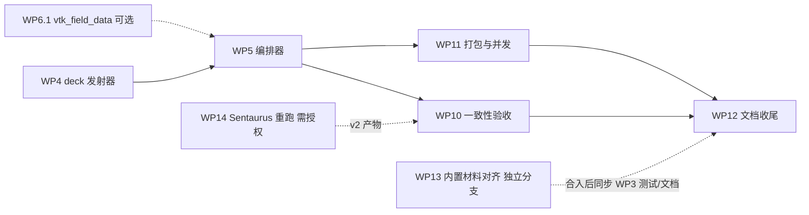

# `vela device`（SDevice cmd 直读运行）交接文档（2026-09-30）

阶段 1–2（WP0 契约冻结 + 并行组 A：WP1/2/3/4a/6/7/8/9）已全部完成并提交在本地分支；
剩余工作是组装（WP4 → WP5，可选 WP6.1）、验收与交付（WP10/11/12）以及两项独立任务
（WP13 内置材料对齐与重新基线化、WP14 Sentaurus 参考重跑）。本文供另一位执行者（人或模型）
接手：先读本文第 1–5 节和当前 `AGENTS.md`，再按第 6 节任务票据与用户的当前请求选择工作。
**下方票据不是自动执行队列**；WP14 需要用户明确授权，WP13 建议在独立分支执行。

设计依据始终是开发方案
[2026-09-26-sdevice-cmd-direct-run-development-plan.md](../superpowers/plans/2026-09-26-sdevice-cmd-direct-run-development-plan.md)
（下称“方案”；第 10.2 节是各 WP 卡片，第 10.5 节是完成情况汇总）和契约文档
[sentaurus_sdevice_workflow.md](../sentaurus_sdevice_workflow.md)（下称“workflow”）。
本文与二者不一致时，以源码、schema、测试为准，并修正文档。

## 1. 工作目录、分支、提交与运行状态

- **工作树**：`D:\code-repo\vela-tcad\.worktrees\sdevice-cmd-frontend`；**分支** `codex/sdevice-cmd-frontend`，
  自 `main` `04e07713` 分出。新会话即使默认目录是仓库根目录，也必须先 `Set-Location` 到该工作树并确认分支，
  再执行本任务命令（`.worktrees/` 被 `.gitignore` 忽略，主检出目录里没有这些文件）。
- **提交**（`git log --oneline main..HEAD`，旧→新）：`f9d3b454` 方案 v2.3 → `a5bd061a`/`2b3238a7`/`851bb481` WP0 →
  `b93e477e` WP1 → `5dbeeada` WP8 → `273e57b9` WP9 → `021593de` WP2 → `0074228d` WP7 → `f497dc08` 状态记录 →
  `fcea7cad` WP3 → `0c9756ba` WP6 → `e5cae3e9` WP4a → `be073edb` 组 A 集成（ASCII 修复、Auger H=0 规则）→
  `0e87e661` WP3 默认库改为 Sentaurus 参数集 → `3d85cea7` 方案 v2.4 → 本文所在提交（方案 v2.5 + 本文）。
  未推送远端，未合并 `main`；用户未要求推送或合并。
- **构建**：`build/`（preset `windows-ucrt64-debug`，MSYS2 UCRT64）已完整构建：`vela_example_runner.exe`、`vela.exe`、
  `sentaurus_import.exe`、全部 Catch2 测试。若改动源码，先 `cmake --build --preset windows-ucrt64-debug` 再测。
- **测试现状**：`be073edb` 全量 CTest 877/877；2026-09-30 于 `3d85cea7`：
  `ctest --test-dir build -R "sdevice|vtu_writer|dc_sweep_output_contract|ascii_sources"` 11/11 通过。
- **外部状态**：Sentaurus VM（ssh 别名 `sentaurus`）上只有 2026-09-26 建立的 v1 只读归档
  `/home/tcad/vela_reference_artifacts/<case>/v1/`；本分支迄今**没有**在 VM 上运行过 sdevice 或写入新文件。
  没有后台进程、监测任务或未完成的仿真。

## 2. 目标与已冻结决定（不可单方面改动）

`vela device [选项] <name_des.cmd|name_des|name>`：以 `sdevice` 同款子进程 CLI 读取 T-2022.03 语法的 SDevice
命令文件，解析 → 映射为 Vela `format_version: 2` deck → 校验并写用户可读 log → 逐 stage 运行 → 输出 XML `.vtu`
（TDR 数据名）与 DF-ISE `.plt`；不满足要求时 fail-closed。以下决定已由用户确认（方案第 2 节、附录 A、第 10.5.2 节），
改动前必须征求用户同意：

| 主题 | 决定 |
| --- | --- |
| CLI/退出码 | 镜像 `sdevice` 选项（方案 5.1）；退出码 0 = 完成，1 输入致命、2 用法、3 文件缺失、4 校验、5 求解、6 输出、7 并发、8 中止（5.2） |
| 输入 | 网格由用户提供 `.tdr` 或 `.grd+.dat`；`File{Parameter}` 必需（缺失 E301）；Workbench 预处理指令/`@…@`/Tcl 块 fail-closed（E101–E103） |
| 语法范围 | 方案第 4 节映射表与 4.7 fail-closed 清单；`Trap(s)`（除均匀 `FixedCharge`）、多 Goal、`System{}`、`Thermode{}`、IALMob 等拒绝 |
| 输出 | `.vtu` 字段名/单位 = 手册附录 F TDR 数据名；`.plt` DF-ISE；每接受偏置点一个 `.vtu` + `.pvd`（`--plot-final-only` 关闭）；log 与结果与 cmd 同目录 |
| 消息 | 英文文案 + 稳定编号（W1xx/W2xx/E1xx–E8xx），平台按编号匹配；目录在 workflow 第 4 节 |
| deck 形式 | `format_version: 2`（TCAD 单位、v2 键名）；导入网格默认 `node_volume_policy=barycentric` 且允许钝角；sidecar `<stem>.vela.json` 白名单深合并 |
| 材料 | `.par` → C3 材料文件；默认库 `share/vela/materials/models.par` 采用 **Sentaurus 默认 Silicon 参数集**（用户 2026-09-29）；历史 IV 参考 `ni` 以 **5e-4** 相对容差核对（用户 2026-09-29） |
| 栅接触 | `Barrier` → `work_function_eV` 1:1；`WorkFunction` 经 `Φ_S,i = χ + E_g/2 + (kT/2)ln(N_c/N_v)` 换算（WP4a，workflow §2.5） |
| 参考产物 | 原始 Sentaurus 产物只留在 VM（S3 方案），仓库只放 manifest + 哈希；本地镜像 `reference_staging/`（忽略目录）；VM 重跑/写入需用户授权（A-3） |
| 电流符号 | 全局符号因子由首个通过 12.4 核对的参考 `.plt`（预期 `pn2d_iv`）确定并固化为常量，禁止按案例翻符号 |
| 阈值 | 一致性阈值只能来自已验证证据；不得为通过阈值修改 Vela 物理默认 |
| 内置材料 | C++ `MaterialDatabase` 内置 Si/SiO2 的对齐与重新基线化列为 WP13（用户 2026-09-29 要求），`vela device` 不依赖内置值 |
| 仓库纪律 | `tests/`、`src/`、`include/` 只含 ASCII（CTest `ascii_sources`）；不提交 Synopsys 专有产物原件；提交前缀 `sdevice(WPn):`；不推送 |

## 3. 已交付资产地图

### 3.1 模块与 API（全部纯标准库 Python ≥ 3.10，或 C++20）

| WP | 位置 | 关键接口 | 测试（CTest 名 / 用例数） |
| --- | --- | --- | --- |
| WP0 | `schemas/vela.{sentaurus_execution_ir.v2,mesh_qualification.v1,stage_plan.v1,reference_artifact_manifest.v1,sdevice_sidecar.v1}.schema.json`；`scripts/vela_sdevice/schema_validator.py`；`tests/fixtures/sdevice/`（`fixtures.json` 索引） | `schema_validator.load_schema(path)`、`validate(schema, doc)`（draft-07 子集，遇不支持关键字抛 `UnsupportedSchemaKeyword`）、`is_valid`、`collect_errors` | `sdevice_contracts`（15） |
| WP1 | `scripts/vela_sdevice/cmd_parser/`（`lexer.py`、`syntax.py`、`sections.py`、`solve.py`、`catalogue.py`） | `parse_cmd_file(path) -> IR dict`、`parse_cmd_text(text, *, path_name)`；`catalogue.exit_code_of(id)`、`severity_of(id)`、`render(id, **fields)`；CLI `python -m vela_sdevice.cmd_parser <deck> [--output f]`（退出码 = `verdict.exit_code`） | `sdevice_cmd_parser`（29） |
| WP2 | `scripts/vela_sdevice/mesh_import/` | `import_grid(grid_path, out_dir, *, importer=None) -> report`（写 `mesh.json`/`doping.csv`/`mesh_qualification.json`）、`check_electrodes(report, names)`、`find_importer()`、`MeshImportError(message_id, message)`；CLI `python -m vela_sdevice.mesh_import <grid> <out_dir> [--importer exe]` | `sdevice_mesh_import`（8） |
| WP3 | `scripts/vela_sdevice/materials/`；`scripts/generate_default_models_par.py [--check]`；`share/vela/materials/models.par` | `emit_materials(par_path, *, active_models, temperature_K, mesh_materials, electrode_materials=(), allow_lossy=False, band_edge_sensitive=False, default_par=None, benchmark=None, effective_models=None) -> EmitResult(materials, report)`、`active_models_from_ir(ir)`、`write_materials(out_dir, result) -> (materials_json, report_json)`、`default_models_par_path()`、`MaterialsError(message_id, **fields)`；CLI `python -m vela_sdevice.materials --par f --ir ir.json --materials Si SiO2 --out dir [--allow-lossy --default-par f]` | `sdevice_materials`（30） |
| WP4a | `scripts/check_sdevice_gate_contact_mapping.py`；`docs/validation/sdevice_gate_contact_reference_2026-09-29.md` | `intrinsic_work_function_eV(...)`、`phi_ms_from_workfunction(...)`、`predicted_flatband_V(...)` | `sdevice_gate_contact_mapping`（6，需 `VELA_EXAMPLE_RUNNER`） |
| WP6 | `include/vela/io/VtuWriter.h` + `src/io/VtuWriter.cpp`；`include/vela/solver/GummelSolver.h`（`DDSolutionVtkOptions`）；`src/simulation/DCSweep.cpp`、`include/vela/simulation/DCSweep.h`、`DCSweepStepControl.h` | deck 键 `sweep.vtk_format/vtk_fields/vtk_binary/vtk_bias_points/csv_all_contacts`、`sweep.breakdown.current_{abs,min,max}_A_per_um` + `current_contact`；`tdrFieldCatalogue()`；CSV 新列 `contact_<name>_{electron,hole,total}_A_per_um`、`stop_criterion`、`stop_current_A_per_um` | Catch2 `vtu_writer`（5）、`dc_sweep_output_contract`（4） |
| WP7 | `src/tools/vela.cpp` → `build/vela.exe` | `vela device <args>` → `<python> bin/vela_sdevice.pyz device <args>`；解释器顺序 `VELA_PYTHON` → `bin/python/` → PATH；退出码透传；无解释器 E202 退出 2 | `sdevice_vela_launcher`（11，`tests/regression/test_vela_launcher.py`） |
| WP8 | `scripts/vela_sdevice/plt/`（`document.py`、`files.py`、`runner_csv.py`） | `rows_from_runner_csv(main_csv, ...)`、`filter_rows(rows, ...)`、`build_plt_document(electrodes, ...)`、`read_plt_document(text)`、`write_plt_atomic(path, text)`、`append_plt(...)`、`build_pvd_document(entries)`、`write_pvd_atomic(path, entries)`；常量 `CURRENT_SIGN_FACTOR`（当前 +1 占位）、`ALL_ACCEPTED_STEPS`、`DEFAULT_COLUMN_MAP` | `sdevice_plt_writer`（15） |
| WP9 | `scripts/reference_artifacts.py`；`reference_tcad/<case>/artifact_manifest.json`（7 案例） | `register|fetch|verify --case <case> [--backend local:<root>|ssh:<host>:<root>] [--version v1] [--dest reference_staging/] [--offline]` | `sdevice_reference_artifacts`（21，`tests/regression/test_reference_artifacts.py`） |

运行 Python 模块 CLI 前设 `$env:PYTHONPATH = "scripts"`（测试文件自行把 `scripts/` 加入 `sys.path`）。

### 3.2 契约 C1–C10 状态

| 契约 | 冻结形式 | 生产者 | 消费者 | 状态 |
| --- | --- | --- | --- | --- |
| C1 执行 IR v2 | `schemas/vela.sentaurus_execution_ir.v2.schema.json` + golden | WP1 ✔ | WP3 ✔、WP4、WP5 | 冻结；顶层键 `schema source verdict preprocessor_findings errors warnings files electrodes physics plot current_plot math solve stages analysis` |
| C2 网格包 | `schemas/vela.mesh_qualification.v1.schema.json` | WP2 ✔ | WP4、WP5 | 冻结；报告键 `materials[]`、`contacts[]{name,node_count,edge_count,adjacent_materials}`、`angles{max_deg,obtuse_element_count,obtuse_fraction,min_deg}`、`qualification{non_obtuse,recommended_node_volume_policy,allow_obtuse,...}` |
| C3 材料文件 | `schema` 恒为 `vela.templates_ldmos.materials.v1`（C++ 装载器只接受此 id，**不发布通用别名**）+ 报告 `vela.sdevice_materials_report.v1` | WP3 ✔ | WP4 | 冻结 |
| C4 stage 计划 | `schemas/vela.stage_plan.v1.schema.json` | WP4 | WP5、WP8 | 只有 schema，无生产者 |
| C5 求解器协议 | `docs/config_schema.md` sweep/solver/contacts 节 | WP6 ✔ | WP4、WP5、WP8 | 冻结（WP6.1 可能追加 `sweep.vtk_field_data`） |
| C6 输出契约 | workflow 第 3 节 | WP8 ✔、WP6 ✔ | WP10 | 符号因子与多段 `time` 语义待 WP10 回填 |
| C7 产物清单 | `schemas/vela.reference_artifact_manifest.v1.schema.json` | WP9 ✔ | WP10 | 冻结 |
| C8 CLI/退出码/消息目录 | workflow 第 2、4 节 | WP0 ✔ | WP5、WP7 ✔、WP12 | 已用编号：W101–W114、W201–W210、W701、E101–E117、E201–E202、E301–E305、E401–E410、E501–E503、E601–E602、E701、E801；新编号先登记 |
| C9 启动器协议 | workflow §2.3 | WP7 ✔ | WP5 | 冻结 |
| C10 sidecar | `schemas/vela.sdevice_sidecar.v1.schema.json` | WP0 ✔ | WP4 | 只有 schema，无消费者 |

### 3.3 夹具

`tests/fixtures/sdevice/fixtures.json` 列出 10 个 deck：`compare="full"`（IR 与 golden JSON 相等）7 个——
`pn2d_sentaurus2018/pn2d_{0v,iv,bv}_sdevice.cmd`、`bvmethods_sentaurus2018/{aba_poisson,external_resistor}_sdevice.cmd`、
`schottky_charon_sentaurus2018/schottky_n_des.cmd`、`genius_bjt_sentaurus2022/bjt_m0_des.cmd`；`compare="findings"` 3 个——
`singledevice`（E101/E102）、`full_physics_ablation`（E107）、`transportmodels pp6`（E105/E109）。
`pn2d_sentaurus2018/models.par` 是 PN2D 参数文件。**主验收 deck 原文都没有 `Parameter=`，golden 因而带 `E301`**（A-2）；
需要 accepted IR 时，对夹具文本追加 `Parameter="models.par"` 后用 `parse_cmd_text` 现场生成，不改 golden。

## 4. 环境与命令速查（Windows，PowerShell）

```powershell
Set-Location D:\code-repo\vela-tcad\.worktrees\sdevice-cmd-frontend
$env:Path = "D:\msys64\ucrt64\bin;D:\msys64\usr\bin;$env:Path"      # 每个新终端都要设
cmake --preset windows-ucrt64-debug; cmake --build --preset windows-ucrt64-debug
ctest --test-dir build -R sdevice --output-on-failure                # 组内 8 个 Python 测试
ctest --test-dir build -R "sdevice|vtu_writer|dc_sweep_output_contract|ascii_sources"
ctest --preset windows-ucrt64-debug                                  # 全量（约 877 项）
python -m unittest tests.regression.test_sdevice_materials -v        # 单个测试模块
$env:PYTHONPATH = "scripts"
python -m vela_sdevice.cmd_parser tests\fixtures\sdevice\pn2d_sentaurus2018\pn2d_iv_sdevice.cmd --output build\ir.json   # 退出 3（E301）
python -m vela_sdevice.mesh_import <grid.grd|grid.tdr> build\mesh_out --importer build\sentaurus_import.exe
python -m vela_sdevice.materials --par tests\fixtures\sdevice\pn2d_sentaurus2018\models.par --ir build\ir.json --materials Si --out build\mat_out
python scripts\generate_default_models_par.py --check
python scripts\reference_artifacts.py verify --case pn2d_sentaurus2018 --offline
build\vela_example_runner.exe --config <deck.json> --log <file>|auto|off --log-profile minimal|default|debug   # 退出 0/1/2
build\vela.exe device -v
C:\Windows\System32\OpenSSH\ssh.exe -o BatchMode=yes sentaurus 'ls /home/tcad/vela_reference_artifacts'          # 只读；写入需授权
```

- Python 为 MSYS2 3.14；脚本只用标准库并保持 3.10 兼容（不用 3.13+ 语法/库）；随包 Python 目标 3.12。
- 需要 runner 的 Python 测试通过环境变量 `VELA_EXAMPLE_RUNNER` 找到 `build/vela_example_runner.exe`（CTest 注册块里已设；
  手动 `python -m unittest` 时自行设置），缺失时 `skipTest`。
- MSYS 的 `ssh` 不读 `~/.ssh/config`，必须用 Windows 自带 OpenSSH；VM 用户为 root（`HOME=/root`），
  sdevice 每次启动 license 约 3 分钟。
- 在 VS Code 代理环境中：默认同步终端在长会话里会挂起/乱码，用异步终端 + 发送命令；工作区搜索工具看不到
  `.worktrees/`（被忽略），在工作树里用终端 `Select-String`；长输出写到 `build/*.txt` 再读。
- `core.autocrlf=true`：工作树文件是 CRLF、仓库内是 LF，新建文件不必手工转换；`git diff --check` 的 CRLF 警告无害。

## 5. 契约事实与陷阱（动手前必读）

1. **v2 deck 的单位与键名**：`format_version: 2` deck 的全部数值用 TCAD 内部单位（µm、cm⁻³、cm²/(V·s)、cm/s、V/cm、cm⁻¹、
   cm⁶/s、eV、s、K、V），键名按 `docs/config_schema.md`“v2 key names”重命名（`_m3→_cm3`、`_m2_V_s→_cm2_V_s`、`_m_s→_cm_s`、
   `_m_inv→_cm_inv`、`_V_m→_V_per_cm`、`_m6_per_s→_cm6_per_s`；`ni/mun/mup/donors/acceptors` → `ni_cm3/mun_cm2_V_s/mup_cm2_V_s/
   donors_cm3/acceptors_cm3`），旧名被**拒绝**而不是别名。WP3 报告 `solver_parameters[].target` 是 v1（SI）键路径、`value_si` 是 SI 值：
   写 deck 要用 `value_par`（`.par` 单位即 TCAD 单位）+ 重命名后的键；Auger 合成值 `solver.auger_cn/cp_m6_per_s` 需 ×1e12 写为
   `auger_cn/cp_cm6_per_s`；`solver.band_to_band` 保留原键名。`solver.normalization` 只在 v2 deck 允许。
2. **公开 schema 不完整**：`configs/schema/vela-simulation.schema.json` 只覆盖部分键（无 `sweep.breakdown/initialization/vtk_*`、
   `contacts[].type`、`regions/interfaces`、`solver.temperature_K` 等），且为 draft 2020-12，而 `vela_sdevice.schema_validator`
   是 draft-07 子集。deck 键名与单位的权威是 `docs/config_schema.md` 与 runner 解析器；runner 退出 2 = deck 被拒。
3. **`initialization.mode="poisson_block"` 与 `initial_state_file` 互斥**，只用于第一段；HDF5 状态文件需要
   `VELA_ENABLE_HDF5_STATE=ON` 的构建（看配置输出）；NFS 上设 `HDF5_USE_FILE_LOCKING=FALSE`。
4. **`vtk_bias_points` 与显式 `bias_points` 互斥**（后者忽略前者）；`vtk_bias_points` 落点 1e-12 V 且不改变其它自适应点；
   点在 `[start,stop]` 之外或等于名义目标时被忽略。
5. **接触电流约定**：runner `total = electron − hole`，流入器件为正；`.plt` 符号因子待 WP10 确定（现 `+1`）。
6. **`File{Output}` 命名偏差**（实测 T-2022.03）：值已以 `_des.log` 结尾则字面使用，否则追加 `_des.log`
   （`Output="pn2d_0v.log"` → `pn2d_0v.log_des.log`）；`Current/Plot/Grid/Parameter` 遵守手册“含 `.` 即字面”规则。
7. **消息目录**：新编号先登记到 workflow 第 4 节，不得与已用编号重复（E410 已被 WP3 占用）；退出码 = 致命编号百位。
8. **ASCII-only**：`tests/`、`src/`、`include/` 下任何非 ASCII 字符（含中文注释、em dash、`₀`）会让 `ascii_sources` 失败；
   Python 字符串用 `\u` 转义。
9. **历史 ni**：`reference_tcad/pn2d_sentaurus2018/source/pn2d_sentaurus2018_iv_materials.json` 的 `ni=1.4638914958767616e10`
   无法由记录在案的公式复现（最接近 −2.7e-4），已按 5e-4 容差接受；不要再试图“修正”发射器去匹配它。
10. **C++ 内置 Si 不自洽**（`ni=1e10` vs 推导 6.68e9）是 WP13 的对象，不是 WP3/WP4 的 bug；`vela device` 路径始终经材料文件。
11. **Sentaurus 产物**：TDR 含时间戳，同 deck 重跑哈希不同（manifest 哈希按归档副本）；bvmethods 归档 deck 与仓库 deck 物理不一致，
    `pn2d_iv/bv` 从未在 T-2022 运行——一致性验收优先用 WP14 的 v2 产物。
12. **runner CLI** 只有 `--config/--log/--log-profile/--mesh-report`，没有 dry-run；runtime log 默认 `<config stem>.log`。
13. **代理执行提示**：子代理常返回“无输出”但已写文件——检查 `git status`、跑其测试、自行提交；不要用 bash heredoc；
    不要在 PowerShell 变量后直接接 `:`（`"${rel}:"`）。

## 6. 剩余任务票据

执行顺序建议：WP4 → WP5（+WP6.1）→ WP14（授权后，越早越好）→ WP10 → WP11 → WP12；WP13 独立分支随时可做。
每张票据的逐步实现见方案第 10.2 节对应卡片；这里给出背景、主要内容、输入/输出与**可勾选的验收清单**。
通用收尾（每个 WP 都要做）：更新方案卡片“状态”行、第 10.3 表、附录 A；更新 workflow 对应节；
`ctest --test-dir build -R sdevice` 全绿；提交 `sdevice(WPn): <摘要>`；按 `AGENTS.md` 写完成报告（结果先行、
实际运行的检查与结果、未能运行的检查与原因）。

### 6.1 WP4 IR → stage 计划与 deck 发射器（组 B，纯 Python）

- **背景**：旧 `scripts/sentaurus_import.py::build_device_deck` 只取最后一个 `Quasistationary`、把 `t` 步长当伏特、
  硬编码 `write_vtk:false` 且写死物理参数；方案决定新发射器只吃 C1 IR、直接产出 v2 deck，物理参数全部来自 WP3 报告。
  前置条件（C1/C2/C3/C4/C5/C10、栅接触公式）全部就绪。
- **主要内容**：`scripts/vela_sdevice/deck_emit/`：stage 链（`initial` 合并为 `equilibrium`，每个 `sweep` 一个 stage，
  `save/load` 处理，HDF5 状态文件链）；电极电压表与 `rebase_stage`；`t`→伏特；`Plot(Time=)`→`required_t`/`vtk_bias_points`/
  文件名（全局序号）；`Plot{}`→`vtk_fields`（隐式追加四个字段）；`physics.effective[].vela` + 报告 `solver_parameters[]`
  （v2 键名 + TCAD 单位，见第 5.1 条）；电极属性映射（workflow §2.5）；`Math{}` 启发式与决策记录；离散默认 `barycentric`；
  sidecar 白名单深合并；schema 校验与旧键断言；CLI `python -m vela_sdevice.deck_emit`。
- **输入**：accepted IR（夹具 + `Parameter="models.par"`）、`mesh_qualification.json`、`materials_report.json`、可选 sidecar。
  **输出**：`stage_plan.json`（C4）、`simulation_stageNN.json`、`decisions[]`。
- **独占文件**：`scripts/vela_sdevice/deck_emit/**`、`tests/regression/test_sdevice_deck_emit.py`、
  `tests/fixtures/sdevice/<case>/expected_stage_plan.json`、`expected_stageNN.json`、`CMakeLists.txt` 新注册块。
- **验收清单**：
  - [ ] `python -m unittest tests.regression.test_sdevice_deck_emit` 全绿，覆盖方案卡片验收 (1)–(7)：golden 一致、`t` 换算
        （`MaxStep=0.025,|ΔV|=10 → max_step_V=0.25`；`Intervals=400 → 401` 个必经点）、两段扫描起点与 `rebase_stage`、
        sidecar 拒绝/合并、无旧键与 v1 SI 后缀、电极映射（`Barrier=0.55→0.55`；`WorkFunction=4.6228018936→≈0`）、
        `unsupported` IR 不生成 deck。
  - [ ] 每个 deck 通过 `vela_sdevice.schema_validator` + 公开 schema；`stage_plan.json` 通过 C4 schema。
  - [ ] `VELA_EXAMPLE_RUNNER` 存在时，平衡/电压扫描/电流目标三类 deck 各一次真 runner 冒烟退出 0（合成小网格 +
        `share/vela/materials/models.par` 发射的材料文件）。
  - [ ] `ctest --test-dir build -R sdevice` 9/9（新增 `sdevice_deck_emit`）；`ascii_sources` 通过。
  - [ ] workflow 新增 “§2.7 stage 计划与 deck 发射规则（C4/C10，WP4）”，登记新消息编号；方案卡片状态更新。
- **不做**：运行 runner（冒烟除外）、读 cmd 文本、改 C++。

### 6.2 WP5 编排器 CLI（组 C）

- **背景**：用户可见行为（CLI、退出码 0–8、单一 log、锁、信号、`.plt` 增量、`.vtu` 归位）全部已冻结；WP1/2/3/4/8 是纯函数库，
  WP7 启动器按 C9 调 `bin/vela_sdevice.pyz`。本 WP 是唯一集成点，也是 WP10/WP11 的前置。
- **主要内容**：`scripts/vela_sdevice/orchestrator/**` + `scripts/vela_sdevice/__main__.py`：CLI（方案 5.1 选项表）→ Gate 0–8
  （方案第 7 节；退出码取 `catalogue.exit_code_of`）→ 逐 stage `subprocess` 运行 runner（cwd=`<stem>_vela/`，ASCII 相对路径，
  线程环境变量，`HDF5_USE_FILE_LOCKING=FALSE`）→ `.plt` 增量（轮询 CSV，`write_plt_atomic`）→ `.vtu`/`.pvd` 归位 → 信号处理
  （退出 8）→ `run_manifest.json`/`fail_report.json` → zipapp 构建脚本 `scripts/build_vela_sdevice_pyz.py`。假 runner
  `tests/fixtures/sdevice_fake_runner/fake_runner.py`（`FAKE_RUNNER_MODE ∈ ok|partial|fail|hang|reject`，计数文件）。
- **输入**：cmd 路径（+ 网格、`.par`、可选 sidecar）。**输出**：方案 6.1 全部产物。
- **独占文件**：上述目录、`tests/regression/test_sdevice_orchestrator.py`、`CMakeLists.txt` 注册块（带 `VELA_EXAMPLE_RUNNER`）。
- **验收清单**：
  - [ ] 假 runner 覆盖退出码 0–8 每个至少一例；锁冲突 → 7；`--check` 时假 runner 调用计数 0。
  - [ ] SIGTERM/`CTRL_BREAK_EVENT` 下部分 `.plt` 保留、锁被删、退出 8（Windows 不可用时 skip 并明示原因）。
  - [ ] log 含头部（版本/提交/cmd SHA-256/时间/主机/pid）、cmd 回显、映射决策、结束摘要；所有 warning/error 行带编号。
  - [ ] 真 runner：`pn2d_iv_sdevice.cmd` 副本（追加 `Parameter="models.par"`，`Grid=` 指向 `dfise_writers.render_dfise_grid`
        合成 `.grd`，电极名与合成接触一致）端到端退出 0，产出 `.log/.plt/.vtu/.pvd`；含中文与空格的临时目录下同样退出 0。
  - [ ] `PYTHONPATH=` 清空下 `python build/bin/vela_sdevice.pyz device -v` 可运行；`build/vela.exe device -v` 经启动器同样可运行。
  - [ ] `ctest --test-dir build -R sdevice` 全绿；方案/ workflow 更新（§2.3 去掉“待 WP7”，新增编号）。
- **不做**：C++ 改动（WP6.1 单列）；数值验收；符号因子/`time` 定案。

### 6.3 WP6.1 `sweep.vtk_field_data` 透传（可选小 C++ 增量）

- **背景**：C6 要求 `.vtu` `FieldData` 含 `CmdSHA256/Stage/t/goal_reached`，只有编排器知道；
  `DDSolutionVtkOptions.fieldDataStrings/fieldDataValues` 已存在但没有 deck 入口。若不做，WP5 只能在 ASCII 模式文本改写 XML。
- **主要内容**：`DCSweep.cpp` 解析 `sweep.vtk_field_data`（对象；字符串→`fieldDataStrings`，数值→`fieldDataValues`；键名
  `[A-Za-z_][A-Za-z0-9_]*`，与内置键重名报错），runner 自动写 `GoalReached`；`docs/config_schema.md` 与 workflow §2.6 增补。
- **验收清单**：
  - [ ] `dc_sweep_output_contract` 新用例：deck 给 `{"CmdSHA256":"abc","Stage":1,"t":0.25}`，回读 `.vtu` 三键一致且 `GoalReached` 存在。
  - [ ] 无该键时 `.vtu` 逐字节与改动前一致。
  - [ ] `ctest -R "vtu_writer|dc_sweep"` 与全量 CTest 无回退。
- **不做**：字段目录/单位改动。

### 6.4 WP10 一致性验收（组 D）

- **背景**：阈值只能来自已验证证据（PN2D IV OOM ≤ 0.4 现行门限、BV −13.2 V 0.70x 已知偏差、LDMOS gm 24%）；符号因子与多段
  `time` 语义待定；参考产物优先用 WP14 的 v2（v1 中 `pn2d_iv/bv` 无 T-2022 运行、bvmethods deck 不一致）。
- **主要内容**：`configs/sdevice_acceptance_contract.json`（结构沿用 `configs/sentaurus_e2e_contract.json`）、
  `scripts/sdevice_acceptance.py`（驱动 `vela device` + 曲线比对 `scripts/compare_reference_curves.py` + 场量比对：
  `build/sentaurus_import.exe --tdr <file> --export-dir <dir>` 导出 vs `.vtu`）、CTest `sdevice_e2e_<case>`
  （`VELA_REFERENCE_ARTIFACTS_DIR` 门控）、`docs/validation/sdevice_acceptance_<date>.md`；确定 `CURRENT_SIGN_FACTOR` 与
  `time` 语义并回填 workflow §3.3（含 `.plt` SHA-256）。
- **验收清单**：
  - [ ] `reference_artifacts.py fetch/verify` 通过的案例才计入；未通过者在报告中列出原因。
  - [ ] 符号因子由 `pn2d_iv` 参考 `.plt` 正向前三点确定，写入 `document.py` 常量 + `test_sdevice_plt_writer.py` 回归用例。
  - [ ] `time` 语义（重置/累加）由两段扫描参考 `.plt` 判定并写入 workflow；如需改动只改 WP5 拼接。
  - [ ] pn2d 0v/iv/bv 曲线与场量通过契约；bvmethods/schottky `vela device --check` 退出 0；transportmodels 2022 deck 被拒且编号正确。
  - [ ] 报告写明配置、网格、单位、后端、参考产物版本/哈希；`known_difference_ledger` 记录已知偏差。
- **不做**：为通过阈值修改 Vela 物理默认。

### 6.5 WP11 打包与并发验证（组 D，可与 WP10 并行）

- **背景**：交付物为 `vela(.exe)` + `bin/`（子程序、运行库、随包 CPython 3.12），Windows 与 Ubuntu 24.04；仓库目前没有
  `install()` 规则、打包脚本或第三方声明生成。
- **主要内容**：CMake `install()`（`vela`、`vela_example_runner`、`sentaurus_import` → `bin/`；`share/vela/materials/models.par`；
  `bin/vela_sdevice.pyz`；`RUNTIME_DEPENDENCY_SET`，Linux `RPATH=$ORIGIN/../lib`）；`scripts/package_vela.py --python-archive <file>`
  （Windows embeddable zip / Linux python-build-standalone，离线）；`THIRD_PARTY_NOTICES`；
  `tests/regression/test_sdevice_package_smoke.py`、`test_sdevice_concurrency.py`（方案 13.3 矩阵）。
- **验收清单**：
  - [ ] Windows zip 与 Ubuntu 24.04 tar 在 `PATH` 只含系统目录（无系统 Python）的环境解包后 `vela device pn2d_iv_des` 退出 0。
  - [ ] 并发矩阵通过：不同 cmd 并行；同一 cmd 重复启动第二个退出 7；`--threads`/`NumberOfThreads` 组合（Windows 只跑锁冲突并明示）。
  - [ ] 包内无 `reference_staging/`、Synopsys 产物；`vela device -P` 写出 `models.par` 且能被同一 deck 使用。
- **不做**：改任何业务逻辑。

### 6.6 WP12 文档与收尾（组 D，最后）

- **背景**：DoD 第 6 条要求 workflow/`config_schema.md`/`sentaurus_import.md` 与消息目录完稿；WP4/WP5 新增编号与键、WP10 回填 C6
  需要统一核对。
- **主要内容**：workflow 完稿（支持子集表、示例 sidecar、消息目录补齐、§2.3/§3.3 回填）、`docs/README.md` 索引、
  `docs/config_schema.md`/`docs/sentaurus_import.md` 增补 `vela device` 入口、CHANGELOG、方案附录 A 收口。
- **验收清单**：
  - [ ] 文档中每条命令在工作树内实际执行过一次（至少 `--check` 路径），输出与文档一致。
  - [ ] 链接检查通过（仓库无脚本时用临时脚本遍历 `docs/**/*.md` 的相对链接）。
  - [ ] DoD 六条逐项引用证据（提交哈希 + 测试名）。

### 6.7 WP13 C++ 内置材料参数对齐与重新基线化（独立；建议分支 `codex/builtin-material-alignment` 自 `main`）

- **背景**：内置 Si `ni=1e10 cm⁻³` 与其 `Nc/Nv/Eg` 不自洽（推导 6.68e9），`Nv`（1.04e19 vs 3.10e19）、迁移率（1350/480 vs
  1417/470.5）偏离 Sentaurus 默认集；SiO2 `χ` 0.95 vs 0.9。用户 2026-09-29 要求列入。影响所有无 `materials_file` 的 deck 与
  20 个引用 `MaterialDatabase` 的 Catch2 测试文件；`vela device` 不受影响。
- **主要内容**：（1）盘点依赖（`grep -l MaterialDatabase tests/*.cpp`；无 `materials_file` 的 deck；写死 `1e10/1e16/2.8e19/2.8e25/
  1.04e19/1.04e25/0.135/0.048` 的脚本与测试），分类为“物理性质测试 / 数值基线 / 校准 deck”；（2）只改
  `MaterialDatabase::MaterialDatabase()` 字面量，`ni` 按 `sqrt(Nc Nv)exp(−Eg/2kT)` 自洽；用 WP3 发射器生成
  `share/vela/materials/default_materials.json` 入库，新 Catch2 `tests/test_material_database_alignment.cpp` 逐字段比较（1e-12）；
  `generate_default_models_par.py --check` 同时校验该 JSON；（3）全量测试后按分类处理：性质测试若失败说明隐含旧值→改为读
  `MaterialDatabase`；数值基线重新生成并在 `docs/validation/builtin_material_alignment_<date>.md` 记录旧值/新值/相对变化/原因；
  针对旧值校准的 deck 改为显式 `materials_file` 固定旧值以保留校准证据；（4）文档：`docs/config_schema.md` 材料默认值、
  workflow §2.4 “遗留默认”段落改为“已对齐（提交 X）”、WP3 测试 `test_builtin_cpp_silicon_is_documented_as_legacy` 改为断言对齐
  （这一步在 sdevice 分支上做，合入后同步）。
- **目标值**（300 K，精确值以 `python -m vela_sdevice.materials --par share/vela/materials/models.par ...` 输出为准）：
  Si `eps_r` 11.7、`bandgap_eV` 1.12415923…、`electron_affinity_eV` 4.05、`Nc` 2.85667914…e19、`Nv` 3.10465703…e19 cm⁻³、
  `ni` ≈1.0750e10 cm⁻³（无 BGN）、`mun/mup` 1417/470.5 cm²/(V·s)；SiO2 `eps_r` 3.9、`bandgap_eV` 9.0、`electron_affinity_eV` 0.9。
- **验收清单**：
  - [ ] 对齐 Catch2 用例通过；`generate_default_models_par.py --check` 通过。
  - [ ] `ctest --preset windows-ucrt64-debug` 全量通过；每个重新基线化的文件在验证文档中有一行记录；diff 审查确认没有放宽容差。
  - [ ] `ctest -R "pn2d_config_templates|pn2d_node_volume_policy_default_acceptance|pn2d_bv_m2_mixed_voronoi_self_consistent_control"` 通过。
  - [ ] `python scripts/run_regression.py --runner build/vela_example_runner.exe` 全绿。
  - [ ] MOS 相关测试的变化（`SiO2.χ` −0.05 eV）逐一解释。
- **不做**：改物理定律实现、改 WP3 发射器、改 `vela device` 行为。

### 6.8 WP14 Sentaurus 参考重跑（A-3；**需用户授权**）

- **背景**：用户 2026-09-26 决定暂不重跑；v1 归档中 `pn2d_iv/bv` 无 T-2022 运行、bvmethods deck 物理不一致、
  `full_physics_ablation` 含占位符；WP4a 遗留 Φ_S,i 定义、WP10 的符号因子与 `time` 语义都需要新的可核对产物。
- **主要内容**：在 VM `/home/tcad/vela_reference_artifacts/<case>/v2/{source,mesh,plt,tdr,log}` 运行：pn2d `0v/iv/bv`
  （追加 `Parameter="models.par"` 的副本，`sdevice -P` 参数文件，v1 的 `_msh.tdr`）、bvmethods `aba_poisson/external_resistor/
  full_physics_ablation`（先材料化占位符）、合成 1-D 等效 MOS 电容 `gate_reference`（`Barrier=0/0.55/−0.3` 与
  `WorkFunction=4.6228` 四个变体，≥ 5 位有效数字输出，用于分辨 Φ_S,i 是否含 `(kT/2)ln(N_c/N_v)`，Si 约 −1.1 mV）；
  `reference_artifacts.py register --case <case> --version v2 ...` → `verify` → 本地只 `fetch` 到 `reference_staging/`；
  盘点文档追加 v2 条目，附录 A 更新 A-3/A-4。
- **验收清单**：
  - [ ] 用户书面授权在案（对话记录/文档注明日期）。
  - [ ] 每个案例 `verify` 六项全绿，`.log` 回显与 `source/*.cmd` 一致。
  - [ ] 符号因子、`time` 语义、Φ_S,i 定义三项各有证据文件路径 + SHA-256 写入 workflow。
  - [ ] 仓库不含任何 Synopsys 专有产物原件（`git status` 无 `.log/.tdr/.plt` 原件）。
- **不做**：修改 deck 物理；在 VM 上运行 Vela。

## 7. 依赖、并行与分支策略



- WP4 与 WP5 文件不相交，可由两位执行者并行（WP5 先用 golden `stage_plan` + 假 runner）；WP6.1 只碰 `DCSweep.*` 与一个 Catch2 文件。
- WP13 改变全局默认与基线，与 sdevice 路径无耦合：在自 `main` 的独立工作树/分支交付，避免阻塞本分支合并；合入后回到本分支更新
  WP3 的“遗留默认”测试与 workflow §2.4。
- WP14 只在获得授权后执行；产物只进 VM 归档与本地 `reference_staging/`。

## 8. 接手检查清单与完成报告模板

接手前：
1. `Set-Location` 到工作树，`git status --short` 为空，`git log --oneline -1` 与本文第 1 节一致（或更新本文）。
2. 设 PATH，`cmake --build --preset windows-ucrt64-debug`，`ctest --test-dir build -R sdevice` 全绿。
3. 读方案第 10.2 节目标 WP 卡片与本文对应票据；确认用户当前请求属于哪张票据、是否需要授权（WP14）。

每个 WP 完成时的报告（遵循 `AGENTS.md`）：
- 结果先行：做了什么、为什么；提交哈希。
- 实际运行的检查与结果（命令 + 通过/失败计数）；未能运行的检查与原因（环境 vs 产品）。
- 数值结论附配置、网格、单位、启用后端、参考产物版本/哈希。
- 更新了哪些文档（方案卡片状态/10.3 表/附录 A、workflow 节、消息目录）。
- 遗留限制与需要用户决定的事项。

## 9. 参考索引

- 方案（含全部卡片与 10.5 汇总）：[2026-09-26-sdevice-cmd-direct-run-development-plan.md](../superpowers/plans/2026-09-26-sdevice-cmd-direct-run-development-plan.md)
- 契约与消息目录：[sentaurus_sdevice_workflow.md](../sentaurus_sdevice_workflow.md)
- deck 键与单位权威：[config_schema.md](../config_schema.md)（`format_version`、`sweep`、`solver`、`contacts[]`、`regions/interfaces`）
- 参考产物盘点与 VM 布局：[sdevice_reference_artifact_inventory_2026-09-26.md](sdevice_reference_artifact_inventory_2026-09-26.md)
- 栅接触核对：[sdevice_gate_contact_reference_2026-09-29.md](sdevice_gate_contact_reference_2026-09-29.md)
- PN2D BV 模板门与策略：[pn2d_bv_validation.md](pn2d_bv_validation.md)
- 回归运行器：[tests/regression/README.md](../../tests/regression/README.md)
